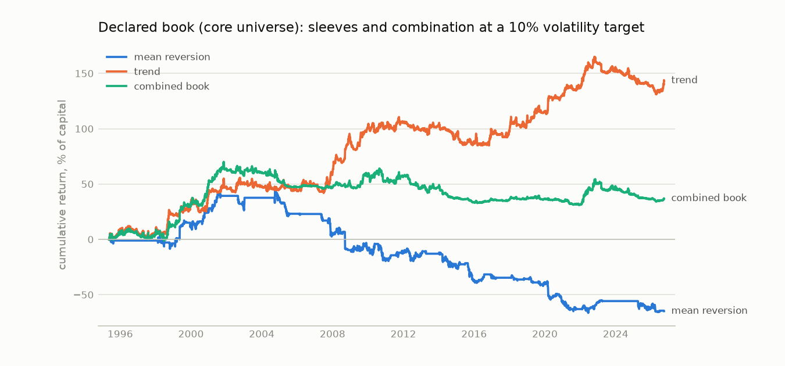
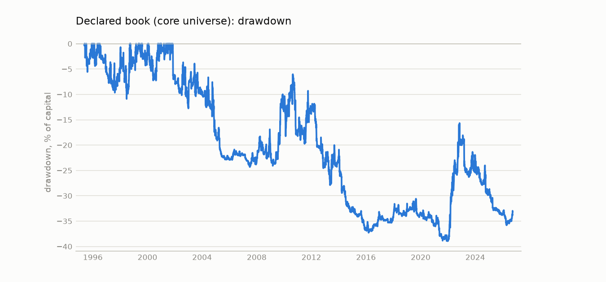
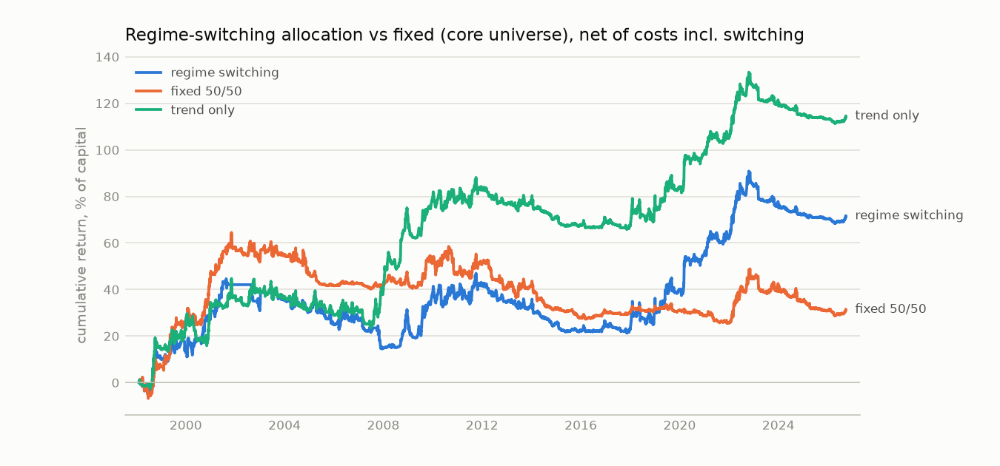
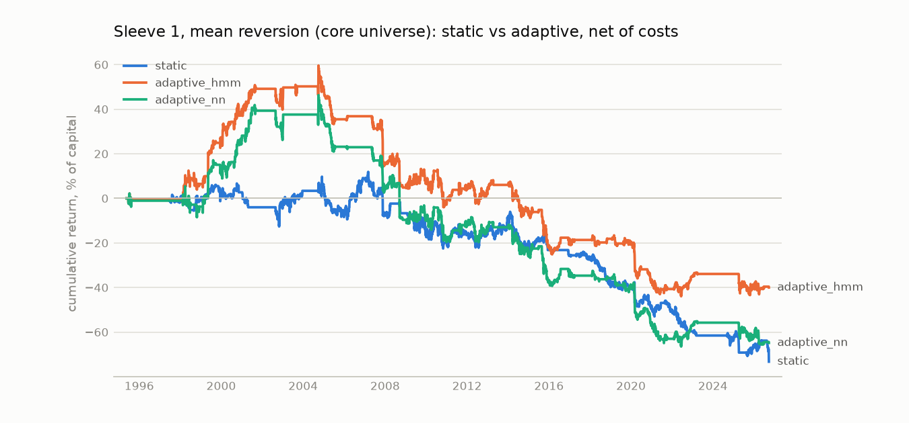
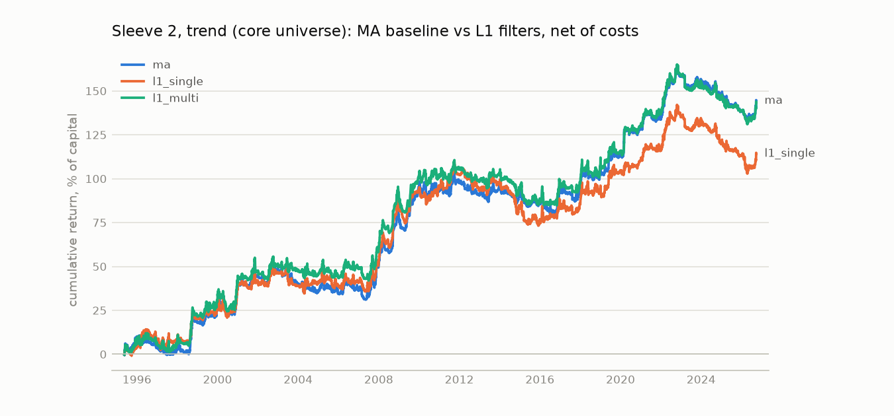
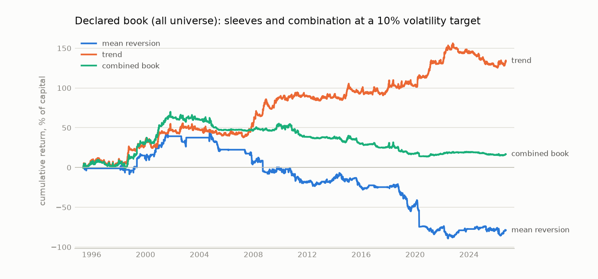
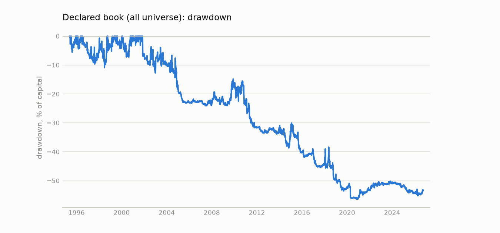
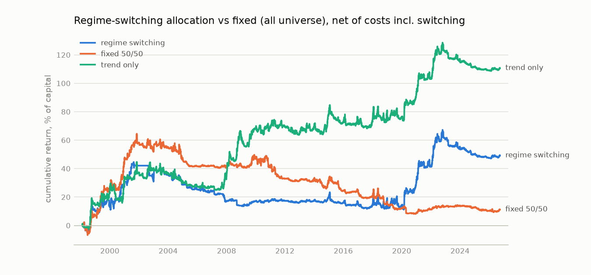
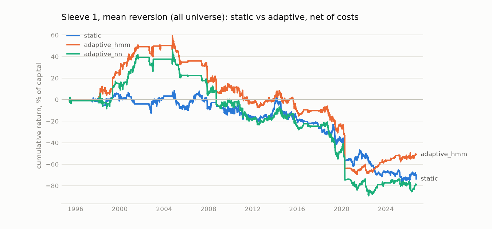
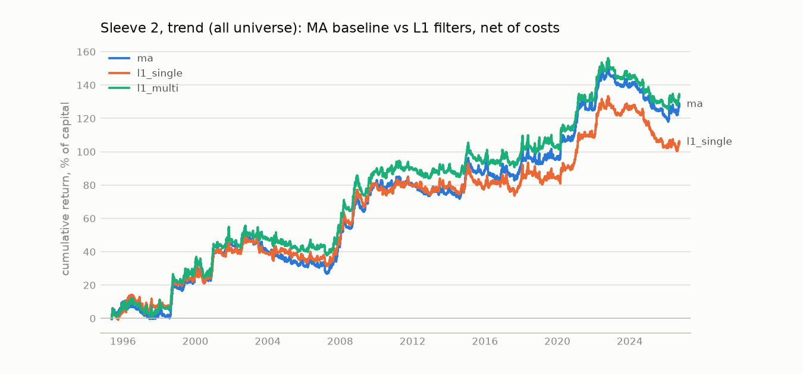

# Appendix: trend, the two-sleeve book and the wider universe

Supporting material. The deliverable is [report.md](report.md), which covers the mean-reversion sleeve only.

Sample ends 2026-09-25. All results are out of sample: walk-forward folds with 1260-bar training windows, 252-bar test blocks, a 10-bar purge and a 5-bar embargo. Returns are net of costs and additive, on a 10% volatility target.

The declared book was fixed before results were inspected: Sleeve 1 = `adaptive_nn`, Sleeve 2 = `l1_multi`. `core` is the graded universe (Treasury curve and HY/IG OAS); `all` adds the energy and grain extension.

## Core universe

### Declared book

| book                               | start      |   ann_return |   ann_vol |   sharpe |   deflated_sharpe |   max_dd |   gross_sharpe |   cost_drag |   sharpe_2x_cost |   sharpe_3x_cost |
|:-----------------------------------|:-----------|-------------:|----------:|---------:|------------------:|---------:|---------------:|------------:|-----------------:|-----------------:|
| adaptive_nn + l1_multi             | 1995-05-19 |         0.01 |      0.06 |     0.18 |              0.69 |    -0.39 |           0.67 |        0.03 |            -0.32 |            -0.79 |
| declared book, no drawdown overlay | 1995-05-19 |         0.02 |      0.08 |     0.22 |              0.77 |    -0.40 |           0.81 |        0.05 |            -0.36 |            -0.92 |

### Regime-switching allocation between the sleeves

A two-state HMM on log VIX and log MOVE defines the regime. On each expanding training window the regime is assigned to whichever sleeve had the higher Sharpe in it, and out of sample the risk budget is the filtered-probability mix of those assignments. All four rows cover the same window and include the cost of moving risk between sleeves.

| book                | start      |   ann_return |   ann_vol |   sharpe |   max_dd |   deflated_sharpe |   gross_sharpe |   cost_drag |   sharpe_2x_cost |   sharpe_3x_cost |   avg_rv_budget |   budget_switches_per_year |
|:--------------------|:-----------|-------------:|----------:|---------:|---------:|------------------:|---------------:|------------:|-----------------:|-----------------:|----------------:|---------------------------:|
| regime switching    | 1998-02-10 |         0.02 |      0.07 |     0.33 |    -0.30 |              0.72 |           0.63 |        0.02 |             0.02 |            -0.28 |            0.18 |                       0.20 |
| fixed 50/50         | 1998-02-10 |         0.01 |      0.06 |     0.17 |    -0.39 |              0.40 |           0.71 |        0.03 |            -0.37 |            -0.88 |          nan    |                     nan    |
| trend only          | 1998-02-10 |         0.04 |      0.08 |     0.50 |    -0.22 |              0.94 |           0.65 |        0.01 |             0.36 |             0.21 |          nan    |                     nan    |
| mean reversion only | 1998-02-10 |         0.00 |      0.05 |     0.02 |    -0.40 |              0.14 |           0.58 |        0.03 |            -0.54 |            -1.01 |          nan    |                     nan    |

Per-fold regime fit (training-window Sharpe of each sleeve by state, and the assignment):

| test_start   |   train_bars |   state0_share |   state0_vix |   state0_rv_sharpe |   state0_trend_sharpe | state0_assigned   |   state1_share |   state1_vix |   state1_rv_sharpe |   state1_trend_sharpe | state1_assigned   |
|:-------------|-------------:|---------------:|-------------:|-------------------:|----------------------:|:------------------|---------------:|-------------:|-------------------:|----------------------:|:------------------|
| 1997-11-17   |          756 |           0.69 |        13.99 |              -0.08 |                  0.87 | trend             |           0.31 |        20.55 |             nan    |                 -0.57 | split             |
| 1998-11-04   |         1008 |           0.52 |        14.00 |              -0.08 |                  0.89 | trend             |           0.48 |        22.76 |               0.01 |                  0.77 | trend             |
| 1999-10-22   |         1260 |           0.58 |        23.58 |               0.75 |                  0.45 | rv                |           0.42 |        14.00 |              -0.08 |                  1.01 | trend             |
| 2000-10-11   |         1512 |           0.65 |        23.26 |               0.75 |                  0.32 | rv                |           0.35 |        14.00 |              -0.08 |                  0.93 | trend             |
| 2001-10-01   |         1764 |           0.70 |        23.47 |               1.04 |                  0.63 | rv                |           0.30 |        14.00 |              -0.08 |                  0.87 | trend             |
| 2002-09-18   |         2016 |           0.74 |        23.77 |               0.94 |                  0.55 | rv                |           0.26 |        14.00 |              -0.08 |                  0.89 | trend             |
| 2003-09-05   |         2268 |           0.35 |        28.15 |               0.76 |                  0.24 | rv                |           0.65 |        18.28 |               0.54 |                  0.83 | trend             |
| 2004-08-24   |         2520 |           0.34 |        15.36 |              -0.07 |                  0.27 | trend             |           0.66 |        24.52 |               0.85 |                  0.56 | rv                |
| 2005-08-11   |         2772 |           0.46 |        18.32 |              -0.46 |                  0.90 | trend             |           0.54 |        21.59 |               0.31 |                  0.15 | rv                |
| 2006-08-01   |         3024 |           0.63 |        23.75 |               0.74 |                  0.33 | rv                |           0.37 |        13.76 |              -0.94 |                  0.60 | trend             |
| 2007-07-19   |         3276 |           0.67 |        22.50 |               0.73 |                  0.35 | rv                |           0.33 |        12.81 |              -1.09 |                  0.36 | trend             |
| 2008-07-07   |         3528 |           0.68 |        22.57 |               0.52 |                  0.60 | trend             |           0.32 |        12.87 |              -1.07 |                  0.38 | trend             |
| 2009-06-24   |         3780 |           0.70 |        23.76 |               0.29 |                  0.69 | trend             |           0.30 |        12.92 |              -1.04 |                  0.32 | trend             |
| 2010-06-11   |         4032 |           0.28 |        12.92 |              -0.92 |                  0.36 | trend             |           0.72 |        23.70 |               0.27 |                  0.73 | trend             |
| 2011-05-31   |         4284 |           0.73 |        23.53 |               0.13 |                  0.71 | trend             |           0.27 |        12.97 |              -0.92 |                  0.30 | trend             |
| 2012-05-17   |         4536 |           0.36 |        14.04 |              -0.69 |                  0.44 | trend             |           0.64 |        24.91 |               0.13 |                  0.67 | trend             |
| 2013-05-06   |         4788 |           0.39 |        14.21 |              -0.63 |                  0.33 | trend             |           0.61 |        24.87 |               0.11 |                  0.67 | trend             |
| 2014-04-23   |         5040 |           0.64 |        24.00 |               0.10 |                  0.75 | trend             |           0.36 |        13.92 |              -0.67 |                  0.11 | trend             |
| 2015-04-10   |         5292 |           0.38 |        13.84 |              -0.70 |                  0.08 | trend             |           0.62 |        23.85 |               0.13 |                  0.66 | trend             |
| 2016-03-29   |         5544 |           0.40 |        13.93 |              -0.72 |                  0.04 | trend             |           0.60 |        23.86 |               0.06 |                  0.65 | trend             |
| 2017-03-16   |         5796 |           0.40 |        13.89 |              -0.70 |                  0.24 | trend             |           0.60 |        23.49 |               0.07 |                  0.57 | trend             |
| 2018-03-05   |         6048 |           0.58 |        23.41 |               0.10 |                  0.56 | trend             |           0.42 |        13.54 |              -0.71 |                  0.29 | trend             |
| 2019-02-20   |         6300 |           0.44 |        13.76 |              -0.65 |                  0.29 | trend             |           0.56 |        23.38 |               0.07 |                  0.54 | trend             |
| 2020-02-07   |         6552 |           0.60 |        22.17 |               0.10 |                  0.60 | trend             |           0.40 |        13.81 |              -0.81 |                  0.19 | trend             |
| 2021-01-26   |         6804 |           0.42 |        14.35 |              -0.75 |                  0.24 | trend             |           0.58 |        22.47 |               0.01 |                  0.63 | trend             |
| 2022-01-13   |         7056 |           0.55 |        22.24 |              -0.04 |                  0.58 | trend             |           0.45 |        15.04 |              -0.67 |                  0.38 | trend             |
| 2023-01-02   |         7308 |           0.44 |        15.07 |              -0.70 |                  0.43 | trend             |           0.56 |        22.48 |               0.02 |                  0.63 | trend             |
| 2023-12-20   |         7560 |           0.57 |        22.12 |               0.03 |                  0.58 | trend             |           0.43 |        15.11 |              -0.70 |                  0.41 | trend             |
| 2024-12-09   |         7812 |           0.42 |        15.13 |              -0.68 |                  0.40 | trend             |           0.58 |        21.63 |               0.01 |                  0.55 | trend             |
| 2025-11-27   |         8064 |           0.59 |        21.53 |              -0.02 |                  0.53 | trend             |           0.41 |        15.16 |              -0.66 |                  0.35 | trend             |

### Alpha and beta

Daily P&L regressed on unit-volatility market factors (long 10y Treasury, 2s10s steepener, long HY credit, long WTI), Newey-West t-statistics. `alpha` is annualised, in the same units as `ann_return`. `appraisal_ratio` is alpha over residual volatility: the Sharpe of what the factors do not explain. Betas are annualised return per unit of factor Sharpe. The `macro` rows start in 2005.

| factors   | series                | start      |   ann_return |   alpha |   alpha_t |   sharpe |   appraisal_ratio |   r_squared |   beta_duration |   t_duration |   beta_steepener |   t_steepener |   beta_credit |   t_credit |   beta_crude |   t_crude |   beta_equity |   t_equity |
|:----------|:----------------------|:-----------|-------------:|--------:|----------:|---------:|------------------:|------------:|----------------:|-------------:|-----------------:|--------------:|--------------:|-----------:|-------------:|----------:|--------------:|-----------:|
| rates     | mean reversion        | 1995-05-19 |       -0.020 |  -0.020 |    -1.499 |   -0.257 |            -0.256 |       0.002 |          -0.003 |       -1.040 |            0.001 |         0.431 |       nan     |    nan     |      nan     |   nan     |       nan     |    nan     |
| rates     | trend                 | 1995-05-19 |        0.044 |   0.044 |     2.764 |    0.509 |             0.508 |       0.003 |           0.004 |        1.108 |            0.003 |         1.139 |       nan     |    nan     |      nan     |   nan     |       nan     |    nan     |
| rates     | fixed 50/50 book      | 1995-05-19 |        0.011 |   0.011 |     1.020 |    0.179 |             0.178 |       0.001 |           0.002 |        0.899 |            0.002 |         0.794 |       nan     |    nan     |      nan     |   nan     |       nan     |    nan     |
| rates     | regime-switching book | 1998-02-10 |        0.024 |   0.024 |     1.708 |    0.325 |             0.329 |       0.011 |          -0.008 |       -2.748 |           -0.005 |        -2.494 |       nan     |    nan     |      nan     |   nan     |       nan     |    nan     |
| macro     | mean reversion        | 2005-01-04 |       -0.045 |  -0.048 |    -3.136 |   -0.610 |            -0.665 |       0.016 |          -0.002 |       -0.472 |           -0.000 |        -0.050 |         0.004 |      1.855 |        0.002 |     1.916 |         0.006 |      4.312 |
| macro     | trend                 | 2005-01-04 |        0.043 |   0.047 |     2.400 |    0.497 |             0.551 |       0.029 |          -0.011 |       -2.274 |           -0.001 |        -0.346 |        -0.009 |     -3.882 |       -0.004 |    -2.414 |        -0.008 |     -3.538 |
| macro     | fixed 50/50 book      | 2005-01-04 |       -0.007 |  -0.007 |    -0.645 |   -0.148 |            -0.144 |       0.018 |          -0.008 |       -3.009 |           -0.003 |        -1.606 |        -0.003 |     -2.048 |       -0.001 |    -1.612 |        -0.001 |     -1.240 |
| macro     | regime-switching book | 2005-01-04 |        0.017 |   0.019 |     1.203 |    0.248 |             0.278 |       0.035 |          -0.014 |       -4.259 |           -0.009 |        -3.481 |        -0.006 |     -2.805 |       -0.003 |    -2.366 |        -0.005 |     -2.591 |

### Sleeve 1: mean reversion, static vs adaptive

| book         | start      |   ann_return |   ann_vol |   sharpe |   deflated_sharpe |   max_dd |   gross_sharpe |   cost_drag |   sharpe_2x_cost |   sharpe_3x_cost |   turnover |
|:-------------|:-----------|-------------:|----------:|---------:|------------------:|---------:|---------------:|------------:|-----------------:|-----------------:|-----------:|
| static       | 1997-06-13 |        -0.02 |      0.07 |    -0.34 |              0.01 |    -0.85 |           0.14 |        0.03 |            -0.80 |            -1.22 |       0.87 |
| adaptive_hmm | 1995-05-19 |        -0.01 |      0.08 |    -0.16 |              0.09 |    -1.04 |           0.41 |        0.04 |            -0.71 |            -1.20 |       1.12 |
| adaptive_nn  | 1995-05-19 |        -0.02 |      0.08 |    -0.26 |              0.03 |    -1.13 |           0.46 |        0.06 |            -0.93 |            -1.50 |       1.42 |

### Sleeve 2: trend, MA vs L1

| book      | start      |   ann_return |   ann_vol |   sharpe |   deflated_sharpe |   max_dd |   gross_sharpe |   cost_drag |   sharpe_2x_cost |   sharpe_3x_cost |   turnover |
|:----------|:-----------|-------------:|----------:|---------:|------------------:|---------:|---------------:|------------:|-----------------:|-----------------:|-----------:|
| ma        | 1995-05-19 |         0.04 |      0.09 |     0.51 |              1.00 |    -0.32 |           0.64 |        0.01 |             0.39 |             0.26 |       4.48 |
| l1_single | 1995-05-19 |         0.04 |      0.09 |     0.40 |              0.98 |    -0.39 |           0.56 |        0.01 |             0.25 |             0.10 |       5.90 |
| l1_multi  | 1995-05-19 |         0.04 |      0.09 |     0.51 |              1.00 |    -0.34 |           0.65 |        0.01 |             0.37 |             0.22 |       4.47 |

### All nine sleeve combinations (the trial set for the deflated Sharpe)

| book                     | declared   |   sharpe |   max_dd |   sharpe_2x_cost |   sharpe_3x_cost |
|:-------------------------|:-----------|---------:|---------:|-----------------:|-----------------:|
| static + ma              | False      |     0.07 |    -0.33 |            -0.39 |            -0.80 |
| static + l1_single       | False      |     0.07 |    -0.37 |            -0.33 |            -0.72 |
| static + l1_multi        | False      |     0.11 |    -0.22 |            -0.32 |            -0.71 |
| adaptive_hmm + ma        | False      |     0.25 |    -0.33 |            -0.18 |            -0.60 |
| adaptive_hmm + l1_single | False      |     0.19 |    -0.36 |            -0.20 |            -0.59 |
| adaptive_hmm + l1_multi  | False      |     0.21 |    -0.40 |            -0.21 |            -0.63 |
| adaptive_nn + ma         | False      |     0.14 |    -0.47 |            -0.41 |            -0.92 |
| adaptive_nn + l1_single  | False      |     0.16 |    -0.38 |            -0.32 |            -0.78 |
| adaptive_nn + l1_multi   | True       |     0.18 |    -0.39 |            -0.32 |            -0.79 |

### Sleeve correlation

| scope   |   rv_trend_correlation |   monthly_correlation |   bars |
|:--------|-----------------------:|----------------------:|-------:|
| core    |                  -0.16 |                 -0.24 |   8175 |

### Stress years

| series   |   year |   return |   sharpe |   max_dd |
|:---------|-------:|---------:|---------:|---------:|
| rv       |   2008 |    -0.14 |    -0.92 |    -0.20 |
| rv       |   2020 |    -0.15 |    -1.69 |    -0.19 |
| rv       |   2022 |     0.06 |     0.90 |    -0.07 |
| trend    |   2008 |     0.30 |     2.89 |    -0.07 |
| trend    |   2020 |     0.15 |     1.70 |    -0.05 |
| trend    |   2022 |     0.22 |     2.02 |    -0.06 |
| book     |   2008 |     0.02 |     0.51 |    -0.04 |
| book     |   2020 |    -0.02 |    -0.74 |    -0.03 |
| book     |   2022 |     0.19 |     2.12 |    -0.04 |

## All universe

### Declared book

| book                               | start      |   ann_return |   ann_vol |   sharpe |   deflated_sharpe |   max_dd |   gross_sharpe |   cost_drag |   sharpe_2x_cost |   sharpe_3x_cost |
|:-----------------------------------|:-----------|-------------:|----------:|---------:|------------------:|---------:|---------------:|------------:|-----------------:|-----------------:|
| adaptive_nn + l1_multi             | 1995-05-19 |         0.01 |      0.06 |     0.09 |              0.42 |    -0.56 |           0.62 |        0.03 |            -0.44 |            -0.94 |
| declared book, no drawdown overlay | 1995-05-19 |         0.01 |      0.09 |     0.13 |              0.52 |    -0.48 |           0.75 |        0.05 |            -0.48 |            -1.06 |

### Regime-switching allocation between the sleeves

A two-state HMM on log VIX and log MOVE defines the regime. On each expanding training window the regime is assigned to whichever sleeve had the higher Sharpe in it, and out of sample the risk budget is the filtered-probability mix of those assignments. All four rows cover the same window and include the cost of moving risk between sleeves.

| book                | start      |   ann_return |   ann_vol |   sharpe |   max_dd |   deflated_sharpe |   gross_sharpe |   cost_drag |   sharpe_2x_cost |   sharpe_3x_cost |   avg_rv_budget |   budget_switches_per_year |
|:--------------------|:-----------|-------------:|----------:|---------:|---------:|------------------:|---------------:|------------:|-----------------:|-----------------:|----------------:|---------------------------:|
| regime switching    | 1998-02-10 |         0.02 |      0.06 |     0.26 |    -0.33 |              0.56 |           0.57 |        0.02 |            -0.05 |            -0.35 |            0.21 |                       0.20 |
| fixed 50/50         | 1998-02-10 |         0.00 |      0.06 |     0.07 |    -0.56 |              0.18 |           0.65 |        0.03 |            -0.52 |            -1.07 |          nan    |                     nan    |
| trend only          | 1998-02-10 |         0.04 |      0.08 |     0.49 |    -0.20 |              0.92 |           0.63 |        0.01 |             0.36 |             0.23 |          nan    |                     nan    |
| mean reversion only | 1998-02-10 |        -0.00 |      0.05 |    -0.01 |    -0.46 |              0.09 |           0.57 |        0.03 |            -0.57 |            -1.05 |          nan    |                     nan    |

Per-fold regime fit (training-window Sharpe of each sleeve by state, and the assignment):

| test_start   |   train_bars |   state0_share |   state0_vix |   state0_rv_sharpe |   state0_trend_sharpe | state0_assigned   |   state1_share |   state1_vix |   state1_rv_sharpe |   state1_trend_sharpe | state1_assigned   |
|:-------------|-------------:|---------------:|-------------:|-------------------:|----------------------:|:------------------|---------------:|-------------:|-------------------:|----------------------:|:------------------|
| 1997-11-17   |          756 |           0.69 |        13.99 |              -0.08 |                  0.87 | trend             |           0.31 |        20.55 |             nan    |                 -0.57 | split             |
| 1998-11-04   |         1008 |           0.52 |        14.00 |              -0.08 |                  0.89 | trend             |           0.48 |        22.76 |               0.01 |                  0.77 | trend             |
| 1999-10-22   |         1260 |           0.58 |        23.58 |               0.75 |                  0.45 | rv                |           0.42 |        14.00 |              -0.08 |                  1.01 | trend             |
| 2000-10-11   |         1512 |           0.65 |        23.26 |               0.75 |                  0.32 | rv                |           0.35 |        14.00 |              -0.08 |                  0.93 | trend             |
| 2001-10-01   |         1764 |           0.70 |        23.47 |               1.04 |                  0.63 | rv                |           0.30 |        14.00 |              -0.08 |                  0.87 | trend             |
| 2002-09-18   |         2016 |           0.74 |        23.77 |               0.94 |                  0.55 | rv                |           0.26 |        14.00 |              -0.08 |                  0.89 | trend             |
| 2003-09-05   |         2268 |           0.35 |        28.15 |               0.76 |                  0.24 | rv                |           0.65 |        18.28 |               0.54 |                  0.83 | trend             |
| 2004-08-24   |         2520 |           0.34 |        15.36 |              -0.07 |                  0.27 | trend             |           0.66 |        24.52 |               0.85 |                  0.56 | rv                |
| 2005-08-11   |         2772 |           0.46 |        18.32 |              -0.37 |                  0.83 | trend             |           0.54 |        21.59 |               0.31 |                  0.15 | rv                |
| 2006-08-01   |         3024 |           0.63 |        23.75 |               0.74 |                  0.32 | rv                |           0.37 |        13.76 |              -0.93 |                  0.50 | trend             |
| 2007-07-19   |         3276 |           0.67 |        22.50 |               0.73 |                  0.34 | rv                |           0.33 |        12.81 |              -1.08 |                  0.35 | trend             |
| 2008-07-07   |         3528 |           0.68 |        22.57 |               0.58 |                  0.53 | rv                |           0.32 |        12.87 |              -1.06 |                  0.35 | trend             |
| 2009-06-24   |         3780 |           0.70 |        23.76 |               0.39 |                  0.59 | trend             |           0.30 |        12.92 |              -1.02 |                  0.29 | trend             |
| 2010-06-11   |         4032 |           0.28 |        12.92 |              -1.05 |                  0.34 | trend             |           0.72 |        23.70 |               0.42 |                  0.61 | trend             |
| 2011-05-31   |         4284 |           0.73 |        23.53 |               0.32 |                  0.63 | trend             |           0.27 |        12.97 |              -1.08 |                  0.26 | trend             |
| 2012-05-17   |         4536 |           0.36 |        14.04 |              -0.91 |                  0.38 | trend             |           0.64 |        24.91 |               0.34 |                  0.57 | trend             |
| 2013-05-06   |         4788 |           0.39 |        14.21 |              -0.85 |                  0.31 | trend             |           0.61 |        24.87 |               0.33 |                  0.59 | trend             |
| 2014-04-23   |         5040 |           0.64 |        24.00 |               0.24 |                  0.67 | trend             |           0.36 |        13.92 |              -0.66 |                  0.06 | trend             |
| 2015-04-10   |         5292 |           0.38 |        13.84 |              -0.68 |                  0.27 | trend             |           0.62 |        23.85 |               0.25 |                  0.61 | trend             |
| 2016-03-29   |         5544 |           0.40 |        13.93 |              -0.68 |                  0.20 | trend             |           0.60 |        23.86 |               0.20 |                  0.59 | trend             |
| 2017-03-16   |         5796 |           0.40 |        13.89 |              -0.68 |                  0.37 | trend             |           0.60 |        23.49 |               0.19 |                  0.51 | trend             |
| 2018-03-05   |         6048 |           0.58 |        23.41 |               0.22 |                  0.48 | trend             |           0.42 |        13.54 |              -0.70 |                  0.41 | trend             |
| 2019-02-20   |         6300 |           0.44 |        13.76 |              -0.68 |                  0.44 | trend             |           0.56 |        23.38 |               0.20 |                  0.45 | trend             |
| 2020-02-07   |         6552 |           0.60 |        22.17 |               0.19 |                  0.55 | trend             |           0.40 |        13.81 |              -0.93 |                  0.18 | trend             |
| 2021-01-26   |         6804 |           0.42 |        14.35 |              -0.81 |                  0.21 | trend             |           0.58 |        22.47 |              -0.01 |                  0.59 | trend             |
| 2022-01-13   |         7056 |           0.55 |        22.24 |              -0.08 |                  0.55 | trend             |           0.45 |        15.04 |              -0.61 |                  0.41 | trend             |
| 2023-01-02   |         7308 |           0.44 |        15.07 |              -0.63 |                  0.43 | trend             |           0.56 |        22.48 |              -0.10 |                  0.60 | trend             |
| 2023-12-20   |         7560 |           0.57 |        22.12 |              -0.07 |                  0.56 | trend             |           0.43 |        15.11 |              -0.62 |                  0.42 | trend             |
| 2024-12-09   |         7812 |           0.42 |        15.13 |              -0.58 |                  0.40 | trend             |           0.58 |        21.63 |              -0.09 |                  0.53 | trend             |
| 2025-11-27   |         8064 |           0.59 |        21.53 |              -0.09 |                  0.50 | trend             |           0.41 |        15.16 |              -0.57 |                  0.35 | trend             |

### Alpha and beta

Daily P&L regressed on unit-volatility market factors (long 10y Treasury, 2s10s steepener, long HY credit, long WTI), Newey-West t-statistics. `alpha` is annualised, in the same units as `ann_return`. `appraisal_ratio` is alpha over residual volatility: the Sharpe of what the factors do not explain. Betas are annualised return per unit of factor Sharpe. The `macro` rows start in 2005.

| factors   | series                | start      |   ann_return |   alpha |   alpha_t |   sharpe |   appraisal_ratio |   r_squared |   beta_duration |   t_duration |   beta_steepener |   t_steepener |   beta_credit |   t_credit |   beta_crude |   t_crude |   beta_equity |   t_equity |
|:----------|:----------------------|:-----------|-------------:|--------:|----------:|---------:|------------------:|------------:|----------------:|-------------:|-----------------:|--------------:|--------------:|-----------:|-------------:|----------:|--------------:|-----------:|
| rates     | mean reversion        | 1995-05-19 |       -0.024 |  -0.024 |    -1.637 |   -0.283 |            -0.281 |       0.001 |          -0.003 |       -1.024 |            0.000 |         0.050 |       nan     |    nan     |      nan     |   nan     |       nan     |    nan     |
| rates     | trend                 | 1995-05-19 |        0.041 |   0.041 |     2.752 |    0.501 |             0.499 |       0.006 |           0.006 |        1.715 |            0.005 |         2.090 |       nan     |    nan     |      nan     |   nan     |       nan     |    nan     |
| rates     | fixed 50/50 book      | 1995-05-19 |        0.005 |   0.005 |     0.494 |    0.089 |             0.085 |       0.007 |           0.005 |        2.494 |            0.003 |         1.980 |       nan     |    nan     |      nan     |   nan     |       nan     |    nan     |
| rates     | regime-switching book | 1998-02-10 |        0.017 |   0.017 |     1.393 |    0.264 |             0.268 |       0.012 |          -0.007 |       -3.060 |           -0.003 |        -2.077 |       nan     |    nan     |      nan     |   nan     |       nan     |    nan     |
| macro     | mean reversion        | 2005-01-04 |       -0.051 |  -0.055 |    -2.959 |   -0.591 |            -0.664 |       0.056 |           0.000 |        0.077 |           -0.002 |        -0.661 |         0.002 |      1.150 |        0.018 |     1.508 |         0.006 |      4.551 |
| macro     | trend                 | 2005-01-04 |        0.039 |   0.042 |     2.367 |    0.491 |             0.533 |       0.025 |          -0.007 |       -1.962 |            0.001 |         0.342 |        -0.010 |     -4.413 |        0.001 |     0.418 |        -0.005 |     -2.173 |
| macro     | fixed 50/50 book      | 2005-01-04 |       -0.016 |  -0.017 |    -1.976 |   -0.422 |            -0.447 |       0.014 |          -0.001 |       -0.956 |           -0.001 |        -1.529 |        -0.002 |     -2.196 |        0.004 |     2.184 |         0.001 |      0.857 |
| macro     | regime-switching book | 2005-01-04 |        0.008 |   0.009 |     0.722 |    0.155 |             0.173 |       0.033 |          -0.011 |       -4.764 |           -0.006 |        -3.430 |        -0.005 |     -2.264 |        0.001 |     0.488 |        -0.003 |     -1.545 |

### Sleeve 1: mean reversion, static vs adaptive

| book         | start      |   ann_return |   ann_vol |   sharpe |   deflated_sharpe |   max_dd |   gross_sharpe |   cost_drag |   sharpe_2x_cost |   sharpe_3x_cost |   turnover |
|:-------------|:-----------|-------------:|----------:|---------:|------------------:|---------:|---------------:|------------:|-----------------:|-----------------:|-----------:|
| static       | 1997-06-13 |        -0.02 |      0.07 |    -0.33 |              0.01 |    -0.85 |           0.18 |        0.04 |            -0.82 |            -1.29 |       0.97 |
| adaptive_hmm | 1995-05-19 |        -0.02 |      0.09 |    -0.17 |              0.07 |    -1.29 |           0.30 |        0.04 |            -0.63 |            -1.06 |       1.17 |
| adaptive_nn  | 1995-05-19 |        -0.02 |      0.09 |    -0.28 |              0.02 |    -1.36 |           0.41 |        0.06 |            -0.94 |            -1.53 |       1.63 |

### Sleeve 2: trend, MA vs L1

| book      | start      |   ann_return |   ann_vol |   sharpe |   deflated_sharpe |   max_dd |   gross_sharpe |   cost_drag |   sharpe_2x_cost |   sharpe_3x_cost |   turnover |
|:----------|:-----------|-------------:|----------:|---------:|------------------:|---------:|---------------:|------------:|-----------------:|-----------------:|-----------:|
| ma        | 1995-05-19 |         0.04 |      0.08 |     0.48 |              0.99 |    -0.34 |           0.59 |        0.01 |             0.36 |             0.25 |       4.62 |
| l1_single | 1995-05-19 |         0.03 |      0.08 |     0.40 |              0.98 |    -0.33 |           0.54 |        0.01 |             0.26 |             0.12 |       5.86 |
| l1_multi  | 1995-05-19 |         0.04 |      0.08 |     0.50 |              1.00 |    -0.31 |           0.63 |        0.01 |             0.37 |             0.25 |       4.62 |

### All nine sleeve combinations (the trial set for the deflated Sharpe)

| book                     | declared   |   sharpe |   max_dd |   sharpe_2x_cost |   sharpe_3x_cost |
|:-------------------------|:-----------|---------:|---------:|-----------------:|-----------------:|
| static + ma              | False      |    -0.02 |    -0.41 |            -0.49 |            -0.90 |
| static + l1_single       | False      |     0.05 |    -0.32 |            -0.38 |            -0.77 |
| static + l1_multi        | False      |    -0.02 |    -0.48 |            -0.49 |            -0.90 |
| adaptive_hmm + ma        | False      |     0.17 |    -0.48 |            -0.21 |            -0.58 |
| adaptive_hmm + l1_single | False      |     0.18 |    -0.45 |            -0.19 |            -0.55 |
| adaptive_hmm + l1_multi  | False      |     0.19 |    -0.45 |            -0.20 |            -0.58 |
| adaptive_nn + ma         | False      |     0.12 |    -0.45 |            -0.39 |            -0.86 |
| adaptive_nn + l1_single  | False      |     0.06 |    -0.58 |            -0.44 |            -0.93 |
| adaptive_nn + l1_multi   | True       |     0.09 |    -0.56 |            -0.44 |            -0.94 |

### Sleeve correlation

| scope   |   rv_trend_correlation |   monthly_correlation |   bars |
|:--------|-----------------------:|----------------------:|-------:|
| all     |                  -0.15 |                 -0.21 |   8175 |

### Stress years

| series   |   year |   return |   sharpe |   max_dd |
|:---------|-------:|---------:|---------:|---------:|
| rv       |   2008 |    -0.12 |    -0.86 |    -0.19 |
| rv       |   2020 |    -0.29 |    -1.36 |    -0.37 |
| rv       |   2022 |    -0.08 |    -1.05 |    -0.16 |
| trend    |   2008 |     0.29 |     2.76 |    -0.07 |
| trend    |   2020 |     0.16 |     1.76 |    -0.04 |
| trend    |   2022 |     0.19 |     1.79 |    -0.07 |
| book     |   2008 |     0.01 |     0.31 |    -0.04 |
| book     |   2020 |    -0.03 |    -0.78 |    -0.05 |
| book     |   2022 |     0.02 |     0.92 |    -0.02 |

## Sleeve 1 by spread

| strategy             | group   | variant      | start      |   sharpe_net |   sharpe_gross |   sharpe_net_2x |   sharpe_net_3x |   in_market |   turnover_per_year |
|:---------------------|:--------|:-------------|:-----------|-------------:|---------------:|----------------:|----------------:|------------:|--------------------:|
| ust_2s10s            | rates   | static       | 1994-12-02 |         0.06 |           0.07 |            0.06 |            0.05 |        0.03 |                0.06 |
| ust_2s10s            | rates   | adaptive_hmm | 1994-12-02 |         0.06 |           0.07 |            0.06 |            0.05 |        0.03 |                0.06 |
| ust_2s10s            | rates   | adaptive_nn  | 1994-12-02 |         0.11 |           0.11 |            0.10 |            0.09 |        0.03 |                0.18 |
| ust_5s30s            | rates   | static       | 1994-12-02 |        -0.10 |          -0.09 |           -0.11 |           -0.12 |        0.02 |                0.18 |
| ust_5s30s            | rates   | adaptive_hmm | 1994-12-02 |        -0.26 |          -0.25 |           -0.27 |           -0.28 |        0.01 |                0.06 |
| ust_5s30s            | rates   | adaptive_nn  | 1994-12-02 |        -0.26 |          -0.25 |           -0.27 |           -0.28 |        0.01 |                0.06 |
| ust_fly_2s5s10s      | rates   | static       | 1994-12-02 |         0.09 |           0.30 |           -0.12 |           -0.33 |        0.27 |                2.61 |
| ust_fly_2s5s10s      | rates   | adaptive_hmm | 1994-12-02 |         0.26 |           0.50 |            0.01 |           -0.24 |        0.12 |                2.86 |
| ust_fly_2s5s10s      | rates   | adaptive_nn  | 1994-12-02 |         0.26 |           0.59 |           -0.08 |           -0.40 |        0.10 |                3.40 |
| ust_fly_5s10s30s     | rates   | static       | 1994-12-02 |        -0.03 |           0.12 |           -0.17 |           -0.30 |        0.11 |                1.22 |
| ust_fly_5s10s30s     | rates   | adaptive_hmm | 1994-12-02 |         0.02 |           0.18 |           -0.14 |           -0.29 |        0.08 |                1.52 |
| ust_fly_5s10s30s     | rates   | adaptive_nn  | 1994-12-02 |        -0.08 |           0.15 |           -0.30 |           -0.50 |        0.06 |                2.19 |
| hy_ig_oas            | credit  | static       | 2005-07-07 |        -0.04 |           0.11 |           -0.18 |           -0.31 |        0.09 |                0.64 |
| hy_ig_oas            | credit  | adaptive_hmm | 2005-07-07 |        -0.27 |          -0.05 |           -0.47 |           -0.65 |        0.08 |                1.91 |
| hy_ig_oas            | credit  | adaptive_nn  | 2005-07-07 |        -0.17 |           0.08 |           -0.41 |           -0.61 |        0.08 |                2.37 |
| ust_2s5s             | rates   | static       | 1994-12-02 |        -0.30 |          -0.29 |           -0.32 |           -0.34 |        0.01 |                0.12 |
| ust_2s5s             | rates   | adaptive_hmm | 1994-12-02 |         0.04 |           0.05 |            0.02 |            0.01 |        0.03 |                0.18 |
| ust_2s5s             | rates   | adaptive_nn  | 1994-12-02 |         0.04 |           0.05 |            0.02 |            0.01 |        0.03 |                0.18 |
| ust_5s10s            | rates   | static       | 1994-12-02 |        -0.18 |          -0.15 |           -0.21 |           -0.24 |        0.10 |                0.43 |
| ust_5s10s            | rates   | adaptive_hmm | 1994-12-02 |        -0.16 |          -0.11 |           -0.21 |           -0.25 |        0.09 |                0.73 |
| ust_5s10s            | rates   | adaptive_nn  | 1994-12-02 |        -0.19 |          -0.14 |           -0.25 |           -0.30 |        0.08 |                0.85 |
| ust_10s30s           | rates   | static       | 1994-12-02 |         0.19 |           0.21 |            0.16 |            0.14 |        0.02 |                0.24 |
| ust_10s30s           | rates   | adaptive_hmm | 1994-12-02 |        -0.39 |          -0.34 |           -0.43 |           -0.48 |        0.01 |                0.30 |
| ust_10s30s           | rates   | adaptive_nn  | 1994-12-02 |        -0.39 |          -0.34 |           -0.43 |           -0.48 |        0.01 |                0.30 |
| ust_fly_2s3s5s       | rates   | static       | 2009-11-24 |        -0.02 |           0.02 |           -0.06 |           -0.10 |        0.06 |                0.11 |
| ust_fly_2s3s5s       | rates   | adaptive_hmm | 2009-11-24 |       nan    |         nan    |          nan    |          nan    |        0.00 |                0.00 |
| ust_fly_2s3s5s       | rates   | adaptive_nn  | 2009-11-24 |       nan    |         nan    |          nan    |          nan    |        0.00 |                0.00 |
| ust_fly_3s5s7s       | rates   | static       | 2014-01-16 |        -0.23 |           0.01 |           -0.46 |           -0.66 |        0.13 |                1.52 |
| ust_fly_3s5s7s       | rates   | adaptive_hmm | 2014-01-16 |        -0.24 |           0.01 |           -0.47 |           -0.67 |        0.09 |                1.14 |
| ust_fly_3s5s7s       | rates   | adaptive_nn  | 2014-01-16 |        -0.38 |          -0.00 |           -0.70 |           -0.93 |        0.07 |                1.90 |
| ust_fly_5s7s10s      | rates   | static       | 2014-01-16 |        -0.50 |          -0.14 |           -0.82 |           -1.08 |        0.22 |                1.60 |
| ust_fly_5s7s10s      | rates   | adaptive_hmm | 2014-01-16 |        -0.61 |          -0.25 |           -0.88 |           -1.05 |        0.06 |                1.37 |
| ust_fly_5s7s10s      | rates   | adaptive_nn  | 2014-01-16 |        -0.42 |          -0.12 |           -0.67 |           -0.86 |        0.08 |                1.07 |
| ust_fly_7s10s30s     | rates   | static       | 2014-01-16 |        -0.43 |          -0.05 |           -0.74 |           -0.96 |        0.08 |                1.22 |
| ust_fly_7s10s30s     | rates   | adaptive_hmm | 2014-01-16 |        -0.17 |           0.12 |           -0.44 |           -0.67 |        0.07 |                0.76 |
| ust_fly_7s10s30s     | rates   | adaptive_nn  | 2014-01-16 |        -0.38 |           0.06 |           -0.75 |           -1.00 |        0.07 |                1.37 |
| swap_spread_2y       | rates   | static       | 2011-11-21 |         0.06 |           0.14 |           -0.01 |           -0.09 |        0.07 |                0.52 |
| swap_spread_2y       | rates   | adaptive_hmm | 2011-11-21 |         0.03 |           0.25 |           -0.18 |           -0.38 |        0.03 |                1.56 |
| swap_spread_2y       | rates   | adaptive_nn  | 2011-11-21 |         0.09 |           0.33 |           -0.15 |           -0.36 |        0.03 |                1.69 |
| swap_spread_5y       | rates   | static       | 2011-11-22 |        -0.26 |          -0.19 |           -0.33 |           -0.40 |        0.04 |                0.26 |
| swap_spread_5y       | rates   | adaptive_hmm | 2011-11-22 |        -0.34 |          -0.22 |           -0.45 |           -0.54 |        0.02 |                0.65 |
| swap_spread_5y       | rates   | adaptive_nn  | 2011-11-22 |        -0.34 |          -0.22 |           -0.45 |           -0.54 |        0.02 |                0.65 |
| swap_spread_10y      | rates   | static       | 2011-11-21 |        -0.12 |          -0.03 |           -0.22 |           -0.32 |        0.08 |                0.39 |
| swap_spread_10y      | rates   | adaptive_hmm | 2011-11-21 |        -0.26 |          -0.10 |           -0.38 |           -0.45 |        0.00 |                0.26 |
| swap_spread_10y      | rates   | adaptive_nn  | 2011-11-21 |        -0.26 |          -0.10 |           -0.38 |           -0.45 |        0.00 |                0.26 |
| swap_fly_2s5s10s     | rates   | static       | 2011-11-22 |        -0.41 |          -0.36 |           -0.46 |           -0.50 |        0.02 |                0.13 |
| swap_fly_2s5s10s     | rates   | adaptive_hmm | 2011-11-22 |        -0.41 |          -0.37 |           -0.45 |           -0.49 |        0.05 |                0.13 |
| swap_fly_2s5s10s     | rates   | adaptive_nn  | 2011-11-22 |        -0.45 |          -0.37 |           -0.53 |           -0.60 |        0.04 |                0.52 |
| cdx_cash_basis       | credit  | static       | 2017-06-28 |        -0.47 |           0.02 |           -0.90 |           -1.25 |        0.19 |                3.35 |
| cdx_cash_basis       | credit  | adaptive_hmm | 2017-06-28 |         0.18 |           1.05 |           -0.63 |           -1.27 |        0.16 |                8.37 |
| cdx_cash_basis       | credit  | adaptive_nn  | 2017-06-28 |         0.04 |           1.00 |           -0.84 |           -1.51 |        0.13 |               10.04 |
| hyg_cdx              | credit  | static       | 2016-07-29 |       nan    |         nan    |          nan    |          nan    |        0.00 |                0.00 |
| hyg_cdx              | credit  | adaptive_hmm | 2016-07-29 |        -0.22 |          -0.06 |           -0.37 |           -0.52 |        0.10 |                0.19 |
| hyg_cdx              | credit  | adaptive_nn  | 2016-07-29 |        -0.13 |           0.08 |           -0.34 |           -0.53 |        0.08 |                1.52 |
| brent_calendar       | energy  | static       | 2009-11-24 |        -0.91 |          -0.74 |           -1.08 |           -1.24 |        0.21 |                4.48 |
| brent_calendar       | energy  | adaptive_hmm | 2009-11-24 |        -0.35 |          -0.19 |           -0.50 |           -0.64 |        0.06 |                1.95 |
| brent_calendar       | energy  | adaptive_nn  | 2009-11-24 |        -0.69 |          -0.46 |           -0.90 |           -1.08 |        0.07 |                5.39 |
| cl_calendar_2_3      | energy  | static       | 2009-11-24 |         0.09 |           0.46 |           -0.26 |           -0.58 |        0.33 |                3.10 |
| cl_calendar_2_3      | energy  | adaptive_hmm | 2009-11-24 |         0.08 |           0.41 |           -0.23 |           -0.51 |        0.13 |                3.33 |
| cl_calendar_2_3      | energy  | adaptive_nn  | 2009-11-24 |        -0.02 |           0.46 |           -0.47 |           -0.84 |        0.18 |                5.28 |
| gasoline_heating_oil | energy  | static       | 2010-08-24 |         0.36 |           0.38 |            0.34 |            0.33 |        0.10 |                1.08 |
| gasoline_heating_oil | energy  | adaptive_hmm | 2010-08-24 |        -0.14 |          -0.12 |           -0.16 |           -0.17 |        0.04 |                0.84 |
| gasoline_heating_oil | energy  | adaptive_nn  | 2010-08-24 |        -0.34 |          -0.33 |           -0.36 |           -0.38 |        0.03 |                0.96 |
| zc_ke                | grains  | static       | 2009-11-24 |         0.11 |           0.19 |            0.02 |           -0.06 |        0.12 |                1.38 |
| zc_ke                | grains  | adaptive_hmm | 2009-11-24 |        -0.07 |           0.01 |           -0.14 |           -0.22 |        0.04 |                1.38 |
| zc_ke                | grains  | adaptive_nn  | 2009-11-24 |         0.00 |           0.09 |           -0.09 |           -0.18 |        0.03 |                1.72 |
| usdcad_crude         | cross   | static       | 2009-11-24 |         0.01 |           0.03 |           -0.01 |           -0.04 |        0.04 |                0.11 |
| usdcad_crude         | cross   | adaptive_hmm | 2009-11-24 |        -0.03 |          -0.01 |           -0.06 |           -0.08 |        0.05 |                0.11 |
| usdcad_crude         | cross   | adaptive_nn  | 2009-11-24 |         0.01 |           0.04 |           -0.03 |           -0.06 |        0.04 |                1.03 |
| usdjpy_rates         | cross   | static       | 2004-11-25 |       nan    |         nan    |          nan    |          nan    |        0.00 |                0.00 |
| usdjpy_rates         | cross   | adaptive_hmm | 2004-11-25 |       nan    |         nan    |          nan    |          nan    |        0.00 |                0.00 |
| usdjpy_rates         | cross   | adaptive_nn  | 2004-11-25 |       nan    |         nan    |          nan    |          nan    |        0.00 |                0.00 |
| es_credit            | cross   | static       | 2005-07-07 |       nan    |         nan    |          nan    |          nan    |        0.00 |                0.00 |
| es_credit            | cross   | adaptive_hmm | 2005-07-07 |       nan    |         nan    |          nan    |          nan    |        0.00 |                0.00 |
| es_credit            | cross   | adaptive_nn  | 2005-07-07 |       nan    |         nan    |          nan    |          nan    |        0.00 |                0.00 |
| fx_eur_jpy_cad       | fx      | static       | 2004-11-25 |       nan    |         nan    |          nan    |          nan    |        0.00 |                0.00 |
| fx_eur_jpy_cad       | fx      | adaptive_hmm | 2004-11-25 |       nan    |         nan    |          nan    |          nan    |        0.00 |                0.00 |
| fx_eur_jpy_cad       | fx      | adaptive_nn  | 2004-11-25 |       nan    |         nan    |          nan    |          nan    |        0.00 |                0.00 |
| cl_calendar          | energy  | static       | 2009-11-24 |        -0.22 |          -0.03 |           -0.40 |           -0.57 |        0.18 |                1.95 |
| cl_calendar          | energy  | adaptive_hmm | 2009-11-24 |         0.03 |           0.19 |           -0.12 |           -0.27 |        0.12 |                1.84 |
| cl_calendar          | energy  | adaptive_nn  | 2009-11-24 |         0.10 |           0.29 |           -0.09 |           -0.27 |        0.08 |                3.44 |
| wti_brent            | energy  | static       | 2009-11-24 |        -0.24 |          -0.21 |           -0.27 |           -0.30 |        0.20 |                2.07 |
| wti_brent            | energy  | adaptive_hmm | 2009-11-24 |        -0.27 |          -0.25 |           -0.29 |           -0.31 |        0.08 |                3.16 |
| wti_brent            | energy  | adaptive_nn  | 2009-11-24 |        -0.21 |          -0.18 |           -0.25 |           -0.28 |        0.15 |                4.65 |
| crack_321            | energy  | static       | 2010-08-24 |         0.39 |           0.46 |            0.32 |            0.24 |        0.16 |                2.40 |
| crack_321            | energy  | adaptive_hmm | 2010-08-24 |        -0.19 |          -0.14 |           -0.25 |           -0.30 |        0.16 |                5.22 |
| crack_321            | energy  | adaptive_nn  | 2010-08-24 |        -0.10 |           0.01 |           -0.20 |           -0.30 |        0.11 |                5.95 |
| zw_zc                | grains  | static       | 2009-11-24 |         0.21 |           0.27 |            0.15 |            0.09 |        0.09 |                0.57 |
| zw_zc                | grains  | adaptive_hmm | 2009-11-24 |         0.73 |           0.79 |            0.68 |            0.62 |        0.09 |                1.49 |
| zw_zc                | grains  | adaptive_nn  | 2009-11-24 |         0.71 |           0.82 |            0.60 |            0.49 |        0.07 |                3.33 |
| zw_ke                | grains  | static       | 2009-11-24 |        -0.48 |          -0.46 |           -0.49 |           -0.50 |        0.00 |                0.11 |
| zw_ke                | grains  | adaptive_hmm | 2009-11-24 |        -0.16 |          -0.00 |           -0.31 |           -0.44 |        0.03 |                1.15 |
| zw_ke                | grains  | adaptive_nn  | 2009-11-24 |        -0.15 |           0.07 |           -0.36 |           -0.54 |        0.02 |                1.61 |

## Cointegration screen and health monitor, by spread

Share of folds passing each test on the training window. A fold trades only if both pass and the training half-life is between 1 and 60 bars.

| spread               |   folds |   eg_pass |   johansen_pass |   both_pass |   median_half_life_static |   median_half_life_adaptive |   health_disabled_share |
|:---------------------|--------:|----------:|----------------:|------------:|--------------------------:|----------------------------:|------------------------:|
| ust_2s10s            |      33 |      0.15 |            0.33 |        0.03 |                     86.93 |                       40.57 |                    0.97 |
| ust_5s30s            |      33 |      0.21 |            0.15 |        0.06 |                     83.62 |                       41.76 |                    0.94 |
| ust_fly_2s5s10s      |      33 |      0.58 |            0.73 |        0.52 |                     27.11 |                       19.16 |                    0.49 |
| ust_fly_5s10s30s     |      33 |      0.48 |            0.61 |        0.36 |                     27.55 |                       20.48 |                    0.65 |
| hy_ig_oas            |      22 |      0.64 |            0.86 |        0.55 |                     47.00 |                       25.85 |                    0.48 |
| ust_2s5s             |      33 |      0.15 |            0.42 |        0.06 |                     79.59 |                       41.75 |                    0.94 |
| ust_5s10s            |      33 |      0.30 |            0.24 |        0.15 |                     88.54 |                       39.88 |                    0.87 |
| ust_10s30s           |      33 |      0.12 |            0.24 |        0.09 |                     84.33 |                       32.16 |                    0.92 |
| ust_fly_2s3s5s       |      18 |      0.11 |            0.83 |        0.11 |                     27.02 |                       22.09 |                    0.90 |
| ust_fly_3s5s7s       |      14 |      0.29 |            0.79 |        0.29 |                     19.92 |                       22.99 |                    0.72 |
| ust_fly_5s7s10s      |      14 |      0.57 |            0.71 |        0.50 |                     17.18 |                       18.45 |                    0.50 |
| ust_fly_7s10s30s     |      14 |      0.50 |            0.57 |        0.29 |                     23.50 |                       20.14 |                    0.71 |
| swap_spread_2y       |      16 |      0.19 |            0.75 |        0.19 |                     59.19 |                       12.37 |                    0.81 |
| swap_spread_5y       |      16 |      0.12 |            0.56 |        0.12 |                     30.61 |                       14.67 |                    0.88 |
| swap_spread_10y      |      16 |      0.12 |            0.44 |        0.12 |                     52.80 |                       15.72 |                    0.88 |
| swap_fly_2s5s10s     |      16 |      0.06 |            0.50 |        0.06 |                     33.74 |                       13.77 |                    0.94 |
| cdx_cash_basis       |      10 |      0.60 |            1.00 |        0.60 |                     12.52 |                        6.68 |                    0.41 |
| hyg_cdx              |      11 |      0.09 |            0.55 |        0.09 |                    101.15 |                       27.16 |                    0.91 |
| brent_calendar       |      18 |      0.72 |            1.00 |        0.72 |                      6.94 |                        3.10 |                    0.30 |
| cl_calendar_2_3      |      18 |      0.78 |            0.78 |        0.72 |                     29.55 |                       17.63 |                    0.30 |
| gasoline_heating_oil |      17 |      0.47 |            0.94 |        0.47 |                     40.97 |                       30.17 |                    0.60 |
| zc_ke                |      18 |      0.39 |            0.44 |        0.33 |                     75.88 |                       21.90 |                    0.70 |
| usdcad_crude         |      18 |      0.06 |            0.50 |        0.06 |                     68.00 |                       26.46 |                    0.94 |
| usdjpy_rates         |      23 |      0.04 |            0.00 |        0.00 |                    100.39 |                       26.01 |                    1.00 |
| es_credit            |      22 |      0.00 |            0.27 |        0.00 |                    192.92 |                        7.75 |                    1.00 |
| fx_eur_jpy_cad       |      23 |      0.04 |            0.22 |        0.00 |                     68.74 |                       30.52 |                    1.00 |
| cl_calendar          |      18 |      0.94 |            1.00 |        0.94 |                      6.61 |                        5.19 |                    0.36 |
| wti_brent            |      18 |      0.72 |            0.67 |        0.67 |                     13.38 |                        7.92 |                    0.39 |
| crack_321            |      17 |      0.59 |            0.76 |        0.59 |                     25.62 |                       16.49 |                    0.51 |
| zw_zc                |      18 |      0.56 |            0.72 |        0.56 |                     46.05 |                       31.43 |                    0.45 |
| zw_ke                |      18 |      0.11 |            0.83 |        0.11 |                     53.52 |                       20.50 |                    0.89 |

## Sleeve 2 by series

| strategy      | group   | variant   | start      |   sharpe_net |   sharpe_gross |   sharpe_net_2x |   sharpe_net_3x |   in_market |   turnover_per_year |
|:--------------|:--------|:----------|:-----------|-------------:|---------------:|----------------:|----------------:|------------:|--------------------:|
| ust_2y        | rates   | ma        | 1994-12-02 |         0.63 |           0.68 |            0.59 |            0.55 |        1.00 |                4.03 |
| ust_2y        | rates   | l1_single | 1994-12-02 |         0.53 |           0.58 |            0.48 |            0.43 |        1.00 |                5.12 |
| ust_2y        | rates   | l1_multi  | 1994-12-02 |         0.64 |           0.69 |            0.58 |            0.53 |        1.00 |                4.36 |
| ust_5y        | rates   | ma        | 1994-12-02 |         0.31 |           0.35 |            0.28 |            0.25 |        1.00 |                4.61 |
| ust_5y        | rates   | l1_single | 1994-12-02 |         0.25 |           0.30 |            0.20 |            0.15 |        1.00 |                6.54 |
| ust_5y        | rates   | l1_multi  | 1994-12-02 |         0.32 |           0.36 |            0.28 |            0.24 |        1.00 |                4.60 |
| ust_10y       | rates   | ma        | 1994-12-02 |         0.16 |           0.20 |            0.13 |            0.10 |        1.00 |                4.84 |
| ust_10y       | rates   | l1_single | 1994-12-02 |         0.21 |           0.26 |            0.17 |            0.12 |        1.00 |                6.50 |
| ust_10y       | rates   | l1_multi  | 1994-12-02 |         0.20 |           0.23 |            0.16 |            0.12 |        1.00 |                4.57 |
| ust_30y       | rates   | ma        | 1994-12-02 |         0.01 |           0.04 |           -0.03 |           -0.07 |        1.00 |                5.04 |
| ust_30y       | rates   | l1_single | 1994-12-02 |        -0.03 |           0.02 |           -0.08 |           -0.13 |        1.00 |                6.72 |
| ust_30y       | rates   | l1_multi  | 1994-12-02 |         0.02 |           0.07 |           -0.02 |           -0.07 |        1.00 |                4.72 |
| hy_oas        | credit  | ma        | 2005-07-07 |         0.31 |           0.50 |            0.12 |           -0.06 |        1.00 |                4.02 |
| hy_oas        | credit  | l1_single | 2005-07-07 |         0.25 |           0.45 |            0.04 |           -0.16 |        1.00 |                4.21 |
| hy_oas        | credit  | l1_multi  | 2005-07-07 |         0.23 |           0.46 |            0.00 |           -0.23 |        1.00 |                4.33 |
| ig_oas        | credit  | ma        | 2005-07-07 |         1.09 |           1.30 |            0.88 |            0.68 |        1.00 |                3.67 |
| ig_oas        | credit  | l1_single | 2005-07-07 |         0.84 |           1.14 |            0.53 |            0.23 |        1.00 |                5.65 |
| ig_oas        | credit  | l1_multi  | 2005-07-07 |         0.91 |           1.16 |            0.66 |            0.41 |        1.00 |                4.02 |
| ust_3y        | rates   | ma        | 2009-11-24 |         0.44 |           0.49 |            0.39 |            0.34 |        1.00 |                4.41 |
| ust_3y        | rates   | l1_single | 2009-11-24 |         0.34 |           0.40 |            0.29 |            0.23 |        1.00 |                5.36 |
| ust_3y        | rates   | l1_multi  | 2009-11-24 |         0.44 |           0.50 |            0.38 |            0.33 |        1.00 |                4.53 |
| ust_7y        | rates   | ma        | 2014-01-16 |         0.28 |           0.32 |            0.25 |            0.21 |        1.00 |                4.71 |
| ust_7y        | rates   | l1_single | 2014-01-16 |         0.07 |           0.11 |            0.02 |           -0.02 |        1.00 |                5.70 |
| ust_7y        | rates   | l1_multi  | 2014-01-16 |         0.22 |           0.26 |            0.17 |            0.13 |        1.00 |                4.67 |
| cdx_hy_spread | credit  | ma        | 2017-06-28 |        -0.67 |          -0.31 |           -1.01 |           -1.35 |        1.00 |                5.31 |
| cdx_hy_spread | credit  | l1_single | 2017-06-28 |        -0.73 |          -0.39 |           -1.06 |           -1.38 |        1.00 |                5.99 |
| cdx_hy_spread | credit  | l1_multi  | 2017-06-28 |        -0.57 |          -0.21 |           -0.93 |           -1.28 |        1.00 |                4.74 |
| cl1           | energy  | ma        | 2009-11-24 |         0.15 |           0.17 |            0.14 |            0.13 |        1.00 |                4.75 |
| cl1           | energy  | l1_single | 2009-11-24 |         0.01 |           0.02 |           -0.01 |           -0.03 |        1.00 |                6.40 |
| cl1           | energy  | l1_multi  | 2009-11-24 |         0.19 |           0.20 |            0.17 |            0.16 |        1.00 |                4.98 |
| co1           | energy  | ma        | 2009-11-24 |         0.62 |           0.63 |            0.60 |            0.59 |        1.00 |                4.13 |
| co1           | energy  | l1_single | 2009-11-24 |         0.70 |           0.72 |            0.68 |            0.67 |        1.00 |                5.92 |
| co1           | energy  | l1_multi  | 2009-11-24 |         0.79 |           0.80 |            0.77 |            0.75 |        1.00 |                4.24 |
| xb1           | energy  | ma        | 2010-08-24 |         0.20 |           0.21 |            0.18 |            0.17 |        1.00 |                4.69 |
| xb1           | energy  | l1_single | 2010-08-24 |         0.09 |           0.10 |            0.07 |            0.05 |        1.00 |                6.14 |
| xb1           | energy  | l1_multi  | 2010-08-24 |         0.31 |           0.32 |            0.29 |            0.28 |        1.00 |                4.58 |
| ho1           | energy  | ma        | 2009-11-24 |         0.19 |           0.21 |            0.18 |            0.17 |        1.00 |                4.65 |
| ho1           | energy  | l1_single | 2009-11-24 |         0.22 |           0.24 |            0.21 |            0.19 |        1.00 |                7.34 |
| ho1           | energy  | l1_multi  | 2009-11-24 |         0.21 |           0.23 |            0.20 |            0.18 |        1.00 |                4.89 |
| zw1           | grains  | ma        | 2009-11-24 |        -0.35 |          -0.28 |           -0.42 |           -0.50 |        1.00 |                5.33 |
| zw1           | grains  | l1_single | 2009-11-24 |        -0.34 |          -0.26 |           -0.41 |           -0.49 |        1.00 |                6.06 |
| zw1           | grains  | l1_multi  | 2009-11-24 |        -0.36 |          -0.28 |           -0.43 |           -0.51 |        1.00 |                5.39 |
| zc1           | grains  | ma        | 2009-11-24 |        -0.04 |           0.07 |           -0.15 |           -0.26 |        1.00 |                4.71 |
| zc1           | grains  | l1_single | 2009-11-24 |        -0.12 |           0.00 |           -0.24 |           -0.36 |        1.00 |                5.44 |
| zc1           | grains  | l1_multi  | 2009-11-24 |        -0.13 |          -0.02 |           -0.25 |           -0.36 |        1.00 |                4.77 |
| ke1           | grains  | ma        | 2009-11-24 |        -0.22 |          -0.15 |           -0.29 |           -0.36 |        1.00 |                5.18 |
| ke1           | grains  | l1_single | 2009-11-24 |        -0.25 |          -0.18 |           -0.33 |           -0.40 |        1.00 |                4.75 |
| ke1           | grains  | l1_multi  | 2009-11-24 |        -0.18 |          -0.10 |           -0.26 |           -0.33 |        1.00 |                5.08 |
| es1           | equity  | ma        | 2004-11-30 |         0.23 |           0.25 |            0.20 |            0.18 |        1.00 |                5.03 |
| es1           | equity  | l1_single | 2004-11-30 |         0.12 |           0.15 |            0.09 |            0.07 |        0.96 |                5.37 |
| es1           | equity  | l1_multi  | 2004-11-30 |         0.10 |           0.12 |            0.07 |            0.04 |        0.96 |                5.36 |
| eurusd        | fx      | ma        | 2004-11-24 |         0.19 |           0.22 |            0.17 |            0.15 |        1.00 |                4.68 |
| eurusd        | fx      | l1_single | 2004-11-24 |         0.09 |           0.11 |            0.06 |            0.03 |        1.00 |                5.13 |
| eurusd        | fx      | l1_multi  | 2004-11-24 |         0.13 |           0.16 |            0.10 |            0.07 |        1.00 |                4.94 |
| usdjpy        | fx      | ma        | 2004-11-25 |         0.13 |           0.17 |            0.09 |            0.05 |        1.00 |                4.76 |
| usdjpy        | fx      | l1_single | 2004-11-25 |         0.18 |           0.22 |            0.13 |            0.09 |        1.00 |                4.96 |
| usdjpy        | fx      | l1_multi  | 2004-11-25 |         0.19 |           0.24 |            0.15 |            0.10 |        1.00 |                4.37 |
| usdcad        | fx      | ma        | 2004-11-24 |        -0.14 |          -0.10 |           -0.17 |           -0.21 |        1.00 |                5.25 |
| usdcad        | fx      | l1_single | 2004-11-24 |        -0.16 |          -0.12 |           -0.21 |           -0.25 |        1.00 |                6.31 |
| usdcad        | fx      | l1_multi  | 2004-11-24 |        -0.10 |          -0.06 |           -0.14 |           -0.18 |        1.00 |                5.11 |

## Intraday FX study (not part of the book)

The Sleeve 1 model on five-minute EURUSD, USDJPY and USDCAD bars, each pair against the other two. Folds train on 10 days and test on the next 5. Costs are half a pip one way. Sharpe is annualised from P&L summed to days. The sample is about six months, so these are indicative only.

| spread      | variant      |   oos_days |   sharpe_net |   sharpe_gross |   in_market |   round_trips_per_day |   coint_pass |   median_half_life_bars |
|:------------|:-------------|-----------:|-------------:|---------------:|------------:|----------------------:|-------------:|------------------------:|
| fx5m_eurusd | static       |        145 |       nan    |         nan    |        0.00 |                  0.00 |         0.00 |                   27.53 |
| fx5m_eurusd | adaptive_hmm |        145 |       nan    |         nan    |        0.00 |                  0.00 |         0.00 |                   27.53 |
| fx5m_eurusd | adaptive_nn  |        145 |       nan    |         nan    |        0.00 |                  0.00 |         0.00 |                   27.53 |
| fx5m_usdjpy | static       |        145 |        -0.64 |           0.17 |        0.02 |                  0.01 |         0.10 |                   32.18 |
| fx5m_usdjpy | adaptive_hmm |        145 |        -1.10 |          -0.84 |        0.01 |                  0.06 |         0.10 |                   32.18 |
| fx5m_usdjpy | adaptive_nn  |        145 |        -1.24 |          -0.89 |        0.01 |                  0.08 |         0.10 |                   32.18 |
| fx5m_usdcad | static       |        145 |        -1.45 |          -1.29 |        0.00 |                  0.02 |         0.10 |                   25.42 |
| fx5m_usdcad | adaptive_hmm |        145 |        -2.61 |          -1.85 |        0.03 |                  0.15 |         0.10 |                   25.42 |
| fx5m_usdcad | adaptive_nn  |        145 |        -2.76 |          -2.04 |        0.03 |                  0.20 |         0.10 |                   25.42 |

## AMP paper-trading plan (dry run, nothing sent)

Latest target positions of the declared `all` book at $3,000 of capital. `exact` is the unrounded contract count; `one_lot_needs_capital` is the account size at which that leg would round to one micro contract.

| series        | symbol   |   exact |   contracts | note         |   dollar_vol_per_contract |   one_lot_needs_capital |
|:--------------|:---------|--------:|------------:|:-------------|--------------------------:|------------------------:|
| cdx_hy_spread | nan      |  nan    |           0 | no AMP micro |                    nan    |                  nan    |
| cl1           | MCLEX26  |    0.00 |           0 |              |                    272.52 |               807501.50 |
| co1           | nan      |  nan    |           0 | no AMP micro |                    nan    |                  nan    |
| es1           | nan      |  nan    |           0 | no AMP micro |                    nan    |                  nan    |
| eurusd        | nan      |  nan    |           0 | no AMP micro |                    nan    |                  nan    |
| ho1           | nan      |  nan    |           0 | no AMP micro |                    nan    |                  nan    |
| hy_oas        | nan      |  nan    |           0 | no AMP micro |                    nan    |                  nan    |
| ig_oas        | nan      |  nan    |           0 | no AMP micro |                    nan    |                  nan    |
| ke1           | nan      |  nan    |           0 | no AMP micro |                    nan    |                  nan    |
| usdcad        | nan      |  nan    |           0 | no AMP micro |                    nan    |                  nan    |
| usdjpy        | nan      |  nan    |           0 | no AMP micro |                    nan    |                  nan    |
| ust_10y       | Z10YV26  |    0.01 |           0 |              |                     51.41 |               116397.77 |
| ust_2y        | Z2YYV26  |    0.01 |           0 |              |                     52.55 |               104732.40 |
| ust_30y       | Z30YV26  |    0.01 |           0 |              |                     43.12 |               116156.24 |
| ust_3y        | nan      |  nan    |           0 | no AMP micro |                    nan    |                  nan    |
| ust_5y        | Z5YYV26  |    0.01 |           0 |              |                     55.46 |               105359.82 |
| ust_7y        | nan      |  nan    |           0 | no AMP micro |                    nan    |                  nan    |
| xb1           | nan      |  nan    |           0 | no AMP micro |                    nan    |                  nan    |
| zc1           | MZCZ26   |    0.03 |           0 |              |                     31.65 |                58442.62 |
| zw1           | MZWZ26   |    0.00 |           0 |              |                     63.17 |               496053.17 |

Limit check on the rounded targets: pass.

Limit check on one micro lot of every mapped leg: overnight margin 2720 exceeds 25% of equity 3000; 3-sigma stress loss 1710 exceeds 10% of equity.

## Method notes and caveats

- **Timing.** A signal uses data through the close of bar t and is held over bar t+1. Fills are assumed at the close of t; the cost model is the only allowance for slippage.
- **Costs.** One-way cost per leg: 0.25 bp for Treasury yields, 2 bp HY OAS, 0.5 bp IG OAS, about one tick plus commission for futures. The 1x rates figure is an institutional cash-market cost. AMP's micro yield futures quoted about 1.4 bp wide in the snapshot, which is closer to the 3x case.
- **Risk scaling.** Sleeves and the book are sized on the larger of recent and long-run realised volatility, so realised volatility sits below the 10% target. The mean-reversion sleeve holds a position on only 17% of bars in the core universe (31% in the full one) and concentrates its risk when it is on. Its worst days are far outside a normal 10%-volatility book: -13.6% of capital on 2008-09-15 (core, stand-alone sleeve), and -47% for the stand-alone sleeve and -26% for the full book on 2020-04-20, when front-month WTI settled at -37.63 with CL spread positions open. The full-universe book is not fit to trade as sized here.
- **Credit is not tradeable as modelled.** HY and IG OAS are index spreads, used as a research proxy.
- **Futures data.** Bloomberg generics and the Yahoo grain chains are unadjusted front-month series. The change on the bar where a generic switches contract is set to zero and a held position pays a roll cost. Spread levels across a roll are those of the new contract pair.
- **Wheat and corn come from Yahoo Finance**, because the Bloomberg exports have no CBOT grain history and the AMP terminal only serves the live contracts. Yahoo KC wheat matches Bloomberg KW1 on 99.7% of days, and Yahoo ZW/ZC are within 1.75 cents of AMP's December 2026 contracts on every day since the September roll.
- **AMP data is used for contract specs, margins and quotes only**, never as a research input.
- **Deflated Sharpe** counts the nine sleeve combinations as the trial set (three per sleeve for the sleeve rows). It does not count design revisions: during development the adaptive model was changed twice after out-of-sample diagnostics showed it almost never traded, the cointegration screen was tightened from either test to both, and the volatility estimate was made more conservative after a first full run. Treat the deflated figures as optimistic.
- **Universe history.** The first full run used 10 spreads and 11 trend series. It was then widened to 27 spreads and 16 series (more curve points, swap spreads, CDX, extra energy and grain spreads), with the list fixed before running. The wider mean-reversion sleeve did worse, not better; the earlier tables are kept in `tables_before_breadth/`. SOFR swap rates before 2018 are Bloomberg backfill. The CDX generic is flagged as rolling from the 20th to month end each March and September.
- **Hedge-ratio rebalancing** of the Kalman legs is not costed. Changes in sleeve weights (volatility re-scaling, the drawdown overlay and regime switches) are charged at the cost of the positions they re-trade.
