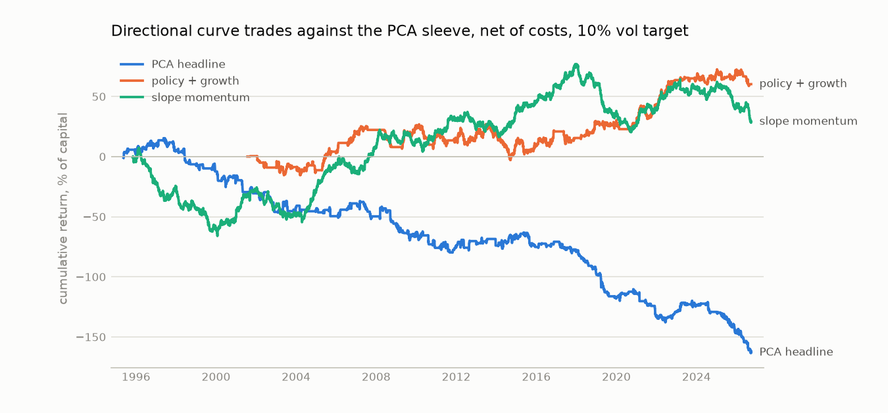

# Directional curve trades vs the PCA sleeve

Sample ends 2026-09-25. Steepeners and flatteners on the 2s10s slope, run through the same engine, cost model and 10% volatility target as the PCA sleeve, from the PCA sleeve's first out-of-sample day (1995-05-19). Net of costs unless marked gross.

**The two are different kinds of trade.** A steepener or flattener is a bet on the slope itself: the second principal component of the curve. The PCA sleeve hedges level and slope out and trades what is left. So this is a comparison between taking slope risk on purpose and removing it.

## Findings (written from the 2026-10-14 run)

1. **The policy rule is the best strategy in this comparison, PCA included.** Net Sharpe 0.45 since 1995
   (0.52 since 2001), deflated Sharpe 0.53 across the ten rows, 0.22 even at twice the cost table, and a
   worst drawdown of 0.36 against 1.79 for the PCA headline. Its alpha t-statistic is 2.5 with an R-squared
   of 0.01 on the duration and steepener factors: it earns by timing the slope, not by holding it.
2. **The textbook story holds when it is read off the 2-year yield.** The policy rule earned about 10% a
   year while hikes were being priced (flattener) and about 12% a year while cuts were being priced
   (steepener), and nothing in between. Holding a steepener through hiking periods lost 11% a year.
3. **Unconditional slope bets are a factor, not a strategy.** Always steepener: net Sharpe -0.18 in yield
   terms, R-squared 0.81 on the steepener factor, -21% in 2022. Always flattener: +0.05. Carry is missing
   from both and would move them toward the steepener.
4. **The growth story does not work as stated.** Using HY spreads as the growth signal loses (-0.09), and
   loses most when the Fed is easing (-7% a year): credit widens in a slowdown, the rule goes flattener, and
   the curve bull-steepens as the Fed cuts. Adding it to the policy rule cut the Sharpe from 0.45 to 0.26.
5. **Slope momentum has a gross edge (0.48) but trades most often of any curve rule** and nets 0.09.
6. **The real difference from PCA is cost, not signal.** Sparse PCA-3 has the best gross Sharpe here (1.21
   against 0.68 for the policy rule). But a slope trade pays about 0.17 daily sigmas to enter against a
   median 0.53 for a PCA-2 residual. Curve rules lose 1-4% a year to cost; the PCA sleeves lose 10-11%.
7. **Curve trades have their own bad episodes.** The policy rule lost 6.4% in 2008: it held a steepener
   January to June, switched to a flattener in July to September after the spring rise in 2-year yields,
   just as 2s10s widened from 144 to 240 bp, then went back to a steepener as the curve flattened to 145 bp.
   Rules on a 126-bar lookback are slow at turning points.
8. **They would diversify the PCA sleeve.** Daily correlation with the PCA headline is between -0.07 and
   +0.01 for every curve rule.
9. **Hold the result lightly.** The policy rule changes sign a few times a year, so 30 years hold a few
   dozen independent calls. Its 25 bp / 126-bar settings were chosen once and not tuned, but they are one
   choice among many. The next test is a grid of thresholds and lookbacks, declared in advance and counted
   as trials, to see whether 0.45 is typical or lucky.
10. **This is a directional macro trade, not stat arb.** It belongs next to the trend sleeve (net Sharpe
   0.51 in the appendix), which is also a directional rates trade, rather than in the graded mean-reversion
   deliverable.

## The rules

Each rule uses data through the close of the day it trades on. Parameters were fixed before the first run and not tuned.

| strategy | goes steepener when | goes flattener when |
|:--|:--|:--|
| always steepener / flattener | always / never | never / always |
| policy rule | 2y yield fell more than 25 bp over 126 bars (easing priced) | 2y yield rose more than 25 bp (hikes priced) |
| growth rule | HY OAS tighter than 126 bars ago (growth improving) | HY OAS wider |
| policy + growth | the two agree on steepener, or one says steepener and the other is flat | the mirror image |
| slope momentum | 2s10s rose over the past 63 bars | 2s10s fell |
| 2s10s mean reversion | the existing pairwise model: slope is below its fitted mean | slope is above it |

A steepener is long the 2-year and short the 10-year, weighted to equal DV01. Cost: 0.25 bp per leg one way.

## Performance, each from its own start

| strategy                       | start      |   ann_return |   ann_vol |   sharpe |   gross_sharpe |   cost_drag |   turnover |   max_dd |   sharpe_2x_cost |   in_market |
|:-------------------------------|:-----------|-------------:|----------:|---------:|---------------:|------------:|-----------:|---------:|-----------------:|------------:|
| always steepener               | 1995-11-03 |        -0.02 |      0.10 |    -0.18 |          -0.11 |        0.01 |       0.00 |    -1.05 |            -0.24 |        1.00 |
| always flattener               | 1995-11-03 |         0.00 |      0.10 |     0.05 |           0.11 |        0.01 |       0.00 |    -0.53 |            -0.01 |        1.00 |
| policy rule                    | 1995-11-03 |         0.04 |      0.09 |     0.45 |           0.68 |        0.02 |      11.51 |    -0.36 |             0.22 |        0.63 |
| growth rule                    | 2001-07-26 |        -0.01 |      0.10 |    -0.09 |           0.12 |        0.02 |      13.69 |    -0.60 |            -0.30 |        1.00 |
| policy + growth                | 2001-07-26 |         0.02 |      0.09 |     0.26 |           0.51 |        0.02 |      13.92 |    -0.30 |             0.00 |        0.63 |
| slope momentum                 | 1995-11-03 |         0.01 |      0.10 |     0.09 |           0.48 |        0.04 |      26.78 |    -0.73 |            -0.28 |        1.00 |
| 2s10s mean reversion, static   | 2009-08-27 |         0.00 |      0.00 |     0.06 |           0.07 |        0.00 |       0.06 |    -0.00 |             0.05 |        0.03 |
| 2s10s mean reversion, adaptive | 2009-08-27 |         0.00 |      0.00 |     0.11 |           0.12 |        0.00 |       0.28 |    -0.00 |             0.09 |        0.03 |
| PCA headline (PCA-2 + credit)  | 1995-05-19 |        -0.05 |      0.08 |    -0.60 |           0.55 |        0.10 |       4.42 |    -1.79 |            -1.64 |        0.44 |
| PCA-3 sparse                   | 1995-05-19 |        -0.01 |      0.08 |    -0.09 |           1.21 |        0.11 |       8.69 |    -0.54 |            -1.28 |        0.34 |

## Performance on the common window from 2001-07-26

The growth rule needs daily HY OAS, so this window starts later. Same columns. The 2s10s mean-reversion rows trade so rarely (about 3% of days) that the sleeve only starts in 2009 and their volatility is far below target; they are kept for reference.

| strategy                       | start      |   ann_return |   ann_vol |   sharpe |   gross_sharpe |   cost_drag |   turnover |   max_dd |   sharpe_2x_cost |   in_market |
|:-------------------------------|:-----------|-------------:|----------:|---------:|---------------:|------------:|-----------:|---------:|-----------------:|------------:|
| always steepener               | 2001-07-26 |        -0.02 |      0.10 |    -0.23 |          -0.18 |        0.01 |       0.00 |    -1.05 |            -0.29 |        1.00 |
| always flattener               | 2001-07-26 |         0.01 |      0.10 |     0.12 |           0.18 |        0.01 |       0.00 |    -0.53 |             0.06 |        1.00 |
| policy rule                    | 2001-07-26 |         0.04 |      0.09 |     0.52 |           0.74 |        0.02 |      11.83 |    -0.26 |             0.30 |        0.58 |
| growth rule                    | 2001-07-26 |        -0.01 |      0.10 |    -0.09 |           0.12 |        0.02 |      13.69 |    -0.60 |            -0.30 |        1.00 |
| policy + growth                | 2001-07-26 |         0.02 |      0.09 |     0.26 |           0.51 |        0.02 |      13.92 |    -0.30 |             0.00 |        0.63 |
| slope momentum                 | 2001-07-26 |         0.02 |      0.10 |     0.24 |           0.58 |        0.03 |      25.19 |    -0.57 |            -0.09 |        1.00 |
| 2s10s mean reversion, static   | 2009-08-27 |         0.00 |      0.00 |     0.06 |           0.07 |        0.00 |       0.06 |    -0.00 |             0.05 |        0.04 |
| 2s10s mean reversion, adaptive | 2009-08-27 |         0.00 |      0.00 |     0.11 |           0.12 |        0.00 |       0.28 |    -0.00 |             0.09 |        0.04 |
| PCA headline (PCA-2 + credit)  | 2001-07-26 |        -0.05 |      0.08 |    -0.62 |           0.55 |        0.10 |       4.07 |    -1.38 |            -1.67 |        0.45 |
| PCA-3 sparse                   | 2001-07-26 |        -0.01 |      0.08 |    -0.12 |           1.23 |        0.11 |       7.53 |    -0.54 |            -1.35 |        0.31 |

## Does the textbook story hold? Net return by Fed regime

Annualised net return, in % of capital, by the trailing 126-bar change in the 2-year yield: `hiking` when it rose more than 50 bp, `easing` when it fell more than 50 bp. Share of days since 1995-05-19: on hold 57%, easing 22%, hiking 21%. The policy rule uses the same variable with a lower threshold, so its row is partly by construction.

| strategy                       |   hiking |   on hold |   easing |
|:-------------------------------|---------:|----------:|---------:|
| always steepener               |    -11.1 |      -2.9 |     11.1 |
| always flattener               |      9.9 |       1.7 |    -12.3 |
| policy rule                    |      9.6 |      -0.8 |     11.6 |
| growth rule                    |      0.1 |       0.7 |     -7.1 |
| policy + growth                |      6.7 |       1.2 |      1.4 |
| slope momentum                 |      1.7 |       0.0 |      2.6 |
| 2s10s mean reversion, static   |      0.0 |       0.0 |     -0.0 |
| 2s10s mean reversion, adaptive |      0.0 |       0.0 |     -0.0 |
| PCA headline (PCA-2 + credit)  |     -3.4 |      -4.6 |     -7.7 |
| PCA-3 sparse                   |     -0.5 |      -0.3 |     -1.9 |

## Stress years

| strategy                       |   2008 return % |   2020 return % |   2022 return % |
|:-------------------------------|----------------:|----------------:|----------------:|
| always steepener               |             8.7 |             6.2 |           -21.1 |
| always flattener               |            -9.5 |            -7.4 |            20.2 |
| policy rule                    |            -6.4 |             4.9 |            20.7 |
| growth rule                    |            -8.9 |           -12.4 |            20.0 |
| policy + growth                |           -14.3 |            -2.9 |            20.9 |
| slope momentum                 |             8.6 |           -12.6 |            17.5 |
| 2s10s mean reversion, static   |           nan   |             0.0 |             0.0 |
| 2s10s mean reversion, adaptive |           nan   |             0.0 |             0.0 |
| PCA headline (PCA-2 + credit)  |            -6.6 |             4.0 |             3.3 |
| PCA-3 sparse                   |             0.3 |           -11.5 |             0.4 |

## Correlation with the PCA sleeve

Correlation of daily net P&L. Low or negative means the curve trade would diversify the PCA sleeve.

| strategy                       |   PCA headline (PCA-2 + credit) |   PCA-3 sparse |
|:-------------------------------|--------------------------------:|---------------:|
| always steepener               |                            0.01 |          -0.03 |
| always flattener               |                           -0.01 |           0.03 |
| policy rule                    |                            0.01 |          -0.01 |
| growth rule                    |                           -0.02 |          -0.01 |
| policy + growth                |                            0.01 |          -0.03 |
| slope momentum                 |                           -0.07 |          -0.00 |
| 2s10s mean reversion, static   |                           -0.13 |          -0.02 |
| 2s10s mean reversion, adaptive |                           -0.12 |          -0.02 |

## What drives the P&L: factor regression

Daily net P&L on unit-volatility duration and 2s10s-steepener factors, Newey-West t-statistics (same as report.md). A directional curve trade should load on the steepener factor; the PCA sleeve should not.

| series                         |   ann_return |   alpha |   alpha_t |   r_squared |   t_duration |   t_steepener |
|:-------------------------------|-------------:|--------:|----------:|------------:|-------------:|--------------:|
| always steepener               |       -0.017 |  -0.017 |    -2.384 |       0.815 |       -1.409 |        33.702 |
| always flattener               |        0.005 |   0.004 |     0.598 |       0.814 |        1.404 |       -33.752 |
| policy rule                    |        0.040 |   0.040 |     2.515 |       0.010 |        0.789 |         1.982 |
| growth rule                    |       -0.008 |  -0.008 |    -0.436 |       0.025 |       -3.749 |         0.822 |
| policy + growth                |        0.023 |   0.024 |     1.456 |       0.052 |       -4.798 |         3.217 |
| slope momentum                 |        0.009 |   0.009 |     0.510 |       0.003 |        2.155 |         0.209 |
| 2s10s mean reversion, static   |        0.000 |   0.000 |     0.320 |       0.044 |        3.502 |        -2.656 |
| 2s10s mean reversion, adaptive |        0.000 |   0.000 |     0.512 |       0.040 |        3.379 |        -2.555 |
| PCA headline (PCA-2 + credit)  |       -0.050 |  -0.050 |    -3.423 |       0.003 |       -2.136 |        -0.346 |
| PCA-3 sparse                   |       -0.007 |  -0.007 |    -0.578 |       0.000 |        0.631 |        -0.629 |

## Cost sensitivity

One unit of slope costs 0.50 bp one way and the slope moves about 3.0 bp on a typical day, so a curve trade pays about 0.17 daily sigmas to enter. A PCA-2 residual pays a median 0.53. Net Sharpe at multiples of the cost table (1x = 0.25 bp per leg, one way):

| strategy                       |    0x |   0.2x |   0.4x |   0.6x |   0.8x |    1x |
|:-------------------------------|------:|-------:|-------:|-------:|-------:|------:|
| always steepener               | -0.11 |  -0.13 |  -0.14 |  -0.15 |  -0.17 | -0.18 |
| always flattener               |  0.11 |   0.10 |   0.09 |   0.08 |   0.06 |  0.05 |
| policy rule                    |  0.68 |   0.64 |   0.59 |   0.54 |   0.50 |  0.45 |
| growth rule                    |  0.12 |   0.08 |   0.04 |  -0.00 |  -0.04 | -0.09 |
| policy + growth                |  0.51 |   0.46 |   0.41 |   0.36 |   0.31 |  0.26 |
| slope momentum                 |  0.48 |   0.40 |   0.32 |   0.25 |   0.17 |  0.09 |
| 2s10s mean reversion, static   |  0.07 |   0.07 |   0.07 |   0.07 |   0.06 |  0.06 |
| 2s10s mean reversion, adaptive |  0.12 |   0.12 |   0.11 |   0.11 |   0.11 |  0.11 |
| PCA headline (PCA-2 + credit)  |  0.55 |   0.32 |   0.09 |  -0.14 |  -0.37 | -0.60 |
| PCA-3 sparse                   |  1.21 |   0.96 |   0.71 |   0.44 |   0.18 | -0.09 |

## Caveats

- **No carry or roll-down.** Both sides are measured in yield changes only. On a positively sloped curve a DV01-neutral steepener earns carry and roll-down and a flattener pays it, so the true gap between the always-steepener and always-flattener rows is wider than shown.
- **Hindsight in the story, not in the rules.** The rules are trailing and untuned, but the idea that hikes flatten the curve is itself known from history. Treat good results in the `hiking` column as expected, not discovered.
- **Trials.** The deflated Sharpe counts the 10 rows of each table as trials.
- **Few, long bets.** A directional rule changes sign a few times a year, so a 30-year sample holds a few dozen independent decisions. Sharpe estimates here are much noisier than for the PCA sleeve, which makes hundreds of short trades.
