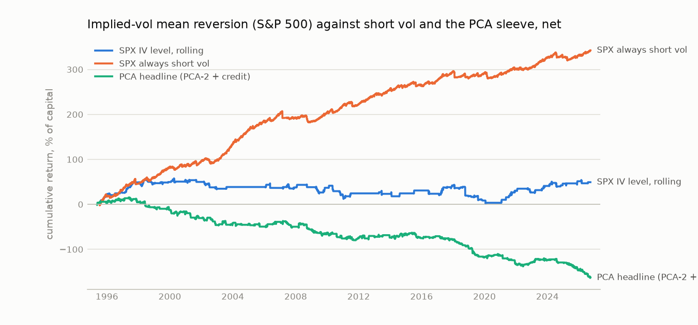
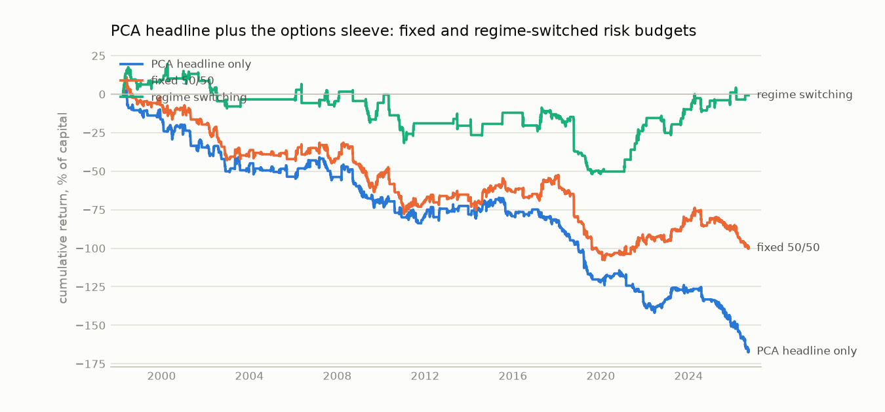

# Implied-volatility mean reversion with delta-hedged options

Sample ends 2026-09-25. Out of sample from walk-forward folds (1,260-bar training, 252-bar test, 10-bar purge, 5-bar embargo), net of costs, at a 10% volatility target, the same rig as the PCA sleeve.

## Findings (written from the 2026-10-14 run, index proxies only)

**Headline: implied-vol mean reversion beats the PCA sleeve after costs, but it does not beat simply selling
volatility, and all of its profit comes from the short-vol side.**

1. **It beats PCA because it is cheap to trade.** Net Sharpe: SPX IV level, rolling 0.18; NDX IV level,
   static 0.44; against -0.60 for the PCA headline and -0.09 for sparse PCA-3. A straddle costs 0.14-0.21
   daily sigmas one way against 0.4-1.4 for a PCA residual, so cost drag is 0.4-2% a year instead of 10%.
   Before costs PCA is still the better signal: gross Sharpe 1.21 for sparse PCA-3 against 0.39-0.55 here.
2. **The mean-reversion bet itself works.** The IV-level strategies earn in the vega column (SPX rolling
   +3.7% a year, NDX static +4.9%), which is the "implied vol returns to its mean" profit the trade is
   built on.
3. **But buying cheap vol loses money.** Every long-vol leg bleeds the gamma-theta cost of owning options:
   SPX rolling long-vol trades average -0.58 sigmas net (45 trades) against +1.05 for short-vol trades (108).
   NDX long-vol trades average -4.1 (7 trades). The textbook trade "buy the underpriced option" is the losing
   half. The strategy works as a way of timing when to sell vol.
4. **Always short vol beats every timing rule.** SPX: net Sharpe 1.15, +16% a year from gamma-theta, -4.5%
   from vega. NDX: 0.64. This number is inflated: VIX sits above at-the-money vol because of skew, so it
   overstates the premium a straddle seller collects (see caveats). Even halved, it would match the best
   timing rule.
5. **The regime layer adds nothing, again.** The HMM gate moved SPX from 0.18 to 0.16 and NDX from 0.27 to
   0.31. It allowed trading in both states in 28 of 32 SPX folds. The HMM short-vol switch never switched
   off, so it is identical to always short vol. This matches the curve, where the regime gate also did not
   help.
6. **Mean reversion earns when VIX is high.** SPX rolling: +3.6% a year in the top VIX tercile, -0.6% in the
   bottom. Short vol too earns most there (+17% a year), because the premium is largest when fear is. The PCA
   headline does the opposite: -10% a year when VIX is high.
7. **The tail is the danger, and it arrives after calm.** The worst days come when VIX was low the day
   before: SPX rolling lost 17.7% on 2018-10-10 (VIX from 16 to 23), always short vol lost 14.8% on
   2007-02-27 (VIX from 11) and 7.3% on 2018-02-05. Volatility targeting makes this worse: a short straddle's
   P&L is quiet in calm markets, so the position is largest just before a shock. 2018 was the worst year for
   both SPX always short vol (-13.5%) and SPX IV level, rolling (-23.5%).
8. **IV minus realised vol is the weaker signal.** The rolling version loses (SPX 0.00, NDX -0.25), mostly
   on long-vol trades when implied vol is below realised: -0.99 sigmas per trade over 94 trades. The static
   SPX version (0.28) is the most cost-robust timing rule, still 0.15 at twice the cost.
9. **It diversifies PCA but not equities.** Daily correlation with the PCA headline is 0.00-0.05. With the
   S&P 500 it is 0.14 for the timing rules and 0.57 for always short vol, which also has an equity t-stat of
   10.8 in the factor regression.
10. **In a book, regime switching mostly picks the options sleeve.** PCA headline plus SPX IV level, rolling
    (declared in advance): PCA alone -0.68, fixed 50/50 -0.38, regime switching 0.00 with 94% of risk on
    options on average, and 0.36 worst drawdown with the drawdown overlay. The allocator gave both states to
    options in 28 of 30 folds. It is avoiding PCA rather than switching between the two.
11. **Few decisions.** SPX IV level, static made 46 trades in 30 years; NDX static 35. Results of this size
    rest on a handful of episodes.

## The trade

Buy a 30-day at-the-money straddle when implied volatility is cheap against its mean, sell it when it is rich, and hedge the delta every day in the underlying. Daily P&L per $1 of underlying, with Black-Scholes greeks at the previous close, has two parts:

- **vega part**: vega x change in implied vol. This is the mean-reversion bet.
- **gamma-theta part**: (gamma / 2) x (realised move squared - implied variance x dt). A long straddle loses this every day the market moves less than the option priced. On average, index options price more variance than is realised (the volatility risk premium), so a seller earns it.

Signals, fitted per fold on the training window:

| signal | static | rolling | rolling + HMM gate |
|:--|:--|:--|:--|
| IV level | z against the training OU mean; trades only if the fit reverts (half-life 1-60 bars) | s-score on a trailing 60-bar OU fit, as in the PCA sleeve | rolling, only in HMM states where it made money in training |
| IV minus 21-day realised vol | same | same | same |

Above the entry band the straddle is sold (vol rich); below, bought. Bands from the training-window grid. Benchmarks on the same test windows: always short vol, always long vol, an HMM switch that sells vol only in calm states, and the underlying itself.

## Data: proxies now, MSFT next

There is no free history of single-stock implied volatility, so this run uses two index proxies:

| underlying | implied vol | price | from |
|:--|:--|:--|:--|
| S&P 500 (`SPX`) | VIX, Bloomberg (panel) | ^GSPC, Yahoo | 1990 |
| Nasdaq-100 (`NDX`) | VXN, Yahoo | ^NDX, Yahoo | 2001 |

**MSFT is not in this run.** To add it, export the fields below from the Bloomberg terminal as `data/raw/msft_options.csv` in the same layout as `rates_1.csv` (Layout A: one date/value column pair per field) and rerun `python -m amp_sa.run_options`. Check the field names with FLDS first.

| ticker | field | why |
|:--|:--|:--|
| MSFT US Equity | `PX_LAST` | close; the hedge instrument |
| MSFT US Equity | `30DAY_IMPVOL_100.0%MNY_DF` | 30-day ATM implied vol: the traded signal |
| MSFT US Equity | `60DAY_IMPVOL_100.0%MNY_DF` | 60-day ATM implied vol: term structure view |
| MSFT US Equity | `30DAY_IMPVOL_90.0%MNY_DF` | 30-day 90% put-side vol: skew view |
| MSFT US Equity | `VOLATILITY_30D` | 30-day realised vol, to check our own estimate |
| MSFT US Equity | `EARN_ANN_DT_TIME_HIST_WITH_EPS` | earnings dates: IV jumps before and collapses after |

Single names differ from indices in ways that matter for this trade: implied vol rises into every earnings date and drops the day after, so an IV-level signal on MSFT will mostly be an earnings calendar unless earnings windows are handled. Single-stock options also trade wider, and the volatility risk premium is smaller than on indices.

## 1. Performance

| strategy                                  | start      |   ann_return |   ann_vol |   sharpe |   deflated_sharpe |   gross_sharpe |   cost_drag |   turnover |   max_dd |   sharpe_2x_cost |   in_market |
|:------------------------------------------|:-----------|-------------:|----------:|---------:|------------------:|---------------:|------------:|-----------:|---------:|-----------------:|------------:|
| SPX IV level, static                      | 1996-03-12 |         0.00 |      0.06 |     0.06 |              0.00 |           0.12 |        0.00 |       2.92 |    -0.47 |            -0.00 |        0.28 |
| SPX IV level, rolling                     | 1995-07-17 |         0.02 |      0.09 |     0.18 |              0.00 |           0.39 |        0.02 |       9.57 |    -0.57 |            -0.04 |        0.17 |
| SPX IV level, rolling + HMM gate          | 1995-07-17 |         0.01 |      0.09 |     0.16 |              0.00 |           0.38 |        0.02 |       9.50 |    -0.61 |            -0.05 |        0.17 |
| SPX IV minus realised, static             | 1995-08-28 |         0.02 |      0.07 |     0.28 |              0.00 |           0.42 |        0.01 |      10.44 |    -0.24 |             0.15 |        0.23 |
| SPX IV minus realised, rolling            | 1995-07-17 |        -0.00 |      0.08 |    -0.00 |              0.00 |           0.20 |        0.02 |      11.04 |    -0.45 |            -0.20 |        0.20 |
| SPX IV minus realised, rolling + HMM gate | 1995-07-17 |        -0.00 |      0.08 |    -0.05 |              0.00 |           0.14 |        0.02 |      10.34 |    -0.50 |            -0.25 |        0.19 |
| SPX always short vol                      | 1995-07-17 |         0.11 |      0.10 |     1.15 |              0.50 |           1.21 |        0.01 |       0.00 |    -0.25 |             1.09 |        1.00 |
| SPX always long vol                       | 1995-07-17 |        -0.12 |      0.10 |    -1.26 |              0.00 |          -1.20 |        0.01 |       0.00 |    -3.79 |            -1.32 |        1.00 |
| SPX HMM switch: short vol in calm states  | 1995-07-17 |         0.11 |      0.10 |     1.15 |              0.50 |           1.21 |        0.01 |       0.00 |    -0.25 |             1.09 |        1.00 |
| SPX underlying, long                      | 1995-07-17 |         0.06 |      0.10 |     0.61 |              0.00 |           0.61 |        0.00 |       0.00 |    -0.36 |             0.61 |        1.00 |
| NDX IV level, static                      | 2008-05-21 |         0.03 |      0.06 |     0.44 |              0.00 |           0.55 |        0.01 |       3.71 |    -0.15 |             0.31 |        0.19 |
| NDX IV level, rolling                     | 2007-09-04 |         0.01 |      0.05 |     0.27 |              0.00 |           0.42 |        0.01 |       4.47 |    -0.20 |             0.12 |        0.12 |
| NDX IV level, rolling + HMM gate          | 2007-09-04 |         0.02 |      0.06 |     0.31 |              0.00 |           0.46 |        0.01 |       4.15 |    -0.18 |             0.16 |        0.11 |
| NDX IV minus realised, static             | 2006-09-26 |        -0.00 |      0.07 |    -0.01 |              0.00 |           0.15 |        0.01 |       8.72 |    -0.31 |            -0.18 |        0.21 |
| NDX IV minus realised, rolling            | 2006-08-14 |        -0.02 |      0.07 |    -0.25 |              0.00 |          -0.00 |        0.02 |      10.90 |    -0.56 |            -0.49 |        0.25 |
| NDX IV minus realised, rolling + HMM gate | 2006-08-14 |        -0.02 |      0.07 |    -0.25 |              0.00 |          -0.00 |        0.02 |      10.90 |    -0.56 |            -0.49 |        0.25 |
| NDX always short vol                      | 2006-08-14 |         0.06 |      0.10 |     0.64 |              0.02 |           0.71 |        0.01 |       0.00 |    -0.22 |             0.56 |        1.00 |
| NDX always long vol                       | 2006-08-14 |        -0.08 |      0.10 |    -0.79 |              0.00 |          -0.71 |        0.01 |       0.00 |    -1.57 |            -0.87 |        1.00 |
| NDX HMM switch: short vol in calm states  | 2006-08-14 |         0.06 |      0.10 |     0.64 |              0.02 |           0.71 |        0.01 |       0.00 |    -0.22 |             0.56 |        1.00 |
| NDX underlying, long                      | 2006-08-14 |         0.09 |      0.10 |     0.90 |              0.14 |           0.91 |        0.00 |       0.00 |    -0.19 |             0.90 |        1.00 |
| PCA headline (PCA-2 + credit)             | 1995-05-19 |        -0.05 |      0.08 |    -0.60 |              0.00 |           0.55 |        0.10 |       4.42 |    -1.79 |            -1.64 |        0.44 |
| PCA-3 sparse                              | 1995-05-19 |        -0.01 |      0.08 |    -0.09 |              0.00 |           1.21 |        0.11 |       8.69 |    -0.54 |            -1.28 |        0.34 |

## 2. Where the money comes from

Annualised % of capital from each part of the straddle P&L. A strategy that earns in the vega column is trading implied-vol mean reversion. One that earns in the gamma-theta column is harvesting (or paying) the volatility risk premium.

| strategy                                  |   vega_pct_per_year |   gamma_theta_pct_per_year |   cost_pct_per_year |   net_pct_per_year |
|:------------------------------------------|--------------------:|---------------------------:|--------------------:|-------------------:|
| SPX IV level, static                      |                2.08 |                      -1.37 |                0.37 |               0.34 |
| SPX IV level, rolling                     |                3.75 |                      -0.26 |                1.91 |               1.58 |
| SPX IV level, rolling + HMM gate          |                3.65 |                      -0.30 |                1.89 |               1.45 |
| SPX IV minus realised, static             |                1.77 |                       1.23 |                0.99 |               2.02 |
| SPX IV minus realised, rolling            |                2.55 |                      -0.96 |                1.59 |              -0.00 |
| SPX IV minus realised, rolling + HMM gate |                2.01 |                      -0.87 |                1.55 |              -0.41 |
| SPX always short vol                      |               -4.54 |                      16.04 |                0.51 |              10.99 |
| SPX always long vol                       |                4.59 |                     -16.18 |                0.51 |             -12.10 |
| SPX HMM switch: short vol in calm states  |               -4.54 |                      16.04 |                0.51 |              10.99 |
| NDX IV level, static                      |                4.87 |                      -1.32 |                0.77 |               2.77 |
| NDX IV level, rolling                     |                2.29 |                      -0.03 |                0.79 |               1.46 |
| NDX IV level, rolling + HMM gate          |                2.56 |                      -0.00 |                0.82 |               1.73 |
| NDX IV minus realised, static             |                0.59 |                       0.49 |                1.17 |              -0.09 |
| NDX IV minus realised, rolling            |                0.64 |                      -0.68 |                1.74 |              -1.78 |
| NDX IV minus realised, rolling + HMM gate |                0.64 |                      -0.68 |                1.74 |              -1.78 |
| NDX always short vol                      |               -4.37 |                      11.22 |                0.69 |               6.17 |
| NDX always long vol                       |                4.44 |                     -11.38 |                0.70 |              -7.64 |
| NDX HMM switch: short vol in calm states  |               -4.37 |                      11.22 |                0.69 |               6.17 |

## 3. Cost sensitivity

Net Sharpe at multiples of the assumed cost: half the bid-ask, 0.2 vol points for SPX and 0.3 for NDX, one way. Option spreads are the least certain input here, so read the 2x and 3x columns.

| strategy                                  |    0x |   0.5x |    1x |    2x |    3x |
|:------------------------------------------|------:|-------:|------:|------:|------:|
| SPX IV level, static                      |  0.12 |   0.09 |  0.06 | -0.00 | -0.07 |
| SPX IV level, rolling                     |  0.39 |   0.29 |  0.18 | -0.04 | -0.25 |
| SPX IV level, rolling + HMM gate          |  0.38 |   0.27 |  0.16 | -0.05 | -0.26 |
| SPX IV minus realised, static             |  0.42 |   0.35 |  0.28 |  0.15 |  0.01 |
| SPX IV minus realised, rolling            |  0.20 |   0.10 | -0.00 | -0.20 | -0.41 |
| SPX IV minus realised, rolling + HMM gate |  0.14 |   0.05 | -0.05 | -0.25 | -0.45 |
| SPX always short vol                      |  1.21 |   1.18 |  1.15 |  1.09 |  1.03 |
| SPX always long vol                       | -1.20 |  -1.23 | -1.26 | -1.32 | -1.38 |
| SPX HMM switch: short vol in calm states  |  1.21 |   1.18 |  1.15 |  1.09 |  1.03 |
| SPX underlying, long                      |  0.61 |   0.61 |  0.61 |  0.61 |  0.60 |
| NDX IV level, static                      |  0.55 |   0.49 |  0.44 |  0.31 |  0.19 |
| NDX IV level, rolling                     |  0.42 |   0.34 |  0.27 |  0.12 | -0.02 |
| NDX IV level, rolling + HMM gate          |  0.46 |   0.38 |  0.31 |  0.16 |  0.02 |
| NDX IV minus realised, static             |  0.15 |   0.07 | -0.01 | -0.18 | -0.33 |
| NDX IV minus realised, rolling            | -0.00 |  -0.13 | -0.25 | -0.49 | -0.73 |
| NDX IV minus realised, rolling + HMM gate | -0.00 |  -0.13 | -0.25 | -0.49 | -0.73 |
| NDX always short vol                      |  0.71 |   0.68 |  0.64 |  0.56 |  0.49 |
| NDX always long vol                       | -0.71 |  -0.75 | -0.79 | -0.87 | -0.95 |
| NDX HMM switch: short vol in calm states  |  0.71 |   0.68 |  0.64 |  0.56 |  0.49 |
| NDX underlying, long                      |  0.91 |   0.91 |  0.90 |  0.90 |  0.90 |
| PCA headline (PCA-2 + credit)             |  0.55 |  -0.03 | -0.60 | -1.64 | -2.46 |
| PCA-3 sparse                              |  1.21 |   0.58 | -0.09 | -1.28 | -2.13 |

## 4. Under different conditions

Annualised net return, % of capital. Conditions are known at the previous close.

### By VIX level

VIX terciles over the whole panel: high VIX 20.8-82.7, low VIX 9.1-15.2, mid VIX 15.2-20.8.

| strategy                                  |   low VIX |   mid VIX |   high VIX |
|:------------------------------------------|----------:|----------:|-----------:|
| SPX IV level, static                      |      -2.0 |      -4.3 |        6.3 |
| SPX IV level, rolling                     |      -0.6 |       1.3 |        3.6 |
| SPX IV level, rolling + HMM gate          |      -0.6 |       1.3 |        3.2 |
| SPX IV minus realised, static             |      -2.0 |      -0.0 |        7.1 |
| SPX IV minus realised, rolling            |      -4.7 |       4.6 |       -0.3 |
| SPX IV minus realised, rolling + HMM gate |      -4.4 |       3.5 |       -0.6 |
| SPX always short vol                      |       5.2 |       9.7 |       17.0 |
| SPX always long vol                       |      -6.7 |     -10.8 |      -17.8 |
| SPX HMM switch: short vol in calm states  |       5.2 |       9.7 |       17.0 |
| SPX underlying, long                      |       6.0 |       4.1 |        7.3 |
| NDX IV level, static                      |       0.4 |       2.5 |        5.5 |
| NDX IV level, rolling                     |       0.9 |      -1.0 |        4.6 |
| NDX IV level, rolling + HMM gate          |       1.0 |      -0.9 |        5.2 |
| NDX IV minus realised, static             |      -2.9 |      -2.9 |        5.8 |
| NDX IV minus realised, rolling            |      -5.6 |      -0.6 |        1.0 |
| NDX IV minus realised, rolling + HMM gate |      -5.6 |      -0.6 |        1.0 |
| NDX always short vol                      |       3.0 |       3.7 |       12.3 |
| NDX always long vol                       |      -4.8 |      -5.1 |      -13.4 |
| NDX HMM switch: short vol in calm states  |       3.0 |       3.7 |       12.3 |
| NDX underlying, long                      |      10.3 |       6.0 |       10.0 |
| PCA headline (PCA-2 + credit)             |      -0.5 |      -3.7 |      -10.1 |
| PCA-3 sparse                              |       2.4 |      -0.6 |       -3.4 |

### By equity trend (S&P 500 over the past 126 bars)

| strategy                                  |   equities up 6m |   equities down 6m |
|:------------------------------------------|-----------------:|-------------------:|
| SPX IV level, static                      |             -0.5 |                3.9 |
| SPX IV level, rolling                     |              2.7 |               -1.6 |
| SPX IV level, rolling + HMM gate          |              2.5 |               -1.6 |
| SPX IV minus realised, static             |              2.8 |                1.0 |
| SPX IV minus realised, rolling            |              0.1 |               -0.5 |
| SPX IV minus realised, rolling + HMM gate |             -0.0 |               -1.5 |
| SPX always short vol                      |             14.5 |               10.6 |
| SPX always long vol                       |            -15.8 |              -11.3 |
| SPX HMM switch: short vol in calm states  |             14.5 |               10.6 |
| SPX underlying, long                      |              7.7 |                2.0 |
| NDX IV level, static                      |              1.7 |                6.7 |
| NDX IV level, rolling                     |              3.1 |               -3.6 |
| NDX IV level, rolling + HMM gate          |              3.4 |               -3.2 |
| NDX IV minus realised, static             |             -0.5 |                1.8 |
| NDX IV minus realised, rolling            |             -2.3 |               -0.6 |
| NDX IV minus realised, rolling + HMM gate |             -2.3 |               -0.6 |
| NDX always short vol                      |             10.0 |                4.6 |
| NDX always long vol                       |            -11.7 |               -5.5 |
| NDX HMM switch: short vol in calm states  |             10.0 |                4.6 |
| NDX underlying, long                      |             10.0 |                4.7 |
| PCA headline (PCA-2 + credit)             |             -4.5 |               -6.1 |
| PCA-3 sparse                              |             -0.4 |                1.8 |

### By Fed cycle (2-year yield over the past 126 bars, +/-50 bp)

| strategy                                  |   hiking |   on hold |   easing |
|:------------------------------------------|---------:|----------:|---------:|
| SPX IV level, static                      |      0.3 |      -0.1 |      1.7 |
| SPX IV level, rolling                     |      1.7 |       2.0 |      0.3 |
| SPX IV level, rolling + HMM gate          |      1.7 |       1.8 |      0.3 |
| SPX IV minus realised, static             |      0.7 |       4.5 |     -3.4 |
| SPX IV minus realised, rolling            |      2.9 |       0.2 |     -3.4 |
| SPX IV minus realised, rolling + HMM gate |      2.2 |       0.1 |     -4.4 |
| SPX always short vol                      |     11.2 |      12.1 |      7.8 |
| SPX always long vol                       |    -12.3 |     -13.3 |     -8.8 |
| SPX HMM switch: short vol in calm states  |     11.2 |      12.1 |      7.8 |
| SPX underlying, long                      |      3.6 |       8.1 |      2.0 |
| NDX IV level, static                      |      5.2 |       2.0 |      4.0 |
| NDX IV level, rolling                     |      0.8 |       2.5 |     -2.2 |
| NDX IV level, rolling + HMM gate          |      0.9 |       2.6 |     -1.1 |
| NDX IV minus realised, static             |     -2.2 |       0.7 |     -1.4 |
| NDX IV minus realised, rolling            |     -3.4 |      -1.2 |     -2.6 |
| NDX IV minus realised, rolling + HMM gate |     -3.4 |      -1.2 |     -2.6 |
| NDX always short vol                      |      1.8 |       7.5 |      4.4 |
| NDX always long vol                       |     -3.0 |      -9.2 |     -5.3 |
| NDX HMM switch: short vol in calm states  |      1.8 |       7.5 |      4.4 |
| NDX underlying, long                      |      3.7 |      10.3 |      6.6 |
| PCA headline (PCA-2 + credit)             |     -3.4 |      -4.6 |     -7.7 |
| PCA-3 sparse                              |     -0.5 |      -0.3 |     -1.9 |

### Stress years, % return

| strategy                                  |   1998 |   2001 |   2008 |   2011 |   2018 |   2020 |   2022 |
|:------------------------------------------|-------:|-------:|-------:|-------:|-------:|-------:|-------:|
| SPX IV level, static                      |    5.0 |   -0.5 |    5.7 |    6.6 |    0.5 |   -7.9 |   13.5 |
| SPX IV level, rolling                     |   -1.6 |   -4.8 |    0.6 |    4.7 |  -23.5 |   -5.0 |   -4.1 |
| SPX IV level, rolling + HMM gate          |   -1.6 |   -4.8 |    0.6 |    4.7 |  -23.5 |   -5.0 |   -4.1 |
| SPX IV minus realised, static             |    0.5 |   -5.8 |    1.9 |   -1.6 |    1.9 |    1.6 |    5.1 |
| SPX IV minus realised, rolling            |    3.2 |  -16.3 |    7.2 |  -12.4 |   -2.3 |   12.8 |    0.0 |
| SPX IV minus realised, rolling + HMM gate |    3.2 |  -16.3 |    7.3 |  -12.3 |    0.0 |   13.3 |    0.0 |
| SPX always short vol                      |   13.7 |    9.3 |   -7.8 |    2.7 |  -13.5 |   -0.8 |    2.4 |
| SPX always long vol                       |  -14.5 |  -10.1 |    7.3 |   -3.5 |   12.7 |    0.2 |   -2.9 |
| SPX HMM switch: short vol in calm states  |   13.7 |    9.3 |   -7.8 |    2.7 |  -13.5 |   -0.8 |    2.4 |
| SPX underlying, long                      |    8.8 |  -10.0 |  -13.6 |   -1.5 |    0.6 |    5.3 |   -9.7 |
| NDX IV level, static                      |  nan   |  nan   |   -7.5 |    5.2 |   -1.4 |   -8.9 |    9.4 |
| NDX IV level, rolling                     |  nan   |  nan   |   -2.3 |   -4.8 |    0.0 |    0.6 |    0.0 |
| NDX IV level, rolling + HMM gate          |  nan   |  nan   |   -2.3 |   -2.3 |    0.0 |    1.1 |    0.0 |
| NDX IV minus realised, static             |  nan   |  nan   |   -3.4 |   -3.3 |    1.2 |    2.1 |    0.3 |
| NDX IV minus realised, rolling            |  nan   |  nan   |    0.8 |   -4.8 |    0.0 |    1.0 |  -11.2 |
| NDX IV minus realised, rolling + HMM gate |  nan   |  nan   |    0.8 |   -4.8 |    0.0 |    1.0 |  -11.2 |
| NDX always short vol                      |  nan   |  nan   |   -9.5 |    1.7 |  -15.1 |   -0.7 |   -6.4 |
| NDX always long vol                       |  nan   |  nan   |    8.9 |   -2.9 |   13.9 |   -0.2 |    5.7 |
| NDX HMM switch: short vol in calm states  |  nan   |  nan   |   -9.5 |    1.7 |  -15.1 |   -0.7 |   -6.4 |
| NDX underlying, long                      |  nan   |  nan   |  -12.6 |    0.1 |    1.7 |   13.0 |  -12.0 |
| PCA headline (PCA-2 + credit)             |  -11.6 |  -11.1 |   -6.6 |    0.5 |  -18.3 |    4.0 |    3.3 |
| PCA-3 sparse                              |   -4.8 |    9.2 |    0.3 |   -4.7 |  -12.5 |  -11.5 |    0.4 |

### Year by year, % net

|   year |   SPX IV level, rolling |   SPX IV level, rolling + HMM gate |   SPX IV minus realised, rolling |   SPX always short vol |   NDX IV level, rolling |   PCA headline (PCA-2 + credit) |
|-------:|------------------------:|-----------------------------------:|---------------------------------:|-----------------------:|------------------------:|--------------------------------:|
| 1995.0 |                    22.5 |                               22.5 |                             -7.2 |                   18.9 |                   nan   |                             1.7 |
| 1996.0 |                     3.2 |                                3.2 |                             21.2 |                   12.8 |                   nan   |                             7.8 |
| 1997.0 |                    23.1 |                               23.1 |                            -11.9 |                   14.7 |                   nan   |                            -4.9 |
| 1998.0 |                    -1.6 |                               -1.6 |                              3.2 |                   13.7 |                   nan   |                           -11.6 |
| 1999.0 |                     2.4 |                                2.4 |                             11.2 |                   22.9 |                   nan   |                            -5.3 |
| 2000.0 |                     5.0 |                                5.0 |                             -0.9 |                    3.1 |                   nan   |                            -7.1 |
| 2001.0 |                    -4.8 |                               -4.8 |                            -16.3 |                    9.3 |                   nan   |                           -11.1 |
| 2002.0 |                   -15.1 |                              -15.1 |                              3.3 |                    3.3 |                   nan   |                           -15.5 |
| 2003.0 |                     3.8 |                                0.0 |                             11.8 |                   34.7 |                   nan   |                             3.9 |
| 2004.0 |                     0.0 |                                0.0 |                              0.0 |                   31.7 |                   nan   |                            -2.3 |
| 2005.0 |                     0.0 |                                0.0 |                             -7.5 |                   20.0 |                   nan   |                            -5.1 |
| 2006.0 |                    -2.0 |                               -2.0 |                              8.6 |                   16.0 |                   nan   |                            10.6 |
| 2007.0 |                     1.0 |                                1.0 |                              2.4 |                   -8.3 |                     0.2 |                           -10.8 |
| 2008.0 |                     0.6 |                                0.6 |                              7.2 |                   -7.8 |                    -2.3 |                            -6.6 |
| 2009.0 |                    -1.4 |                               -1.4 |                              0.4 |                   19.2 |                    -3.9 |                            -7.7 |
| 2010.0 |                   -17.1 |                              -17.2 |                             -5.0 |                   15.2 |                    -6.4 |                           -11.9 |
| 2011.0 |                     4.7 |                                4.7 |                            -12.4 |                    2.7 |                    -4.8 |                             0.5 |
| 2012.0 |                     0.0 |                                0.0 |                              1.6 |                   19.9 |                     0.0 |                             4.9 |
| 2013.0 |                    -1.1 |                               -1.1 |                             -2.6 |                   14.1 |                     3.2 |                            -3.5 |
| 2014.0 |                     1.0 |                                1.0 |                             -7.6 |                    5.9 |                     1.2 |                             9.4 |
| 2015.0 |                     6.4 |                                6.4 |                             -0.8 |                    3.4 |                    -4.7 |                           -10.6 |
| 2016.0 |                    -7.2 |                               -7.3 |                              1.7 |                    9.1 |                     5.9 |                             4.4 |
| 2017.0 |                    18.3 |                               18.3 |                            -14.4 |                   20.1 |                    12.0 |                            -8.2 |
| 2018.0 |                   -23.5 |                              -23.5 |                             -2.3 |                  -13.5 |                     0.0 |                           -18.3 |
| 2019.0 |                    -9.9 |                               -9.9 |                              4.6 |                   10.9 |                    -0.1 |                           -20.6 |
| 2020.0 |                    -5.0 |                               -5.0 |                             12.8 |                   -0.8 |                     0.6 |                             4.0 |
| 2021.0 |                    26.9 |                               27.0 |                              0.0 |                   10.7 |                    19.8 |                           -18.6 |
| 2022.0 |                    -4.1 |                               -4.1 |                              0.0 |                    2.4 |                     0.0 |                             3.3 |
| 2023.0 |                    14.5 |                               14.5 |                              4.3 |                   22.5 |                     0.0 |                             5.9 |
| 2024.0 |                     5.2 |                                5.2 |                              1.0 |                    0.2 |                    -0.5 |                            -5.9 |
| 2025.0 |                     5.2 |                                5.2 |                             -3.9 |                    4.9 |                    -1.3 |                           -16.6 |
| 2026.0 |                    -2.1 |                               -2.1 |                             -2.5 |                   10.5 |                     9.0 |                           -17.3 |

## 5. Trades

Trades in daily sigmas of the straddle's P&L, as in [trades.md](trades.md).

| strategy                                  |   trades |   trades_per_year |   median_bars |   hit_rate_gross |   hit_rate_net |   mean_gross |   mean_cost |   mean_net |   cost_share_of_gross |   resize_share_of_cost |   avg_win_over_avg_loss |   top_decile_share_of_gross |
|:------------------------------------------|---------:|------------------:|--------------:|-----------------:|---------------:|-------------:|------------:|-----------:|----------------------:|-----------------------:|------------------------:|----------------------------:|
| SPX IV level, static                      |       46 |              1.45 |         19.00 |             0.67 |           0.67 |         1.27 |        0.38 |       0.88 |                  0.30 |                   0.39 |                    0.58 |                        1.71 |
| SPX IV level, rolling                     |      153 |              4.84 |          6.00 |             0.71 |           0.65 |         0.93 |        0.36 |       0.57 |                  0.39 |                   0.06 |                    0.82 |                        0.63 |
| SPX IV level, rolling + HMM gate          |      152 |              4.81 |          6.00 |             0.71 |           0.64 |         0.91 |        0.36 |       0.55 |                  0.39 |                   0.07 |                    0.81 |                        0.64 |
| SPX IV minus realised, static             |      163 |              5.15 |          7.00 |             0.62 |           0.61 |         0.85 |        0.25 |       0.60 |                  0.29 |                   0.11 |                    1.01 |                        0.93 |
| SPX IV minus realised, rolling            |      176 |              5.56 |          7.50 |             0.58 |           0.56 |         0.38 |        0.30 |       0.08 |                  0.78 |                   0.07 |                    0.83 |                        1.59 |
| SPX IV minus realised, rolling + HMM gate |      165 |              5.22 |          7.00 |             0.58 |           0.56 |         0.31 |        0.30 |       0.01 |                  0.97 |                   0.06 |                    0.78 |                        1.95 |
| NDX IV level, static                      |       35 |              1.70 |         15.00 |             0.77 |           0.74 |         2.49 |        0.41 |       2.09 |                  0.16 |                   0.22 |                    0.86 |                        0.57 |
| NDX IV level, rolling                     |       45 |              2.19 |          9.00 |             0.64 |           0.64 |         0.68 |        0.42 |       0.26 |                  0.62 |                   0.10 |                    0.63 |                        0.77 |
| NDX IV level, rolling + HMM gate          |       42 |              2.04 |          8.50 |             0.64 |           0.64 |         0.82 |        0.43 |       0.39 |                  0.52 |                   0.10 |                    0.68 |                        0.68 |
| NDX IV minus realised, static             |       88 |              4.28 |          7.00 |             0.56 |           0.51 |         0.51 |        0.32 |       0.19 |                  0.63 |                   0.13 |                    1.10 |                        1.37 |
| NDX IV minus realised, rolling            |      118 |              5.74 |         10.00 |             0.59 |           0.55 |         0.40 |        0.43 |      -0.03 |                  1.07 |                   0.09 |                    0.80 |                        1.88 |
| NDX IV minus realised, rolling + HMM gate |      118 |              5.74 |         10.00 |             0.59 |           0.55 |         0.40 |        0.43 |      -0.03 |                  1.07 |                   0.09 |                    0.80 |                        1.88 |

### By holding period

| strategy                                  | holding   |   trades |   mean_gross |   mean_cost |   mean_net |   hit_rate_net |   total_net |
|:------------------------------------------|:----------|---------:|-------------:|------------:|-----------:|---------------:|------------:|
| SPX IV level, static                      | 1-2 bars  |        3 |        -2.52 |        0.23 |      -2.75 |           0.00 |       -8.24 |
| SPX IV level, static                      | 3-5       |        6 |        -0.32 |        0.20 |      -0.51 |           0.67 |       -3.09 |
| SPX IV level, static                      | 6-10      |        4 |        -4.15 |        0.23 |      -4.38 |           0.50 |      -17.50 |
| SPX IV level, static                      | 11-20     |       12 |         4.07 |        0.27 |       3.80 |           0.92 |       45.60 |
| SPX IV level, static                      | 21+       |       21 |         1.69 |        0.55 |       1.14 |           0.67 |       23.90 |
| SPX IV level, rolling                     | 1-2 bars  |       32 |         1.39 |        0.39 |       1.00 |           0.72 |       31.89 |
| SPX IV level, rolling                     | 3-5       |       43 |         1.29 |        0.35 |       0.94 |           0.79 |       40.24 |
| SPX IV level, rolling                     | 6-10      |       36 |         1.46 |        0.34 |       1.13 |           0.69 |       40.52 |
| SPX IV level, rolling                     | 11-20     |       29 |         1.34 |        0.37 |       0.97 |           0.55 |       28.15 |
| SPX IV level, rolling                     | 21+       |       13 |        -3.78 |        0.33 |      -4.11 |           0.08 |      -53.46 |
| SPX IV level, rolling + HMM gate          | 1-2 bars  |       31 |         1.32 |        0.39 |       0.93 |           0.71 |       28.74 |
| SPX IV level, rolling + HMM gate          | 3-5       |       43 |         1.29 |        0.35 |       0.94 |           0.79 |       40.24 |
| SPX IV level, rolling + HMM gate          | 6-10      |       36 |         1.46 |        0.34 |       1.13 |           0.69 |       40.52 |
| SPX IV level, rolling + HMM gate          | 11-20     |       29 |         1.34 |        0.37 |       0.97 |           0.55 |       28.15 |
| SPX IV level, rolling + HMM gate          | 21+       |       13 |        -3.78 |        0.33 |      -4.11 |           0.08 |      -53.46 |
| SPX IV minus realised, static             | 1-2 bars  |       37 |         1.15 |        0.19 |       0.96 |           0.84 |       35.68 |
| SPX IV minus realised, static             | 3-5       |       32 |         1.34 |        0.19 |       1.15 |           0.62 |       36.87 |
| SPX IV minus realised, static             | 6-10      |       31 |        -0.21 |        0.24 |      -0.45 |           0.55 |      -14.00 |
| SPX IV minus realised, static             | 11-20     |       35 |        -0.40 |        0.29 |      -0.69 |           0.40 |      -24.13 |
| SPX IV minus realised, static             | 21+       |       28 |         2.61 |        0.34 |       2.27 |           0.61 |       63.43 |
| SPX IV minus realised, rolling            | 1-2 bars  |       30 |         0.59 |        0.24 |       0.34 |           0.70 |       10.29 |
| SPX IV minus realised, rolling            | 3-5       |       37 |         1.52 |        0.29 |       1.22 |           0.78 |       45.30 |
| SPX IV minus realised, rolling            | 6-10      |       39 |         0.22 |        0.31 |      -0.09 |           0.59 |       -3.55 |
| SPX IV minus realised, rolling            | 11-20     |       60 |        -0.48 |        0.31 |      -0.79 |           0.33 |      -47.39 |
| SPX IV minus realised, rolling            | 21+       |       10 |         1.37 |        0.34 |       1.03 |           0.60 |       10.31 |
| SPX IV minus realised, rolling + HMM gate | 1-2 bars  |       29 |         0.57 |        0.25 |       0.32 |           0.72 |        9.26 |
| SPX IV minus realised, rolling + HMM gate | 3-5       |       34 |         1.24 |        0.30 |       0.93 |           0.76 |       31.73 |
| SPX IV minus realised, rolling + HMM gate | 6-10      |       38 |        -0.13 |        0.31 |      -0.44 |           0.55 |      -16.80 |
| SPX IV minus realised, rolling + HMM gate | 11-20     |       55 |        -0.40 |        0.31 |      -0.71 |           0.35 |      -39.20 |
| SPX IV minus realised, rolling + HMM gate | 21+       |        9 |         2.15 |        0.34 |       1.81 |           0.67 |       16.27 |
| NDX IV level, static                      | 1-2 bars  |        2 |         2.99 |        0.28 |       2.72 |           1.00 |        5.43 |
| NDX IV level, static                      | 3-5       |        3 |        -0.48 |        0.38 |      -0.86 |           0.67 |       -2.57 |
| NDX IV level, static                      | 6-10      |        7 |         1.59 |        0.31 |       1.28 |           0.86 |        8.97 |
| NDX IV level, static                      | 11-20     |        9 |         2.28 |        0.28 |       2.00 |           0.78 |       18.01 |
| NDX IV level, static                      | 21+       |       14 |         3.65 |        0.56 |       3.09 |           0.64 |       43.22 |
| NDX IV level, rolling                     | 1-2 bars  |        6 |        -0.08 |        0.36 |      -0.43 |           0.67 |       -2.60 |
| NDX IV level, rolling                     | 3-5       |        7 |         3.58 |        0.37 |       3.20 |           1.00 |       22.42 |
| NDX IV level, rolling                     | 6-10      |       14 |         1.64 |        0.47 |       1.16 |           0.64 |       16.27 |
| NDX IV level, rolling                     | 11-20     |        7 |         0.09 |        0.36 |      -0.27 |           0.57 |       -1.91 |
| NDX IV level, rolling                     | 21+       |       11 |        -1.61 |        0.45 |      -2.06 |           0.45 |      -22.67 |
| NDX IV level, rolling + HMM gate          | 1-2 bars  |        7 |        -0.11 |        0.35 |      -0.47 |           0.57 |       -3.26 |
| NDX IV level, rolling + HMM gate          | 3-5       |        6 |         3.80 |        0.41 |       3.39 |           1.00 |       20.36 |
| NDX IV level, rolling + HMM gate          | 6-10      |       12 |         2.24 |        0.49 |       1.76 |           0.67 |       21.08 |
| NDX IV level, rolling + HMM gate          | 11-20     |        6 |         0.53 |        0.37 |       0.16 |           0.67 |        0.96 |
| NDX IV level, rolling + HMM gate          | 21+       |       11 |        -1.61 |        0.45 |      -2.06 |           0.45 |      -22.67 |
| NDX IV minus realised, static             | 1-2 bars  |       18 |         0.95 |        0.22 |       0.73 |           0.61 |       13.17 |
| NDX IV minus realised, static             | 3-5       |       19 |        -0.11 |        0.28 |      -0.39 |           0.37 |       -7.41 |
| NDX IV minus realised, static             | 6-10      |       16 |         0.18 |        0.33 |      -0.15 |           0.56 |       -2.48 |
| NDX IV minus realised, static             | 11-20     |       20 |         0.53 |        0.32 |       0.22 |           0.50 |        4.35 |
| NDX IV minus realised, static             | 21+       |       15 |         1.08 |        0.48 |       0.60 |           0.53 |        8.99 |
| NDX IV minus realised, rolling            | 1-2 bars  |       13 |         0.55 |        0.32 |       0.24 |           0.92 |        3.07 |
| NDX IV minus realised, rolling            | 3-5       |       19 |         0.95 |        0.45 |       0.51 |           0.63 |        9.63 |
| NDX IV minus realised, rolling            | 6-10      |       31 |         0.54 |        0.42 |       0.12 |           0.42 |        3.80 |
| NDX IV minus realised, rolling            | 11-20     |       43 |        -0.78 |        0.44 |      -1.22 |           0.44 |      -52.53 |
| NDX IV minus realised, rolling            | 21+       |       12 |         3.21 |        0.49 |       2.72 |           0.75 |       32.69 |
| NDX IV minus realised, rolling + HMM gate | 1-2 bars  |       13 |         0.55 |        0.32 |       0.24 |           0.92 |        3.07 |
| NDX IV minus realised, rolling + HMM gate | 3-5       |       19 |         0.95 |        0.45 |       0.51 |           0.63 |        9.63 |
| NDX IV minus realised, rolling + HMM gate | 6-10      |       31 |         0.54 |        0.42 |       0.12 |           0.42 |        3.80 |
| NDX IV minus realised, rolling + HMM gate | 11-20     |       43 |        -0.78 |        0.44 |      -1.22 |           0.44 |      -52.53 |
| NDX IV minus realised, rolling + HMM gate | 21+       |       12 |         3.21 |        0.49 |       2.72 |           0.75 |       32.69 |

### Long vol against short vol

| strategy                         | side      |   trades |   mean_gross |   mean_cost |   mean_net |   hit_rate_net |   total_net |
|:---------------------------------|:----------|---------:|-------------:|------------:|-----------:|---------------:|------------:|
| SPX IV level, rolling            | long vol  |       45 |        -0.17 |        0.41 |      -0.58 |           0.47 |      -25.92 |
| SPX IV level, rolling            | short vol |      108 |         1.39 |        0.34 |       1.05 |           0.72 |      113.26 |
| SPX IV level, rolling + HMM gate | long vol  |       45 |        -0.17 |        0.41 |      -0.58 |           0.47 |      -25.92 |
| SPX IV level, rolling + HMM gate | short vol |      107 |         1.37 |        0.34 |       1.03 |           0.72 |      110.12 |
| SPX IV minus realised, rolling   | long vol  |       94 |        -0.72 |        0.28 |      -1.00 |           0.35 |      -93.55 |
| SPX IV minus realised, rolling   | short vol |       82 |         1.64 |        0.32 |       1.32 |           0.80 |      108.51 |
| NDX IV level, rolling            | long vol  |        7 |        -3.64 |        0.42 |      -4.07 |           0.29 |      -28.48 |
| NDX IV level, rolling            | short vol |       38 |         1.47 |        0.42 |       1.05 |           0.71 |       39.98 |

### Best and worst trades

| strategy                         | kind   | side      | entry      | exit       |   bars |   gross |   cost |    net |
|:---------------------------------|:-------|:----------|:-----------|:-----------|-------:|--------:|-------:|-------:|
| SPX IV level, rolling            | worst  | short vol | 2018-10-04 | 2018-10-10 |      4 |  -11.49 |   0.39 | -11.89 |
| SPX IV level, rolling            | worst  | short vol | 2024-07-17 | 2024-08-02 |     12 |  -10.89 |   0.59 | -11.48 |
| SPX IV level, rolling            | worst  | long vol  | 1998-01-16 | 1998-03-24 |     45 |   -8.58 |   0.32 |  -8.90 |
| SPX IV level, rolling            | worst  | long vol  | 2009-04-09 | 2009-07-08 |     61 |   -8.13 |   0.21 |  -8.34 |
| SPX IV level, rolling            | worst  | short vol | 2002-06-03 | 2002-07-10 |     26 |   -7.64 |   0.32 |  -7.97 |
| SPX IV level, rolling            | best   | short vol | 1998-03-30 | 1998-04-20 |     14 |    8.26 |   0.35 |   7.91 |
| SPX IV level, rolling            | best   | short vol | 2017-04-05 | 2017-04-24 |     12 |    7.07 |   0.34 |   6.73 |
| SPX IV level, rolling            | best   | short vol | 1995-10-02 | 1995-10-20 |     14 |    7.51 |   0.82 |   6.69 |
| SPX IV level, rolling            | best   | short vol | 1995-07-31 | 1995-08-15 |     11 |    7.45 |   0.78 |   6.67 |
| SPX IV level, rolling            | best   | short vol | 2023-09-26 | 2023-11-01 |     26 |    6.54 |   0.41 |   6.13 |
| SPX IV level, rolling + HMM gate | worst  | short vol | 2018-10-04 | 2018-10-10 |      4 |  -11.49 |   0.39 | -11.89 |
| SPX IV level, rolling + HMM gate | worst  | short vol | 2024-07-17 | 2024-08-02 |     12 |  -10.89 |   0.59 | -11.48 |
| SPX IV level, rolling + HMM gate | worst  | long vol  | 1998-01-16 | 1998-03-24 |     45 |   -8.58 |   0.32 |  -8.90 |
| SPX IV level, rolling + HMM gate | worst  | long vol  | 2009-04-09 | 2009-07-08 |     61 |   -8.13 |   0.21 |  -8.34 |
| SPX IV level, rolling + HMM gate | worst  | short vol | 2002-06-03 | 2002-07-10 |     26 |   -7.64 |   0.32 |  -7.97 |
| SPX IV level, rolling + HMM gate | best   | short vol | 1998-03-30 | 1998-04-20 |     14 |    8.26 |   0.35 |   7.91 |
| SPX IV level, rolling + HMM gate | best   | short vol | 2017-04-05 | 2017-04-24 |     12 |    7.07 |   0.34 |   6.73 |
| SPX IV level, rolling + HMM gate | best   | short vol | 1995-10-02 | 1995-10-20 |     14 |    7.51 |   0.82 |   6.69 |
| SPX IV level, rolling + HMM gate | best   | short vol | 1995-07-31 | 1995-08-15 |     11 |    7.45 |   0.78 |   6.67 |
| SPX IV level, rolling + HMM gate | best   | short vol | 2023-09-26 | 2023-11-01 |     26 |    6.54 |   0.41 |   6.13 |
| SPX IV minus realised, rolling   | worst  | short vol | 1997-10-23 | 1997-10-27 |      2 |  -16.93 |   0.16 | -17.10 |
| SPX IV minus realised, rolling   | worst  | short vol | 2011-07-29 | 2011-08-08 |      6 |  -16.11 |   0.28 | -16.38 |
| SPX IV minus realised, rolling   | worst  | short vol | 2001-08-30 | 2001-09-17 |      7 |  -12.88 |   0.30 | -13.18 |
| SPX IV minus realised, rolling   | worst  | long vol  | 2005-10-28 | 2005-11-23 |     18 |   -7.19 |   0.50 |  -7.69 |
| SPX IV minus realised, rolling   | worst  | long vol  | 1995-11-02 | 1995-11-21 |     13 |   -6.50 |   0.72 |  -7.22 |
| SPX IV minus realised, rolling   | best   | long vol  | 2020-02-05 | 2020-02-24 |     12 |    8.50 |   0.31 |   8.19 |
| SPX IV minus realised, rolling   | best   | short vol | 1996-06-03 | 1996-06-27 |     18 |    7.98 |   0.41 |   7.58 |
| SPX IV minus realised, rolling   | best   | short vol | 1996-09-30 | 1996-11-06 |     27 |    7.82 |   0.51 |   7.31 |
| SPX IV minus realised, rolling   | best   | short vol | 2017-04-10 | 2017-04-24 |      9 |    7.47 |   0.32 |   7.15 |
| SPX IV minus realised, rolling   | best   | short vol | 2001-05-31 | 2001-07-02 |     22 |    7.42 |   0.33 |   7.09 |
| NDX IV level, rolling            | worst  | long vol  | 2009-04-09 | 2009-08-17 |     89 |  -18.72 |   0.51 | -19.23 |
| NDX IV level, rolling            | worst  | short vol | 2015-08-20 | 2015-08-21 |      1 |   -7.67 |   0.34 |  -8.01 |
| NDX IV level, rolling            | worst  | short vol | 2020-01-27 | 2020-02-24 |     19 |   -7.11 |   0.55 |  -7.66 |
| NDX IV level, rolling            | worst  | short vol | 2011-07-27 | 2011-08-05 |      7 |   -7.08 |   0.39 |  -7.46 |
| NDX IV level, rolling            | worst  | long vol  | 2010-12-13 | 2011-01-20 |     26 |   -5.97 |   0.60 |  -6.57 |
| NDX IV level, rolling            | best   | short vol | 2017-04-12 | 2017-04-24 |      7 |    6.48 |   0.82 |   5.67 |
| NDX IV level, rolling            | best   | short vol | 2020-09-03 | 2020-10-09 |     25 |    5.92 |   0.27 |   5.65 |
| NDX IV level, rolling            | best   | short vol | 2021-01-27 | 2021-02-04 |      6 |    5.54 |   0.24 |   5.30 |
| NDX IV level, rolling            | best   | short vol | 2014-08-01 | 2014-08-14 |      9 |    5.35 |   0.53 |   4.82 |
| NDX IV level, rolling            | best   | short vol | 2026-03-06 | 2026-03-17 |      7 |    4.85 |   0.31 |   4.55 |

### Best and worst days

| strategy                         | kind   | date       |   net_pct |   spx_return_pct |   vix_change |   vix_prev_close |
|:---------------------------------|:-------|:-----------|----------:|-----------------:|-------------:|-----------------:|
| SPX IV level, rolling            | worst  | 2018-10-10 |    -17.71 |            -3.29 |         7.01 |            15.95 |
| SPX IV level, rolling            | worst  | 2006-05-17 |     -9.42 |            -1.68 |         2.91 |            13.35 |
| SPX IV level, rolling            | worst  | 2019-08-05 |     -9.25 |            -2.98 |         6.98 |            17.61 |
| SPX IV level, rolling            | worst  | 2013-06-20 |     -8.34 |            -2.50 |         3.85 |            16.64 |
| SPX IV level, rolling            | worst  | 2010-05-06 |     -7.93 |            -3.24 |         7.89 |            24.91 |
| SPX IV level, rolling            | best   | 1995-10-06 |      4.96 |            -0.02 |        -1.76 |            15.74 |
| SPX IV level, rolling            | best   | 2017-04-24 |      4.87 |             1.08 |        -3.79 |            14.63 |
| SPX IV level, rolling            | best   | 2017-05-17 |      4.86 |            -1.82 |         4.94 |            10.65 |
| SPX IV level, rolling            | best   | 1995-12-18 |      4.52 |            -1.55 |         3.11 |            11.44 |
| SPX IV level, rolling            | best   | 2009-04-20 |      3.95 |            -4.28 |         5.24 |            33.94 |
| SPX IV level, rolling + HMM gate | worst  | 2018-10-10 |    -17.77 |            -3.29 |         7.01 |            15.95 |
| SPX IV level, rolling + HMM gate | worst  | 2006-05-17 |     -9.50 |            -1.68 |         2.91 |            13.35 |
| SPX IV level, rolling + HMM gate | worst  | 2019-08-05 |     -9.25 |            -2.98 |         6.98 |            17.61 |
| SPX IV level, rolling + HMM gate | worst  | 2013-06-20 |     -8.38 |            -2.50 |         3.85 |            16.64 |
| SPX IV level, rolling + HMM gate | worst  | 2010-05-06 |     -7.98 |            -3.24 |         7.89 |            24.91 |
| SPX IV level, rolling + HMM gate | best   | 1995-10-06 |      4.96 |            -0.02 |        -1.76 |            15.74 |
| SPX IV level, rolling + HMM gate | best   | 2017-04-24 |      4.87 |             1.08 |        -3.79 |            14.63 |
| SPX IV level, rolling + HMM gate | best   | 2017-05-17 |      4.86 |            -1.82 |         4.94 |            10.65 |
| SPX IV level, rolling + HMM gate | best   | 1995-12-18 |      4.52 |            -1.55 |         3.11 |            11.44 |
| SPX IV level, rolling + HMM gate | best   | 2009-04-20 |      3.97 |            -4.28 |         5.24 |            33.94 |
| SPX IV minus realised, rolling   | worst  | 1997-10-27 |    -15.24 |            -6.87 |         7.95 |            23.17 |
| SPX IV minus realised, rolling   | worst  | 2011-08-04 |    -11.46 |            -4.78 |         8.28 |            23.38 |
| SPX IV minus realised, rolling   | worst  | 2017-08-10 |    -10.04 |            -1.45 |         4.93 |            11.11 |
| SPX IV minus realised, rolling   | worst  | 2001-09-17 |     -6.92 |            -4.92 |         9.92 |            31.84 |
| SPX IV minus realised, rolling   | worst  | 2015-08-24 |     -5.96 |            -3.94 |        12.71 |            28.03 |
| SPX IV minus realised, rolling   | best   | 2020-02-24 |     12.14 |            -3.35 |         7.95 |            17.08 |
| SPX IV minus realised, rolling   | best   | 2017-04-24 |      6.44 |             1.08 |        -3.79 |            14.63 |
| SPX IV minus realised, rolling   | best   | 2008-10-15 |      4.93 |            -9.03 |        14.12 |            55.13 |
| SPX IV minus realised, rolling   | best   | 2018-10-24 |      4.17 |            -3.09 |         4.52 |            20.71 |
| SPX IV minus realised, rolling   | best   | 2024-09-03 |      3.35 |            -2.12 |         5.17 |            15.55 |
| SPX always short vol             | worst  | 2007-02-27 |    -14.82 |            -3.47 |         7.16 |            11.15 |
| SPX always short vol             | worst  | 1997-10-27 |     -9.52 |            -6.87 |         7.95 |            23.17 |
| SPX always short vol             | worst  | 2018-02-05 |     -7.27 |            -4.10 |        20.01 |            17.31 |
| SPX always short vol             | worst  | 2018-10-10 |     -5.94 |            -3.29 |         7.01 |            15.95 |
| SPX always short vol             | worst  | 2024-12-18 |     -5.83 |            -2.95 |        11.75 |            15.87 |
| SPX always short vol             | best   | 2017-04-24 |      2.98 |             1.08 |        -3.79 |            14.63 |
| SPX always short vol             | best   | 1995-10-06 |      2.65 |            -0.02 |        -1.76 |            15.74 |
| SPX always short vol             | best   | 2012-12-31 |      2.24 |             1.69 |        -4.70 |            22.72 |
| SPX always short vol             | best   | 1995-12-08 |      1.97 |             0.21 |        -1.62 |            12.74 |
| SPX always short vol             | best   | 2013-10-16 |      1.83 |             1.38 |        -3.95 |            18.66 |

## 6. Fold diagnostics

Median across folds. `train_half_life_median` is the OU half-life of the signal on the training window, in bars; `cost_over_daily_vol` is the one-way cost of a straddle over the daily volatility of its P&L.

| underlying   | kind   |   folds |   train_half_life_median |   static_traded_share |   rolling_tradeable_share |   rolling_entry |   rolling_exit |   cost_over_daily_vol | hmm_states_allowed   |
|:-------------|:-------|--------:|-------------------------:|----------------------:|--------------------------:|----------------:|---------------:|----------------------:|:---------------------|
| ndx          | iv     |      21 |                    22.75 |                  0.90 |                      0.93 |            2.50 |           0.00 |                  0.21 | 11: 20, 01: 1        |
| ndx          | vrp    |      21 |                     9.64 |                  1.00 |                      0.94 |            1.50 |           0.00 |                  0.21 | 11: 13, 01: 5, 10: 3 |
| spx          | iv     |      32 |                    21.03 |                  0.97 |                      0.93 |            1.75 |           0.25 |                  0.14 | 11: 28, 01: 2, 10: 2 |
| spx          | vrp    |      32 |                     7.56 |                  1.00 |                      0.94 |            2.00 |           0.50 |                  0.14 | 11: 22, 10: 6, 01: 4 |

## 7. Diversification and factor exposure

Correlation of daily net P&L with the PCA sleeves and with the S&P 500:

| strategy                                  |   PCA headline (PCA-2 + credit) |   PCA-3 sparse |   S&P 500 daily return |
|:------------------------------------------|--------------------------------:|---------------:|-----------------------:|
| SPX IV level, static                      |                            0.00 |           0.02 |                   0.14 |
| SPX IV level, rolling                     |                            0.04 |           0.03 |                   0.14 |
| SPX IV level, rolling + HMM gate          |                            0.04 |           0.04 |                   0.14 |
| SPX IV minus realised, static             |                            0.03 |           0.02 |                   0.15 |
| SPX IV minus realised, rolling            |                            0.01 |          -0.02 |                   0.05 |
| SPX IV minus realised, rolling + HMM gate |                            0.01 |          -0.02 |                   0.06 |
| SPX always short vol                      |                            0.08 |           0.03 |                   0.57 |
| SPX always long vol                       |                           -0.08 |          -0.03 |                  -0.57 |
| SPX HMM switch: short vol in calm states  |                            0.08 |           0.03 |                   0.57 |
| SPX underlying, long                      |                            0.09 |           0.03 |                   0.84 |
| NDX IV level, static                      |                            0.04 |           0.00 |                   0.14 |
| NDX IV level, rolling                     |                            0.04 |          -0.02 |                   0.13 |
| NDX IV level, rolling + HMM gate          |                            0.03 |          -0.02 |                   0.12 |
| NDX IV minus realised, static             |                            0.02 |           0.01 |                   0.10 |
| NDX IV minus realised, rolling            |                            0.05 |          -0.01 |                   0.05 |
| NDX IV minus realised, rolling + HMM gate |                            0.05 |          -0.01 |                   0.05 |
| NDX always short vol                      |                            0.10 |           0.03 |                   0.52 |
| NDX always long vol                       |                           -0.10 |          -0.03 |                  -0.53 |
| NDX HMM switch: short vol in calm states  |                            0.10 |           0.03 |                   0.52 |
| NDX underlying, long                      |                            0.13 |           0.05 |                   0.76 |

Factor regression (macro factors from 2005: duration, steepener, credit, crude, equity; Newey-West t):

| series                           | start      |   ann_return |   alpha |   alpha_t |   r_squared |   t_duration |   t_credit |   t_equity |
|:---------------------------------|:-----------|-------------:|--------:|----------:|------------:|-------------:|-----------:|-----------:|
| SPX IV level, rolling            | 2005-01-04 |        0.005 |  -0.006 |    -0.292 |       0.044 |       -2.697 |      0.112 |      4.718 |
| SPX IV level, rolling + HMM gate | 2005-01-04 |        0.005 |  -0.006 |    -0.295 |       0.043 |       -2.692 |      0.109 |      4.716 |
| SPX IV minus realised, rolling   | 2005-01-04 |       -0.007 |  -0.007 |    -0.406 |       0.001 |       -0.245 |     -0.561 |      0.109 |
| SPX always short vol             | 2005-01-04 |        0.082 |   0.054 |     3.247 |       0.305 |       -6.334 |      2.624 |     10.768 |
| NDX IV level, rolling            | 2007-09-04 |        0.015 |   0.009 |     0.724 |       0.033 |       -2.643 |     -0.452 |      4.324 |
| PCA headline (PCA-2 + credit)    | 2005-01-04 |       -0.053 |  -0.058 |    -3.437 |       0.020 |       -2.491 |      0.604 |      4.149 |

## 8. A book: PCA headline plus the options sleeve

The options sleeve for the book was declared before the first run: **SPX IV level, rolling**. Daily correlation of the two sleeves: 0.05. `regime switching` is the appendix's allocator: a two-state HMM on log VIX and log MOVE, each state assigned on the training window to the sleeve with the better Sharpe in it, budget = filtered-probability mix. All rows cover the same window (1998-04-02 on) and pay for re-weighting.

| book                                | start      | end        |   ann_return |   ann_vol |   sharpe |   max_dd |   hit_rate |   deflated_sharpe |   gross_sharpe |   cost_drag |   sharpe_2x_cost |   avg_options_budget |
|:------------------------------------|:-----------|:-----------|-------------:|----------:|---------:|---------:|-----------:|------------------:|---------------:|------------:|-----------------:|---------------------:|
| PCA headline only                   | 1998-04-02 | 2026-09-25 |        -0.06 |      0.08 |    -0.68 |    -1.70 |       0.45 |              0.00 |           0.44 |        0.09 |            -1.69 |               nan    |
| SPX IV level, rolling only          | 1998-04-02 | 2026-09-25 |         0.00 |      0.09 |     0.02 |    -0.58 |       0.47 |              0.03 |           0.21 |        0.02 |            -0.16 |               nan    |
| fixed 50/50                         | 1998-04-02 | 2026-09-25 |        -0.03 |      0.09 |    -0.38 |    -1.19 |       0.46 |              0.00 |           0.49 |        0.08 |            -1.21 |                 0.50 |
| regime switching                    | 1998-04-02 | 2026-09-25 |        -0.00 |      0.09 |    -0.00 |    -0.72 |       0.45 |              0.02 |           0.25 |        0.02 |            -0.26 |                 0.94 |
| regime switching + drawdown overlay | 1998-04-02 | 2026-09-25 |        -0.00 |      0.04 |    -0.08 |    -0.36 |       0.45 |              0.01 |           0.13 |        0.01 |            -0.29 |                 0.94 |

| book                                |   1998 |   2001 |   2008 |   2011 |   2018 |   2020 |   2022 |
|:------------------------------------|-------:|-------:|-------:|-------:|-------:|-------:|-------:|
| PCA headline only                   |  -11.1 |  -11.1 |   -6.6 |    0.5 |  -18.3 |    4.0 |    3.3 |
| SPX IV level, rolling only          |    4.8 |   -5.0 |    0.8 |    4.8 |  -23.9 |   -5.3 |   -4.1 |
| fixed 50/50                         |   -4.8 |  -11.0 |   -4.0 |    2.7 |  -28.1 |   -0.7 |   -0.1 |
| regime switching                    |    6.4 |   -6.5 |    0.0 |    5.1 |  -23.0 |    1.3 |   -5.2 |
| regime switching + drawdown overlay |    6.4 |   -8.4 |    0.0 |    1.3 |   -5.7 |    0.3 |   -1.3 |

## Caveats

- **VIX is not an ATM implied vol.** It is a model-free 30-day variance price and sits above ATM vol because of skew. The vega and gamma-theta parts are priced with it as if it were ATM vol, which overstates the premium a straddle seller collects.
- **Constant maturity.** The straddle is rolled every day to keep 30 days to expiry. A real position is rolled monthly; its greeks drift between rolls and each roll costs a spread.
- **Costs are assumed**, not measured: half the bid-ask in vol points times vega. Delta-hedging costs are not charged.
- **Black-Scholes greeks, daily hedging.** Jumps between closes are in the gamma-theta part (a squared return), so crash days are captured, but intraday hedging is not.
- **Trials.** The deflated Sharpe counts the 22 rows of the performance table.
- **Index proxies, not MSFT.** See the data section.
