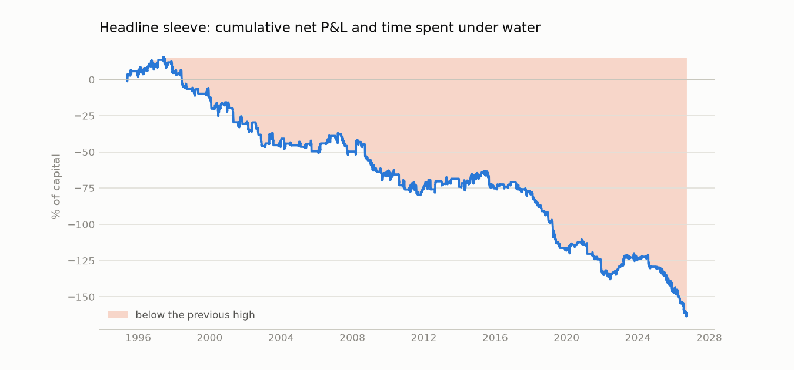
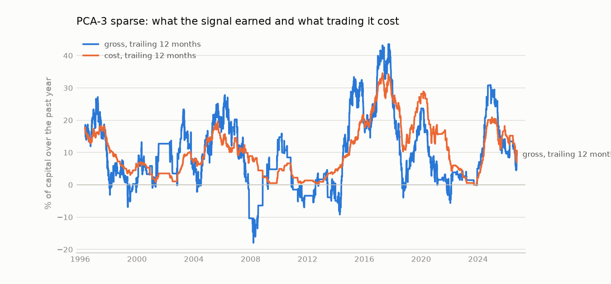
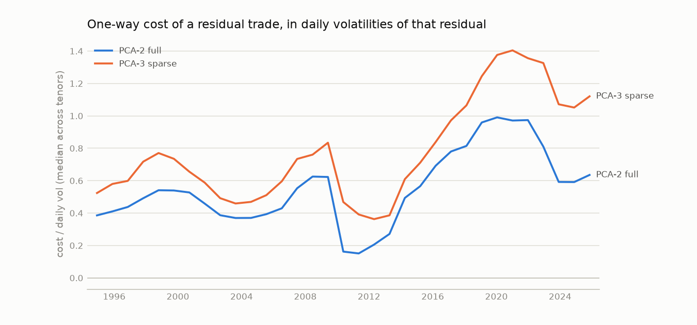

# Sleeve 1, period by period

Sample ending 2026-09-25. P&L in % of capital at the 10% volatility target, out of sample and additive. Contributions split the sleeve's net P&L across its instruments; `rescaling` is the cost of changing the sleeve's overall weight, which no instrument owns.

## Gross, cost and net by year

|   year |   Headline (PCA-2 + credit): gross |   Headline (PCA-2 + credit): cost |   Headline (PCA-2 + credit): net |   PCA-3 sparse: gross |   PCA-3 sparse: cost |   PCA-3 sparse: net |   Pairwise adaptive, neural: gross |   Pairwise adaptive, neural: cost |   Pairwise adaptive, neural: net |
|-------:|-----------------------------------:|----------------------------------:|---------------------------------:|----------------------:|---------------------:|--------------------:|-----------------------------------:|----------------------------------:|---------------------------------:|
| 1995.0 |                                7.0 |                               5.3 |                              1.7 |                  12.2 |                 11.6 |                 0.6 |                                2.6 |                               3.6 |                             -1.1 |
| 1996.0 |                               26.3 |                              18.5 |                              7.8 |                  24.6 |                 17.7 |                 6.9 |                                0.0 |                               0.0 |                              0.0 |
| 1997.0 |                                6.2 |                              11.2 |                             -4.9 |                   4.5 |                 12.2 |                -7.6 |                                0.0 |                               0.0 |                              0.0 |
| 1998.0 |                               -1.1 |                              10.5 |                            -11.6 |                   1.4 |                  6.2 |                -4.8 |                               20.4 |                              23.1 |                             -2.7 |
| 1999.0 |                                1.9 |                               7.2 |                             -5.3 |                   2.2 |                  6.1 |                -3.9 |                               28.2 |                              11.6 |                             16.6 |
| 2000.0 |                               -0.1 |                               7.0 |                             -7.1 |                   5.9 |                  3.2 |                 2.6 |                               18.7 |                               5.6 |                             13.1 |
| 2001.0 |                               -5.6 |                               5.5 |                            -11.1 |                  12.7 |                  3.5 |                 9.2 |                               20.3 |                               7.0 |                             13.3 |
| 2002.0 |                              -10.3 |                               5.2 |                            -15.5 |                  11.3 |                  3.9 |                 7.5 |                               -9.0 |                               3.5 |                            -12.5 |
| 2003.0 |                               10.5 |                               6.6 |                              3.9 |                   4.8 |                  7.4 |                -2.6 |                               11.4 |                               0.6 |                             10.8 |
| 2004.0 |                                1.8 |                               4.1 |                             -2.3 |                  14.1 |                 15.0 |                -0.9 |                                1.3 |                               2.6 |                             -1.3 |
| 2005.0 |                                1.5 |                               6.6 |                             -5.1 |                  19.0 |                 13.0 |                 6.0 |                              -11.7 |                               1.5 |                            -13.2 |
| 2006.0 |                               22.0 |                              11.4 |                             10.6 |                  20.2 |                 14.5 |                 5.7 |                                1.4 |                               1.6 |                             -0.2 |
| 2007.0 |                                1.5 |                              12.3 |                            -10.8 |                 -10.4 |                  8.9 |               -19.3 |                              -12.2 |                               6.4 |                            -18.6 |
| 2008.0 |                               -0.1 |                               6.5 |                             -6.6 |                   2.6 |                  2.3 |                 0.3 |                               -4.5 |                               9.5 |                            -14.0 |
| 2009.0 |                               -4.0 |                               3.7 |                             -7.7 |                  14.3 |                  4.6 |                 9.7 |                                7.5 |                               7.1 |                              0.4 |
| 2010.0 |                               -6.9 |                               5.0 |                            -11.9 |                  -1.0 |                  2.6 |                -3.6 |                               -3.8 |                               6.5 |                            -10.4 |
| 2011.0 |                                4.9 |                               4.4 |                              0.5 |                  -3.4 |                  1.3 |                -4.7 |                               10.0 |                               2.5 |                              7.4 |
| 2012.0 |                                9.3 |                               4.4 |                              4.9 |                   1.7 |                  0.9 |                 0.7 |                               -1.0 |                               0.4 |                             -1.4 |
| 2013.0 |                                0.2 |                               3.8 |                             -3.5 |                  -5.0 |                  4.8 |                -9.8 |                                2.0 |                               1.4 |                              0.6 |
| 2014.0 |                               30.2 |                              20.8 |                              9.4 |                  26.4 |                 11.7 |                14.8 |                               -1.1 |                              10.7 |                            -11.8 |
| 2015.0 |                                1.5 |                              12.1 |                            -10.6 |                  19.1 |                 20.4 |                -1.4 |                               -4.1 |                               7.9 |                            -12.0 |
| 2016.0 |                               12.3 |                               8.0 |                              4.4 |                  36.7 |                 31.7 |                 5.0 |                                8.6 |                               4.5 |                              4.1 |
| 2017.0 |                               10.6 |                              18.8 |                             -8.2 |                  28.1 |                 27.2 |                 0.9 |                                2.2 |                               4.3 |                             -2.1 |
| 2018.0 |                               -0.9 |                              17.4 |                            -18.3 |                   3.2 |                 15.7 |               -12.5 |                                4.5 |                               5.6 |                             -1.1 |
| 2019.0 |                               -9.4 |                              11.2 |                            -20.6 |                  23.6 |                 28.2 |                -4.6 |                                5.8 |                              10.7 |                             -5.0 |
| 2020.0 |                               13.7 |                               9.8 |                              4.0 |                   4.4 |                 15.9 |               -11.5 |                               -5.2 |                               9.8 |                            -15.0 |
| 2021.0 |                              -12.0 |                               6.6 |                            -18.6 |                  -2.7 |                  9.1 |               -11.8 |                                1.1 |                               8.4 |                             -7.3 |
| 2022.0 |                               10.7 |                               7.3 |                              3.3 |                   2.7 |                  2.3 |                 0.4 |                               13.4 |                               7.4 |                              5.9 |
| 2023.0 |                               15.2 |                               9.3 |                              5.9 |                   5.0 |                  2.2 |                 2.8 |                                3.9 |                               2.6 |                              1.3 |
| 2024.0 |                               -0.5 |                               5.4 |                             -5.9 |                  29.4 |                 20.9 |                 8.4 |                                0.0 |                               0.0 |                              0.0 |
| 2025.0 |                                3.3 |                              19.8 |                            -16.6 |                  10.0 |                 15.2 |                -5.2 |                               -1.1 |                               4.5 |                             -5.7 |
| 2026.0 |                                8.0 |                              25.3 |                            -17.3 |                   8.5 |                  8.9 |                -0.4 |                                5.7 |                               9.1 |                             -3.4 |

## By era

| model                     | era       |   gross_sharpe |   net_sharpe |   gross_pct_per_year |   cost_pct_per_year |
|:--------------------------|:----------|---------------:|-------------:|---------------------:|--------------------:|
| Headline (PCA-2 + credit) | 1995-2004 |           0.42 |        -0.51 |                 3.68 |                8.13 |
| Headline (PCA-2 + credit) | 2005-2012 |           0.39 |        -0.36 |                 3.41 |                6.56 |
| Headline (PCA-2 + credit) | 2013-2019 |           0.84 |        -0.87 |                 6.16 |               12.70 |
| Headline (PCA-2 + credit) | 2020-2026 |           0.67 |        -0.77 |                 5.50 |               11.99 |
| PCA-3 sparse              | 1995-2004 |           1.04 |         0.08 |                 9.42 |                8.72 |
| PCA-3 sparse              | 2005-2012 |           0.68 |        -0.08 |                 5.20 |                5.82 |
| PCA-3 sparse              | 2013-2019 |           1.96 |        -0.12 |                18.24 |               19.28 |
| PCA-3 sparse              | 2020-2026 |           1.22 |        -0.37 |                 8.22 |               10.69 |
| PCA-2 full                | 1995-2004 |           0.42 |        -0.51 |                 3.68 |                8.13 |
| PCA-2 full                | 2005-2012 |           0.51 |        -0.24 |                 4.32 |                6.34 |
| PCA-2 full                | 2013-2019 |           0.60 |        -1.00 |                 4.91 |               13.28 |
| PCA-2 full                | 2020-2026 |           0.27 |        -1.04 |                 2.44 |               12.06 |
| Pairwise adaptive, neural | 1995-2004 |           1.07 |         0.42 |                 9.44 |                5.79 |
| Pairwise adaptive, neural | 2005-2012 |          -0.20 |        -0.67 |                -1.74 |                4.30 |
| Pairwise adaptive, neural | 2013-2019 |           0.43 |        -0.63 |                 2.49 |                6.23 |
| Pairwise adaptive, neural | 2020-2026 |           0.41 |        -0.55 |                 2.54 |                6.01 |

## Where the headline's cost comes from

Cost per year in % of capital: trading the curve residuals, trading the credit pairs, and re-trading every position when the sleeve's volatility scaling changes its weight.

|   year |   curve_residuals |   credit_pairs |   rescaling |   total |
|-------:|------------------:|---------------:|------------:|--------:|
| 1995.0 |               3.4 |            0.0 |         1.9 |     5.3 |
| 1996.0 |              17.0 |            0.0 |         1.5 |    18.5 |
| 1997.0 |               9.5 |            0.0 |         1.7 |    11.2 |
| 1998.0 |               9.2 |            0.0 |         1.3 |    10.5 |
| 1999.0 |               6.7 |            0.0 |         0.5 |     7.2 |
| 2000.0 |               6.2 |            0.0 |         0.8 |     7.0 |
| 2001.0 |               5.3 |            0.0 |         0.2 |     5.5 |
| 2002.0 |               5.2 |            0.0 |         0.0 |     5.2 |
| 2003.0 |               6.0 |            0.0 |         0.5 |     6.6 |
| 2004.0 |               3.5 |            0.0 |         0.6 |     4.1 |
| 2005.0 |               6.6 |            0.0 |         0.0 |     6.6 |
| 2006.0 |              11.0 |            0.0 |         0.4 |    11.4 |
| 2007.0 |               9.0 |            1.5 |         1.8 |    12.3 |
| 2008.0 |               3.9 |            2.3 |         0.3 |     6.5 |
| 2009.0 |               0.9 |            2.7 |         0.1 |     3.7 |
| 2010.0 |               2.9 |            2.0 |         0.2 |     5.0 |
| 2011.0 |               4.1 |            0.0 |         0.3 |     4.4 |
| 2012.0 |               4.3 |            0.0 |         0.1 |     4.4 |
| 2013.0 |               3.8 |            0.0 |         0.0 |     3.8 |
| 2014.0 |              16.5 |            2.1 |         2.3 |    20.8 |
| 2015.0 |               9.2 |            2.5 |         0.4 |    12.1 |
| 2016.0 |               7.2 |            0.8 |         0.0 |     8.0 |
| 2017.0 |              18.8 |            0.0 |         0.0 |    18.8 |
| 2018.0 |              12.0 |            5.4 |         0.0 |    17.4 |
| 2019.0 |               6.5 |            3.7 |         0.9 |    11.2 |
| 2020.0 |               8.6 |            1.0 |         0.1 |     9.8 |
| 2021.0 |               6.6 |            0.0 |         0.0 |     6.6 |
| 2022.0 |               0.4 |            6.9 |         0.0 |     7.3 |
| 2023.0 |               6.6 |            2.3 |         0.4 |     9.3 |
| 2024.0 |               5.3 |            0.0 |         0.1 |     5.4 |
| 2025.0 |              16.1 |            2.9 |         0.8 |    19.8 |
| 2026.0 |              17.5 |            6.1 |         1.7 |    25.3 |

## Why cost moves: the cost of a trade relative to the residual's volatility

Median across tenors of the one-way cost of a residual divided by its daily volatility, fitted on each fold's training window, next to the average 2-year yield and the 2-year's daily volatility in bp over that window.

| test_start   |   pca2 |   pca3_sparse |   train_avg_2y_yield |   train_2y_daily_vol_bp |
|:-------------|-------:|--------------:|---------------------:|------------------------:|
| 1994-12-02   |   0.39 |          0.52 |               580.79 |                    6.03 |
| 1995-11-21   |   0.41 |          0.58 |               545.43 |                    6.29 |
| 1996-11-07   |   0.44 |          0.60 |               532.62 |                    6.59 |
| 1997-10-27   |   0.49 |          0.72 |               557.30 |                    6.12 |
| 1998-10-14   |   0.54 |          0.77 |               584.21 |                    6.10 |
| 1999-10-01   |   0.54 |          0.74 |               571.22 |                    6.01 |
| 2000-09-20   |   0.53 |          0.66 |               570.47 |                    5.62 |
| 2001-09-07   |   0.46 |          0.59 |               547.99 |                    5.54 |
| 2002-08-28   |   0.39 |          0.49 |               487.01 |                    6.35 |
| 2003-08-15   |   0.37 |          0.46 |               412.49 |                    6.55 |
| 2004-08-03   |   0.37 |          0.47 |               351.24 |                    6.66 |
| 2005-07-21   |   0.39 |          0.51 |               288.70 |                    6.63 |
| 2006-07-11   |   0.43 |          0.60 |               285.82 |                    6.21 |
| 2007-06-28   |   0.55 |          0.73 |               322.97 |                    5.26 |
| 2008-06-16   |   0.63 |          0.76 |               351.74 |                    6.28 |
| 2009-06-03   |   0.62 |          0.83 |               340.33 |                    6.88 |
| 2010-05-21   |   0.16 |          0.47 |               295.59 |                    6.91 |
| 2011-05-10   |   0.15 |          0.39 |               216.99 |                    6.86 |
| 2012-04-26   |   0.21 |          0.36 |               127.09 |                    6.65 |
| 2013-04-15   |   0.27 |          0.39 |                70.45 |                    4.95 |
| 2014-04-02   |   0.49 |          0.61 |                48.40 |                    3.01 |
| 2015-03-20   |   0.57 |          0.71 |                39.49 |                    2.43 |
| 2016-03-08   |   0.69 |          0.84 |                42.08 |                    2.29 |
| 2017-02-23   |   0.78 |          0.97 |                53.92 |                    2.51 |
| 2018-02-12   |   0.81 |          1.06 |                78.79 |                    2.68 |
| 2019-01-30   |   0.96 |          1.24 |               123.90 |                    2.86 |
| 2020-01-17   |   0.99 |          1.38 |               151.84 |                    3.13 |
| 2021-01-05   |   0.97 |          1.40 |               144.02 |                    3.17 |
| 2021-12-23   |   0.97 |          1.36 |               131.30 |                    3.00 |
| 2022-12-12   |   0.81 |          1.33 |               158.54 |                    4.53 |
| 2023-11-29   |   0.59 |          1.07 |               198.73 |                    6.06 |
| 2024-11-18   |   0.59 |          1.05 |               248.85 |                    6.44 |
| 2025-11-06   |   0.64 |          1.12 |               320.55 |                    6.66 |

## The worst and best 126-bar stretches

Non-overlapping six-month windows ranked by net P&L. Market context: change in the 10-year yield and the 2s10s slope over the window, in bp, and the average MOVE.

| model                     | kind   | start      | end        |   net_pct |   gross_pct |   cost_pct | main_contributors                          |   chg_10y_bp |   chg_2s10s_bp |   avg_move |
|:--------------------------|:-------|:-----------|:-----------|----------:|------------:|-----------:|:-------------------------------------------|-------------:|---------------:|-----------:|
| Headline (PCA-2 + credit) | worst  | 2018-12-11 | 2019-06-04 |    -21.16 |      -10.99 |      10.17 | pca2_ust_7y (-5.4), pca2_ust_2y (-5.3)     |       -74.94 |          13.13 |      53.25 |
| Headline (PCA-2 + credit) | worst  | 2008-09-09 | 2009-03-03 |    -18.11 |      -15.76 |       2.34 | hy_ig_oas (-9.6), pca2_ust_10y (-3.6)      |       -68.97 |          59.86 |     183.50 |
| Headline (PCA-2 + credit) | worst  | 2026-03-23 | 2026-09-15 |    -17.54 |       -2.40 |      15.14 | pca2_ust_3y (-6.7), pca2_ust_10y (-5.4)    |        65.99 |         -15.10 |      75.24 |
| Headline (PCA-2 + credit) | worst  | 2002-06-10 | 2002-12-02 |    -16.48 |      -13.40 |       3.07 | pca2_ust_30y (-6.9), pca2_ust_10y (-4.3)   |       -79.77 |          23.95 |     131.72 |
| Headline (PCA-2 + credit) | worst  | 2007-04-06 | 2007-09-28 |    -14.09 |       -6.84 |       7.26 | pca2_ust_10y (-5.9), pca2_ust_30y (-3.7)   |       -16.20 |          58.87 |      80.93 |
| Headline (PCA-2 + credit) | best   | 2022-10-17 | 2023-04-10 |     12.71 |       18.09 |       5.38 | cdx_cash_basis (+6.6), pca2_ust_7y (+1.8)  |       -59.36 |         -15.80 |     128.82 |
| Headline (PCA-2 + credit) | best   | 2011-10-28 | 2012-04-20 |     10.60 |       12.06 |       1.46 | pca2_ust_2y (+5.9), pca2_ust_10y (+4.7)    |       -35.38 |         -32.88 |      87.00 |
| Headline (PCA-2 + credit) | best   | 1996-04-04 | 1996-09-26 |      9.26 |       16.61 |       7.36 | pca2_ust_10y (+4.2), pca2_ust_2y (+3.7)    |        31.60 |           9.20 |     119.62 |
| Headline (PCA-2 + credit) | best   | 2006-03-15 | 2006-09-06 |      9.22 |       15.13 |       5.90 | pca2_ust_2y (+4.8), pca2_ust_30y (+2.5)    |         6.82 |          -6.47 |      64.93 |
| Headline (PCA-2 + credit) | best   | 2003-01-10 | 2003-07-04 |      9.18 |       12.34 |       3.16 | pca2_ust_30y (+7.5), pca2_ust_5y (+2.0)    |       -48.46 |          -2.81 |     106.10 |
| PCA-3 sparse              | worst  | 2007-06-18 | 2007-12-10 |    -20.99 |      -15.00 |       5.99 | pca3s_ust_2y (-5.2), pca3s_ust_5y (-5.1)   |       -97.68 |          85.00 |     100.03 |
| PCA-3 sparse              | worst  | 2020-11-04 | 2021-04-28 |    -14.63 |       -3.68 |      10.95 | pca3s_ust_2y (-3.2), pca3s_ust_3y (-3.2)   |        84.65 |          82.71 |      52.93 |
| PCA-3 sparse              | worst  | 2017-09-19 | 2018-03-13 |    -11.90 |       -4.63 |       7.27 | pca3s_ust_5y (-3.7), pca3s_ust_2y (-3.7)   |        59.80 |         -25.48 |      52.88 |
| PCA-3 sparse              | worst  | 2013-10-25 | 2014-04-18 |    -11.78 |       -8.34 |       3.44 | pca3s_ust_5y (-4.6), pca3s_ust_3y (-4.5)   |        21.27 |          11.64 |      63.67 |
| PCA-3 sparse              | worst  | 1998-11-18 | 1999-05-12 |    -11.25 |       -9.31 |       1.94 | pca3s_ust_30y (-2.8), pca3s_ust_5y (-2.8)  |        72.60 |          16.70 |      94.74 |
| PCA-3 sparse              | best   | 2002-10-31 | 2003-04-24 |     16.02 |       23.53 |       7.52 | pca3s_ust_5y (+4.2), pca3s_ust_10y (+4.2)  |         2.64 |           7.11 |     116.56 |
| PCA-3 sparse              | best   | 2014-04-21 | 2014-10-13 |     13.69 |       19.19 |       5.51 | pca3s_ust_5y (+3.8), pca3s_ust_3y (+3.8)   |       -43.47 |         -46.74 |      58.59 |
| PCA-3 sparse              | best   | 2001-05-03 | 2001-10-26 |     10.34 |       13.26 |       2.92 | pca3s_ust_10y (+2.6), pca3s_ust_30y (+2.6) |       -67.60 |          91.80 |     102.39 |
| PCA-3 sparse              | best   | 2024-05-28 | 2024-11-19 |      9.85 |       21.06 |      11.20 | pca3s_ust_3y (+3.3), pca3s_ust_5y (+3.3)   |       -15.38 |          54.23 |     105.58 |
| PCA-3 sparse              | best   | 2005-11-24 | 2006-05-19 |      9.69 |       16.55 |       6.86 | pca3s_ust_30y (+2.5), pca3s_ust_5y (+2.5)  |        58.84 |          -2.13 |      67.35 |

## The worst and best days

Context is the same day's change in the 10-year yield and 2s10s, in bp, and MOVE at the previous close.

| model                     | kind   | date       |   net_pct | main_contributor      |   chg_10y_bp |   chg_2s10s_bp |   move_prev_close |
|:--------------------------|:-------|:-----------|----------:|:----------------------|-------------:|---------------:|------------------:|
| Headline (PCA-2 + credit) | worst  | 2021-02-25 |     -6.91 | pca2_ust_5y (-6.91)   |        14.43 |           9.53 |             61.92 |
| Headline (PCA-2 + credit) | worst  | 2008-09-15 |     -6.01 | hy_ig_oas (-5.77)     |       -33.19 |          16.48 |            125.40 |
| Headline (PCA-2 + credit) | worst  | 2013-12-20 |     -5.07 | pca2_ust_5y (-2.57)   |        -4.05 |          -5.23 |             67.74 |
| Headline (PCA-2 + credit) | worst  | 2012-05-17 |     -4.87 | pca2_ust_30y (-2.49)  |        -6.32 |          -7.13 |             67.00 |
| Headline (PCA-2 + credit) | worst  | 2024-08-02 |     -4.39 | pca2_ust_30y (-3.92)  |       -18.56 |           8.28 |            101.82 |
| Headline (PCA-2 + credit) | worst  | 2019-03-27 |     -4.01 | pca2_ust_5y (-1.74)   |        -5.65 |           0.97 |             56.51 |
| Headline (PCA-2 + credit) | worst  | 2000-06-26 |     -3.80 | pca2_ust_5y (-1.54)   |        -8.30 |          -3.00 |            100.69 |
| Headline (PCA-2 + credit) | worst  | 2003-07-21 |     -3.69 | pca2_ust_30y (-1.56)  |        21.16 |           7.92 |            104.92 |
| Headline (PCA-2 + credit) | best   | 2008-03-14 |      4.81 | pca2_ust_30y (+2.42)  |        -5.82 |           8.92 |            162.70 |
| Headline (PCA-2 + credit) | best   | 2003-12-24 |      3.96 | pca2_ust_5y (+2.03)   |        -7.59 |          -6.09 |            115.28 |
| Headline (PCA-2 + credit) | best   | 2001-09-13 |      3.61 | pca2_ust_2y (+3.61)   |       -18.60 |          34.70 |            105.64 |
| Headline (PCA-2 + credit) | best   | 2007-03-09 |      3.61 | pca2_ust_10y (+1.34)  |         7.46 |          -3.34 |             69.80 |
| Headline (PCA-2 + credit) | best   | 2006-03-15 |      3.19 | pca2_ust_2y (+1.64)   |         3.42 |          -0.80 |             64.40 |
| Headline (PCA-2 + credit) | best   | 2014-04-04 |      3.17 | pca2_ust_7y (+1.23)   |        -7.65 |          -3.32 |             65.20 |
| Headline (PCA-2 + credit) | best   | 2026-01-15 |      3.14 | hyg_cdx (+2.63)       |         3.74 |          -1.70 |             58.11 |
| Headline (PCA-2 + credit) | best   | 2020-03-13 |      3.11 | pca2_ust_10y (+1.82)  |        15.61 |          14.68 |            152.62 |
| PCA-3 sparse              | worst  | 2007-11-21 |     -7.26 | pca3s_ust_5y (-1.81)  |        -8.94 |          11.15 |            109.20 |
| PCA-3 sparse              | worst  | 2021-02-25 |     -7.03 | pca3s_ust_2y (-1.81)  |        14.43 |           9.53 |             61.92 |
| PCA-3 sparse              | worst  | 2020-03-10 |     -4.99 | pca3s_ust_2y (-1.82)  |        26.23 |          10.91 |            163.70 |
| PCA-3 sparse              | worst  | 2007-07-26 |     -4.27 | pca3s_ust_5y (-1.06)  |       -11.29 |           5.56 |             78.40 |
| PCA-3 sparse              | worst  | 2007-07-10 |     -4.09 | pca3s_ust_30y (-1.02) |       -11.70 |           0.08 |             74.40 |
| PCA-3 sparse              | worst  | 2010-05-14 |     -3.99 | pca3s_ust_30y (-1.00) |        -7.27 |          -3.17 |             89.50 |
| PCA-3 sparse              | worst  | 2003-08-07 |     -3.97 | pca3s_ust_2y (-0.99)  |        -5.06 |          -0.24 |            144.38 |
| PCA-3 sparse              | worst  | 2014-03-19 |     -3.63 | pca3s_ust_2y (-1.21)  |        10.03 |           2.74 |             59.21 |
| PCA-3 sparse              | best   | 2002-11-06 |      6.80 | pca3s_ust_5y (+1.70)  |        -3.66 |          -5.23 |            136.86 |
| PCA-3 sparse              | best   | 1999-05-13 |      5.88 | pca3s_ust_5y (+1.47)  |       -15.80 |          -9.80 |             94.26 |
| PCA-3 sparse              | best   | 2006-02-09 |      4.98 | pca3s_ust_2y (+1.25)  |        -4.41 |          -6.96 |             70.00 |
| PCA-3 sparse              | best   | 2000-02-04 |      4.93 | pca3s_ust_5y (+1.23)  |         6.00 |          -3.50 |            119.13 |
| PCA-3 sparse              | best   | 2009-11-25 |      3.58 | pca3s_ust_5y (+0.89)  |        -3.32 |          -4.90 |             83.70 |
| PCA-3 sparse              | best   | 1998-05-14 |      3.57 | pca3s_ust_10y (+0.89) |         1.60 |          -1.80 |             75.65 |
| PCA-3 sparse              | best   | 2003-05-08 |      3.57 | pca3s_ust_2y (+0.92)  |         0.57 |          -4.21 |             86.37 |
| PCA-3 sparse              | best   | 2009-12-30 |      3.32 | pca3s_ust_5y (+0.84)  |        -1.16 |          -1.16 |            108.90 |

## By rates-volatility regime

MOVE at the previous close, split into terciles over the whole sample.

| model                     | regime    | move_range   |   gross_pct_per_year |   cost_pct_per_year |   net_sharpe |   gross_sharpe |
|:--------------------------|:----------|:-------------|---------------------:|--------------------:|-------------:|---------------:|
| Headline (PCA-2 + credit) | low MOVE  | 37-75        |                 6.73 |               11.82 |        -0.63 |           0.85 |
| Headline (PCA-2 + credit) | mid MOVE  | 75-102       |                 2.56 |                9.84 |        -0.80 |           0.28 |
| Headline (PCA-2 + credit) | high MOVE | 102-265      |                 4.37 |                7.07 |        -0.34 |           0.54 |
| PCA-3 sparse              | low MOVE  | 37-75        |                11.22 |               13.84 |        -0.31 |           1.33 |
| PCA-3 sparse              | mid MOVE  | 75-102       |                11.04 |               12.32 |        -0.15 |           1.25 |
| PCA-3 sparse              | high MOVE | 102-265      |                 7.90 |                6.12 |         0.24 |           1.04 |
| PCA-2 full                | low MOVE  | 37-75        |                 5.71 |               13.09 |        -0.82 |           0.65 |
| PCA-2 full                | mid MOVE  | 75-102       |                 2.23 |                9.91 |        -0.82 |           0.24 |
| PCA-2 full                | high MOVE | 102-265      |                 3.60 |                6.00 |        -0.31 |           0.47 |
| Pairwise adaptive, neural | low MOVE  | 37-75        |                 1.64 |                4.95 |        -0.53 |           0.27 |
| Pairwise adaptive, neural | mid MOVE  | 75-102       |                 6.65 |                6.75 |        -0.01 |           0.73 |
| Pairwise adaptive, neural | high MOVE | 102-265      |                 2.37 |                4.96 |        -0.33 |           0.31 |
