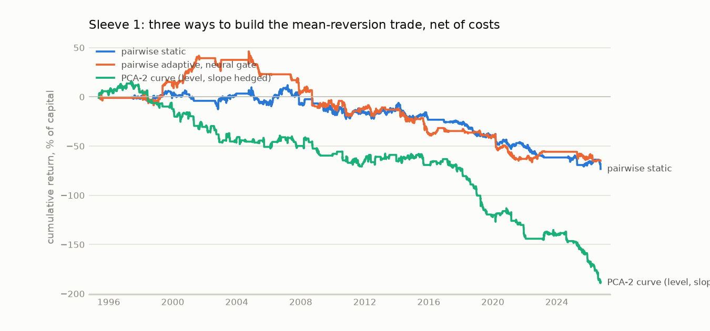
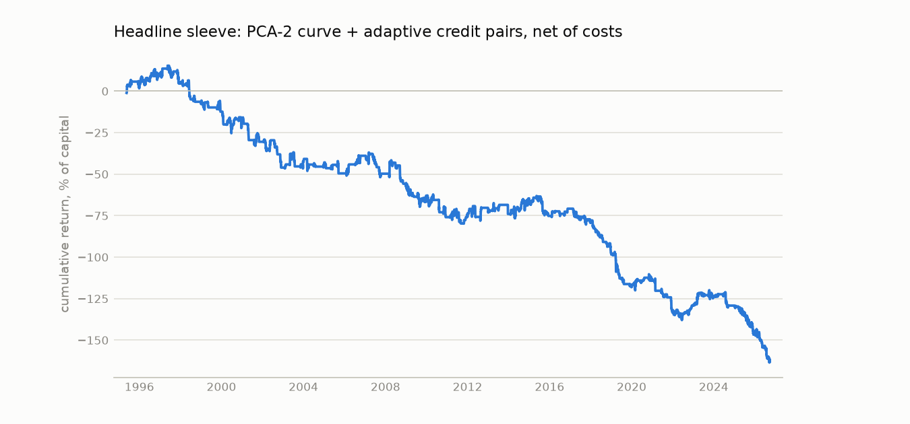

# Statistical arbitrage on the Treasury curve and credit spreads

One sleeve, mean reversion, built three ways. Sample ends 2026-09-25. All results are out of sample from walk-forward folds (1260-bar training, 252-bar test, 10-bar purge, 5-bar embargo), net of costs, at a 10% volatility target.

- **Pairwise static.** Engle-Granger and Johansen screen, OLS hedge ratio, OU bands.
- **Pairwise adaptive.** Kalman hedge ratio, health monitor, and a regime gate (HMM or neural classifier).
- **PCA residual.** Hedge each tenor against the first two or three principal components of the curve and trade the residual's s-score (Avellaneda-Lee).

Headline model, named in advance: **PCA-2 curve + adaptive credit pairs**.

## Model comparison

| model                               | start      |   ann_return |   ann_vol |   sharpe |   max_dd |   deflated_sharpe |   gross_sharpe |   cost_drag |   turnover |   sharpe_2x_cost |   sharpe_3x_cost |   in_market |
|:------------------------------------|:-----------|-------------:|----------:|---------:|---------:|------------------:|---------------:|------------:|-----------:|-----------------:|-----------------:|------------:|
| pairwise static                     | 1997-06-13 |        -0.02 |      0.07 |    -0.34 |    -0.85 |              0.00 |           0.14 |        0.03 |       0.87 |            -0.80 |            -1.22 |        0.64 |
| pairwise adaptive, HMM gate         | 1995-05-19 |        -0.01 |      0.08 |    -0.16 |    -1.04 |              0.01 |           0.41 |        0.04 |       1.12 |            -0.71 |            -1.20 |        0.44 |
| pairwise adaptive, neural gate      | 1995-05-19 |        -0.02 |      0.08 |    -0.26 |    -1.13 |              0.00 |           0.46 |        0.06 |       1.42 |            -0.93 |            -1.50 |        0.40 |
| pairwise adaptive, rates only       | 1995-05-19 |        -0.02 |      0.07 |    -0.23 |    -1.02 |              0.00 |           0.36 |        0.04 |       1.15 |            -0.79 |            -1.26 |        0.33 |
| PCA-2 curve (level, slope hedged)   | 1995-05-19 |        -0.06 |      0.09 |    -0.67 |    -2.04 |              0.00 |           0.45 |        0.10 |       4.37 |            -1.65 |            -2.39 |        0.37 |
| PCA-3 curve (+ curvature hedged)    | 1995-05-19 |        -0.02 |      0.07 |    -0.32 |    -0.98 |              0.00 |           0.92 |        0.09 |       7.43 |            -1.45 |            -2.28 |        0.38 |
| PCA-2 curve + adaptive credit pairs | 1995-05-19 |        -0.05 |      0.08 |    -0.60 |    -1.79 |              0.00 |           0.55 |        0.10 |       4.42 |            -1.64 |            -2.46 |        0.44 |
| PCA-2 sparse (3 legs per residual)  | 1995-05-19 |        -0.03 |      0.09 |    -0.35 |    -1.21 |              0.00 |           0.94 |        0.11 |       5.59 |            -1.54 |            -2.40 |        0.35 |
| PCA-3 sparse (4 legs per residual)  | 1995-05-19 |        -0.01 |      0.08 |    -0.09 |    -0.54 |              0.02 |           1.21 |        0.11 |       8.69 |            -1.28 |            -2.13 |        0.34 |
| PCA-2 curve, Leung-Li levels        | 1996-05-06 |        -0.04 |      0.08 |    -0.51 |    -1.35 |              0.00 |          -0.05 |        0.04 |       0.88 |            -0.93 |            -1.28 |        0.41 |
| PCA-3 curve, Leung-Li levels        | 1996-05-06 |        -0.02 |      0.07 |    -0.31 |    -0.76 |              0.00 |           0.26 |        0.04 |       1.06 |            -0.79 |            -1.15 |        0.45 |

## How much cost each model can bear

Net Sharpe at multiples of the cost table. 1x is 0.25 bp per Treasury leg, one way; 0.4x is 0.1 bp. Bands were optimised at 1x, so the lower-cost columns understate what re-optimised bands would do.

| model                               |    0x |   0.2x |   0.4x |   0.6x |   0.8x |    1x |
|:------------------------------------|------:|-------:|-------:|-------:|-------:|------:|
| pairwise static                     |  0.14 |   0.04 |  -0.05 |  -0.15 |  -0.24 | -0.34 |
| pairwise adaptive, HMM gate         |  0.41 |   0.30 |   0.18 |   0.07 |  -0.05 | -0.16 |
| pairwise adaptive, neural gate      |  0.46 |   0.32 |   0.17 |   0.03 |  -0.11 | -0.26 |
| pairwise adaptive, rates only       |  0.36 |   0.25 |   0.13 |   0.01 |  -0.11 | -0.23 |
| PCA-2 curve (level, slope hedged)   |  0.45 |   0.22 |  -0.00 |  -0.23 |  -0.45 | -0.67 |
| PCA-3 curve (+ curvature hedged)    |  0.92 |   0.68 |   0.43 |   0.18 |  -0.07 | -0.32 |
| PCA-2 curve + adaptive credit pairs |  0.55 |   0.32 |   0.09 |  -0.14 |  -0.37 | -0.60 |
| PCA-2 sparse (3 legs per residual)  |  0.94 |   0.69 |   0.43 |   0.17 |  -0.09 | -0.35 |
| PCA-3 sparse (4 legs per residual)  |  1.21 |   0.96 |   0.71 |   0.44 |   0.18 | -0.09 |
| PCA-2 curve, Leung-Li levels        | -0.05 |  -0.14 |  -0.24 |  -0.33 |  -0.42 | -0.51 |
| PCA-3 curve, Leung-Li levels        |  0.26 |   0.14 |   0.03 |  -0.09 |  -0.20 | -0.31 |

## Alpha and beta

Daily P&L on unit-volatility market factors, Newey-West t-statistics. `rates` uses duration and the 2s10s steepener over the full sample; `macro` adds credit, crude and equity from 2005.

| factors   | series                              | start      |   ann_return |   alpha |   alpha_t |   appraisal_ratio |   r_squared |   t_duration |   t_steepener |
|:----------|:------------------------------------|:-----------|-------------:|--------:|----------:|------------------:|------------:|-------------:|--------------:|
| rates     | pairwise static                     | 1997-06-13 |       -0.024 |  -0.024 |    -1.964 |            -0.337 |       0.001 |       -0.989 |         0.094 |
| rates     | pairwise adaptive, HMM gate         | 1995-05-19 |       -0.012 |  -0.012 |    -0.913 |            -0.159 |       0.003 |       -1.345 |         0.646 |
| rates     | pairwise adaptive, neural gate      | 1995-05-19 |       -0.020 |  -0.020 |    -1.499 |            -0.256 |       0.002 |       -1.040 |         0.431 |
| rates     | pairwise adaptive, rates only       | 1995-05-19 |       -0.017 |  -0.017 |    -1.347 |            -0.227 |       0.001 |       -0.805 |         0.590 |
| rates     | PCA-2 curve (level, slope hedged)   | 1995-05-19 |       -0.058 |  -0.058 |    -3.810 |            -0.667 |       0.001 |       -1.246 |        -0.525 |
| rates     | PCA-3 curve (+ curvature hedged)    | 1995-05-19 |       -0.023 |  -0.023 |    -2.117 |            -0.321 |       0.000 |        0.183 |        -0.546 |
| rates     | PCA-2 curve + adaptive credit pairs | 1995-05-19 |       -0.050 |  -0.050 |    -3.423 |            -0.597 |       0.003 |       -2.136 |        -0.346 |
| rates     | PCA-2 sparse (3 legs per residual)  | 1995-05-19 |       -0.030 |  -0.030 |    -2.176 |            -0.350 |       0.001 |        1.551 |        -0.047 |
| rates     | PCA-3 sparse (4 legs per residual)  | 1995-05-19 |       -0.007 |  -0.007 |    -0.578 |            -0.087 |       0.000 |        0.631 |        -0.629 |
| rates     | PCA-2 curve, Leung-Li levels        | 1996-05-06 |       -0.039 |  -0.039 |    -3.067 |            -0.512 |       0.009 |       -3.372 |        -4.688 |
| rates     | PCA-3 curve, Leung-Li levels        | 1996-05-06 |       -0.020 |  -0.020 |    -1.949 |            -0.307 |       0.001 |       -1.994 |        -2.510 |
| macro     | pairwise static                     | 2005-01-04 |       -0.034 |  -0.038 |    -2.667 |            -0.545 |       0.014 |        0.310 |         0.024 |
| macro     | pairwise adaptive, HMM gate         | 2005-01-04 |       -0.039 |  -0.044 |    -2.855 |            -0.617 |       0.019 |       -0.792 |         0.206 |
| macro     | pairwise adaptive, neural gate      | 2005-01-04 |       -0.045 |  -0.048 |    -3.136 |            -0.665 |       0.016 |       -0.472 |        -0.050 |
| macro     | pairwise adaptive, rates only       | 2005-01-04 |       -0.040 |  -0.042 |    -3.050 |            -0.635 |       0.008 |       -0.163 |         0.043 |
| macro     | PCA-2 curve (level, slope hedged)   | 2005-01-04 |       -0.064 |  -0.068 |    -3.778 |            -0.790 |       0.008 |       -1.978 |        -1.825 |
| macro     | PCA-3 curve (+ curvature hedged)    | 2005-01-04 |       -0.037 |  -0.037 |    -3.021 |            -0.577 |       0.001 |        0.096 |        -0.056 |
| macro     | PCA-2 curve + adaptive credit pairs | 2005-01-04 |       -0.053 |  -0.058 |    -3.437 |            -0.713 |       0.020 |       -2.491 |        -1.602 |
| macro     | PCA-2 sparse (3 legs per residual)  | 2005-01-04 |       -0.043 |  -0.043 |    -2.545 |            -0.517 |       0.001 |        1.027 |        -0.345 |
| macro     | PCA-3 sparse (4 legs per residual)  | 2005-01-04 |       -0.014 |  -0.014 |    -0.955 |            -0.178 |       0.001 |        1.027 |         0.011 |
| macro     | PCA-2 curve, Leung-Li levels        | 2005-01-04 |       -0.053 |  -0.058 |    -3.406 |            -0.697 |       0.018 |       -3.401 |        -4.705 |
| macro     | PCA-3 curve, Leung-Li levels        | 2005-01-04 |       -0.029 |  -0.031 |    -2.609 |            -0.466 |       0.005 |       -3.357 |        -2.461 |

## Stress years

| model                               |   year |   return |   sharpe |   max_dd |
|:------------------------------------|-------:|---------:|---------:|---------:|
| pairwise static                     |   2008 |    -0.00 |    -0.04 |    -0.05 |
| pairwise static                     |   2020 |    -0.08 |    -0.87 |    -0.12 |
| pairwise static                     |   2022 |    -0.09 |    -1.18 |    -0.11 |
| pairwise adaptive, HMM gate         |   2008 |    -0.11 |    -0.97 |    -0.15 |
| pairwise adaptive, HMM gate         |   2020 |    -0.16 |    -1.90 |    -0.18 |
| pairwise adaptive, HMM gate         |   2022 |     0.06 |     0.90 |    -0.06 |
| pairwise adaptive, neural gate      |   2008 |    -0.14 |    -0.92 |    -0.20 |
| pairwise adaptive, neural gate      |   2020 |    -0.15 |    -1.69 |    -0.19 |
| pairwise adaptive, neural gate      |   2022 |     0.06 |     0.90 |    -0.07 |
| pairwise adaptive, rates only       |   2008 |    -0.08 |    -0.81 |    -0.14 |
| pairwise adaptive, rates only       |   2020 |    -0.17 |    -1.74 |    -0.21 |
| pairwise adaptive, rates only       |   2022 |     0.00 |   nan    |     0.00 |
| PCA-2 curve (level, slope hedged)   |   2008 |    -0.03 |    -0.34 |    -0.14 |
| PCA-2 curve (level, slope hedged)   |   2020 |     0.03 |     0.33 |    -0.07 |
| PCA-2 curve (level, slope hedged)   |   2022 |    -0.03 |    -1.37 |    -0.04 |
| PCA-3 curve (+ curvature hedged)    |   2008 |     0.00 |     0.05 |    -0.05 |
| PCA-3 curve (+ curvature hedged)    |   2020 |    -0.09 |    -1.86 |    -0.11 |
| PCA-3 curve (+ curvature hedged)    |   2022 |    -0.05 |    -1.80 |    -0.06 |
| PCA-2 curve + adaptive credit pairs |   2008 |    -0.07 |    -0.65 |    -0.16 |
| PCA-2 curve + adaptive credit pairs |   2020 |     0.04 |     0.48 |    -0.05 |
| PCA-2 curve + adaptive credit pairs |   2022 |     0.03 |     0.53 |    -0.06 |
| PCA-2 sparse (3 legs per residual)  |   2008 |     0.01 |     0.07 |    -0.11 |
| PCA-2 sparse (3 legs per residual)  |   2020 |    -0.22 |    -2.49 |    -0.22 |
| PCA-2 sparse (3 legs per residual)  |   2022 |     0.01 |     0.30 |    -0.02 |
| PCA-3 sparse (4 legs per residual)  |   2008 |     0.00 |     0.05 |    -0.05 |
| PCA-3 sparse (4 legs per residual)  |   2020 |    -0.11 |    -1.53 |    -0.13 |
| PCA-3 sparse (4 legs per residual)  |   2022 |     0.00 |     0.11 |    -0.03 |
| PCA-2 curve, Leung-Li levels        |   2008 |    -0.04 |    -0.51 |    -0.08 |
| PCA-2 curve, Leung-Li levels        |   2020 |    -0.05 |    -0.49 |    -0.12 |
| PCA-2 curve, Leung-Li levels        |   2022 |    -0.03 |    -1.36 |    -0.04 |
| PCA-3 curve, Leung-Li levels        |   2008 |     0.00 |   nan    |     0.00 |
| PCA-3 curve, Leung-Li levels        |   2020 |     0.02 |     0.35 |    -0.05 |
| PCA-3 curve, Leung-Li levels        |   2022 |    -0.03 |    -0.64 |    -0.04 |

## PCA residuals by tenor

`cost_over_daily_vol` is the one-way cost of the residual portfolio relative to its daily volatility.

| strategy      |   legs | start      |   sharpe_net |   sharpe_gross |   sharpe_net_2x |   in_market |   turnover_per_year |   cost_over_daily_vol |   variance_explained_by_factors |
|:--------------|-------:|:-----------|-------------:|---------------:|----------------:|------------:|--------------------:|----------------------:|--------------------------------:|
| pca2_ust_2y   |      6 | 1994-12-02 |        -0.17 |           0.24 |           -0.57 |        0.13 |                4.92 |                  0.42 |                            0.98 |
| pca2_ust_3y   |      6 | 2010-05-21 |        -0.37 |           0.82 |           -1.31 |        0.15 |                6.56 |                  0.70 |                            0.98 |
| pca2_ust_5y   |      6 | 1994-12-02 |        -0.32 |           0.05 |           -0.65 |        0.08 |                2.98 |                  0.55 |                            0.98 |
| pca2_ust_7y   |      6 | 2014-04-02 |        -0.53 |          -0.15 |           -0.85 |        0.09 |                2.25 |                  0.75 |                            0.98 |
| pca2_ust_10y  |      6 | 1994-12-02 |        -0.25 |           0.38 |           -0.82 |        0.12 |                4.62 |                  0.62 |                            0.98 |
| pca2_ust_30y  |      6 | 1994-12-02 |        -0.21 |           0.20 |           -0.59 |        0.10 |                4.19 |                  0.46 |                            0.98 |
| pca3_ust_2y   |      6 | 1994-12-02 |        -0.09 |           0.79 |           -0.92 |        0.25 |                8.11 |                  0.67 |                            0.99 |
| pca3_ust_3y   |      6 | 2010-05-21 |        -0.08 |           0.97 |           -1.08 |        0.23 |                7.98 |                  0.69 |                            0.99 |
| pca3_ust_5y   |      6 | 1994-12-02 |        -0.10 |           0.71 |           -0.83 |        0.21 |                6.90 |                  0.73 |                            0.99 |
| pca3_ust_7y   |      6 | 2014-04-02 |        -0.33 |           1.09 |           -1.37 |        0.10 |                5.11 |                  1.24 |                            0.99 |
| pca3_ust_10y  |      6 | 1994-12-02 |        -0.19 |           0.65 |           -0.93 |        0.20 |                6.87 |                  0.74 |                            0.99 |
| pca3_ust_30y  |      6 | 1994-12-02 |        -0.11 |           0.67 |           -0.82 |        0.20 |                6.68 |                  0.73 |                            0.99 |
| pca2s_ust_2y  |      3 | 1994-12-02 |         0.04 |           0.68 |           -0.59 |        0.18 |                6.23 |                  0.58 |                            0.98 |
| pca2s_ust_3y  |      3 | 2010-05-21 |        -0.04 |           0.70 |           -0.78 |        0.22 |                7.51 |                  0.59 |                            0.98 |
| pca2s_ust_5y  |      3 | 1994-12-02 |        -0.30 |           0.51 |           -1.00 |        0.16 |                5.83 |                  0.59 |                            0.98 |
| pca2s_ust_7y  |      3 | 2014-04-02 |        -0.35 |           0.78 |           -1.24 |        0.11 |                5.42 |                  1.18 |                            0.98 |
| pca2s_ust_10y |      3 | 1994-12-02 |        -0.13 |           0.54 |           -0.73 |        0.12 |                4.56 |                  0.64 |                            0.98 |
| pca2s_ust_30y |      3 | 1994-12-02 |        -0.13 |           0.54 |           -0.73 |        0.12 |                4.56 |                  0.64 |                            0.98 |
| pca3s_ust_2y  |      4 | 1994-12-02 |         0.04 |           1.14 |           -0.99 |        0.28 |               10.63 |                  0.72 |                            0.99 |
| pca3s_ust_3y  |      4 | 2010-05-21 |        -0.10 |           1.20 |           -1.27 |        0.23 |               10.17 |                  0.86 |                            0.99 |
| pca3s_ust_5y  |      4 | 1994-12-02 |         0.04 |           1.14 |           -1.00 |        0.28 |               10.69 |                  0.72 |                            0.99 |
| pca3s_ust_7y  |      4 | 2014-04-02 |        -0.10 |           1.15 |           -1.12 |        0.13 |                5.57 |                  1.28 |                            0.99 |
| pca3s_ust_10y |      4 | 1994-12-02 |         0.02 |           0.81 |           -0.74 |        0.20 |                6.62 |                  0.73 |                            0.99 |
| pca3s_ust_30y |      4 | 1994-12-02 |         0.02 |           0.81 |           -0.73 |        0.20 |                6.62 |                  0.73 |                            0.99 |

Rows named `pca2s` and `pca3s` are the sparse construction: the own tenor hedged with only its nearest two (or three) tenors, which is the fewest legs that can be neutral to two (or three) factors.

## Leung-Li levels on the PCA residuals

The same residuals and s-scores, with entry and exit set by the Leung-Li optimal stopping solution instead of the grid search. Levels are in sigmas from the mean; the take-profit sits past the mean. Inputs are the median half-life and cost on each training window.

| strategy     |   half_life_bars |   cost_in_sigma |   folds_traded |   entry_sigma |   take_profit_sigma_past_mean |   grid_entry |   grid_exit |   sharpe_net |   sharpe_gross |   in_market |   turnover_per_year |
|:-------------|-----------------:|----------------:|---------------:|--------------:|------------------------------:|-------------:|------------:|-------------:|---------------:|------------:|--------------------:|
| pca2_ust_2y  |             6.22 |            0.21 |           1.00 |          2.69 |                          2.84 |         2.00 |        0.25 |         0.02 |           0.14 |        0.10 |                0.79 |
| pca2_ust_3y  |             5.21 |            0.37 |           1.00 |          2.75 |                          2.88 |         2.50 |        0.25 |        -0.20 |           0.04 |        0.17 |                0.89 |
| pca2_ust_5y  |             5.51 |            0.26 |           1.00 |          2.72 |                          2.86 |         2.50 |        0.50 |        -0.18 |          -0.04 |        0.16 |                0.79 |
| pca2_ust_7y  |             6.28 |            0.33 |           1.00 |          2.71 |                          2.85 |         2.50 |        0.25 |        -0.73 |          -0.52 |        0.19 |                1.32 |
| pca2_ust_10y |             6.56 |            0.31 |           1.00 |          2.71 |                          2.85 |         2.50 |        0.25 |        -0.21 |           0.02 |        0.19 |                1.15 |
| pca2_ust_30y |             6.89 |            0.22 |           1.00 |          2.67 |                          2.82 |         2.50 |        0.00 |        -0.09 |           0.04 |        0.04 |                0.67 |
| pca3_ust_2y  |             4.61 |            0.35 |           1.00 |          2.77 |                          2.90 |         2.00 |        0.00 |        -0.28 |          -0.06 |        0.28 |                0.94 |
| pca3_ust_3y  |             4.74 |            0.37 |           1.00 |          2.78 |                          2.90 |         2.00 |        0.25 |        -0.19 |           0.04 |        0.23 |                0.65 |
| pca3_ust_5y  |             4.29 |            0.42 |           1.00 |          2.80 |                          2.92 |         2.00 |        0.00 |         0.02 |           0.29 |        0.30 |                1.18 |
| pca3_ust_7y  |             3.06 |            0.73 |           1.00 |          2.88 |                          2.97 |         2.50 |        0.25 |         0.01 |           0.50 |        0.46 |                1.55 |
| pca3_ust_10y |             4.92 |            0.42 |           1.00 |          2.76 |                          2.89 |         2.00 |        0.00 |        -0.33 |          -0.09 |        0.19 |                1.09 |
| pca3_ust_30y |             4.95 |            0.39 |           1.00 |          2.76 |                          2.89 |         2.00 |        0.00 |        -0.06 |           0.16 |        0.20 |                0.97 |

## Pairwise spreads

| strategy         | group   | variant      | start      |   sharpe_net |   sharpe_gross |   sharpe_net_2x |   sharpe_net_3x |   in_market |   turnover_per_year |
|:-----------------|:--------|:-------------|:-----------|-------------:|---------------:|----------------:|----------------:|------------:|--------------------:|
| ust_2s10s        | rates   | static       | 1994-12-02 |         0.06 |           0.07 |            0.06 |            0.05 |        0.03 |                0.06 |
| ust_2s10s        | rates   | adaptive_hmm | 1994-12-02 |         0.06 |           0.07 |            0.06 |            0.05 |        0.03 |                0.06 |
| ust_2s10s        | rates   | adaptive_nn  | 1994-12-02 |         0.11 |           0.11 |            0.10 |            0.09 |        0.03 |                0.18 |
| ust_5s30s        | rates   | static       | 1994-12-02 |        -0.10 |          -0.09 |           -0.11 |           -0.12 |        0.02 |                0.18 |
| ust_5s30s        | rates   | adaptive_hmm | 1994-12-02 |        -0.26 |          -0.25 |           -0.27 |           -0.28 |        0.01 |                0.06 |
| ust_5s30s        | rates   | adaptive_nn  | 1994-12-02 |        -0.26 |          -0.25 |           -0.27 |           -0.28 |        0.01 |                0.06 |
| ust_fly_2s5s10s  | rates   | static       | 1994-12-02 |         0.09 |           0.30 |           -0.12 |           -0.33 |        0.27 |                2.61 |
| ust_fly_2s5s10s  | rates   | adaptive_hmm | 1994-12-02 |         0.26 |           0.50 |            0.01 |           -0.24 |        0.12 |                2.86 |
| ust_fly_2s5s10s  | rates   | adaptive_nn  | 1994-12-02 |         0.26 |           0.59 |           -0.08 |           -0.40 |        0.10 |                3.40 |
| ust_fly_5s10s30s | rates   | static       | 1994-12-02 |        -0.03 |           0.12 |           -0.17 |           -0.30 |        0.11 |                1.22 |
| ust_fly_5s10s30s | rates   | adaptive_hmm | 1994-12-02 |         0.02 |           0.18 |           -0.14 |           -0.29 |        0.08 |                1.52 |
| ust_fly_5s10s30s | rates   | adaptive_nn  | 1994-12-02 |        -0.08 |           0.15 |           -0.30 |           -0.50 |        0.06 |                2.19 |
| hy_ig_oas        | credit  | static       | 2005-07-07 |        -0.04 |           0.11 |           -0.18 |           -0.31 |        0.09 |                0.64 |
| hy_ig_oas        | credit  | adaptive_hmm | 2005-07-07 |        -0.27 |          -0.05 |           -0.47 |           -0.65 |        0.08 |                1.91 |
| hy_ig_oas        | credit  | adaptive_nn  | 2005-07-07 |        -0.17 |           0.08 |           -0.41 |           -0.61 |        0.08 |                2.37 |
| ust_2s5s         | rates   | static       | 1994-12-02 |        -0.30 |          -0.29 |           -0.32 |           -0.34 |        0.01 |                0.12 |
| ust_2s5s         | rates   | adaptive_hmm | 1994-12-02 |         0.04 |           0.05 |            0.02 |            0.01 |        0.03 |                0.18 |
| ust_2s5s         | rates   | adaptive_nn  | 1994-12-02 |         0.04 |           0.05 |            0.02 |            0.01 |        0.03 |                0.18 |
| ust_5s10s        | rates   | static       | 1994-12-02 |        -0.18 |          -0.15 |           -0.21 |           -0.24 |        0.10 |                0.43 |
| ust_5s10s        | rates   | adaptive_hmm | 1994-12-02 |        -0.16 |          -0.11 |           -0.21 |           -0.25 |        0.09 |                0.73 |
| ust_5s10s        | rates   | adaptive_nn  | 1994-12-02 |        -0.19 |          -0.14 |           -0.25 |           -0.30 |        0.08 |                0.85 |
| ust_10s30s       | rates   | static       | 1994-12-02 |         0.19 |           0.21 |            0.16 |            0.14 |        0.02 |                0.24 |
| ust_10s30s       | rates   | adaptive_hmm | 1994-12-02 |        -0.39 |          -0.34 |           -0.43 |           -0.48 |        0.01 |                0.30 |
| ust_10s30s       | rates   | adaptive_nn  | 1994-12-02 |        -0.39 |          -0.34 |           -0.43 |           -0.48 |        0.01 |                0.30 |
| ust_fly_2s3s5s   | rates   | static       | 2009-11-24 |        -0.02 |           0.02 |           -0.06 |           -0.10 |        0.06 |                0.11 |
| ust_fly_2s3s5s   | rates   | adaptive_hmm | 2009-11-24 |       nan    |         nan    |          nan    |          nan    |        0.00 |                0.00 |
| ust_fly_2s3s5s   | rates   | adaptive_nn  | 2009-11-24 |       nan    |         nan    |          nan    |          nan    |        0.00 |                0.00 |
| ust_fly_3s5s7s   | rates   | static       | 2014-01-16 |        -0.23 |           0.01 |           -0.46 |           -0.66 |        0.13 |                1.52 |
| ust_fly_3s5s7s   | rates   | adaptive_hmm | 2014-01-16 |        -0.24 |           0.01 |           -0.47 |           -0.67 |        0.09 |                1.14 |
| ust_fly_3s5s7s   | rates   | adaptive_nn  | 2014-01-16 |        -0.38 |          -0.00 |           -0.70 |           -0.93 |        0.07 |                1.90 |
| ust_fly_5s7s10s  | rates   | static       | 2014-01-16 |        -0.50 |          -0.14 |           -0.82 |           -1.08 |        0.22 |                1.60 |
| ust_fly_5s7s10s  | rates   | adaptive_hmm | 2014-01-16 |        -0.61 |          -0.25 |           -0.88 |           -1.05 |        0.06 |                1.37 |
| ust_fly_5s7s10s  | rates   | adaptive_nn  | 2014-01-16 |        -0.42 |          -0.12 |           -0.67 |           -0.86 |        0.08 |                1.07 |
| ust_fly_7s10s30s | rates   | static       | 2014-01-16 |        -0.43 |          -0.05 |           -0.74 |           -0.96 |        0.08 |                1.22 |
| ust_fly_7s10s30s | rates   | adaptive_hmm | 2014-01-16 |        -0.17 |           0.12 |           -0.44 |           -0.67 |        0.07 |                0.76 |
| ust_fly_7s10s30s | rates   | adaptive_nn  | 2014-01-16 |        -0.38 |           0.06 |           -0.75 |           -1.00 |        0.07 |                1.37 |
| swap_spread_2y   | rates   | static       | 2011-11-21 |         0.06 |           0.14 |           -0.01 |           -0.09 |        0.07 |                0.52 |
| swap_spread_2y   | rates   | adaptive_hmm | 2011-11-21 |         0.03 |           0.25 |           -0.18 |           -0.38 |        0.03 |                1.56 |
| swap_spread_2y   | rates   | adaptive_nn  | 2011-11-21 |         0.09 |           0.33 |           -0.15 |           -0.36 |        0.03 |                1.69 |
| swap_spread_5y   | rates   | static       | 2011-11-22 |        -0.26 |          -0.19 |           -0.33 |           -0.40 |        0.04 |                0.26 |
| swap_spread_5y   | rates   | adaptive_hmm | 2011-11-22 |        -0.34 |          -0.22 |           -0.45 |           -0.54 |        0.02 |                0.65 |
| swap_spread_5y   | rates   | adaptive_nn  | 2011-11-22 |        -0.34 |          -0.22 |           -0.45 |           -0.54 |        0.02 |                0.65 |
| swap_spread_10y  | rates   | static       | 2011-11-21 |        -0.12 |          -0.03 |           -0.22 |           -0.32 |        0.08 |                0.39 |
| swap_spread_10y  | rates   | adaptive_hmm | 2011-11-21 |        -0.26 |          -0.10 |           -0.38 |           -0.45 |        0.00 |                0.26 |
| swap_spread_10y  | rates   | adaptive_nn  | 2011-11-21 |        -0.26 |          -0.10 |           -0.38 |           -0.45 |        0.00 |                0.26 |
| swap_fly_2s5s10s | rates   | static       | 2011-11-22 |        -0.41 |          -0.36 |           -0.46 |           -0.50 |        0.02 |                0.13 |
| swap_fly_2s5s10s | rates   | adaptive_hmm | 2011-11-22 |        -0.41 |          -0.37 |           -0.45 |           -0.49 |        0.05 |                0.13 |
| swap_fly_2s5s10s | rates   | adaptive_nn  | 2011-11-22 |        -0.45 |          -0.37 |           -0.53 |           -0.60 |        0.04 |                0.52 |
| cdx_cash_basis   | credit  | static       | 2017-06-28 |        -0.47 |           0.02 |           -0.90 |           -1.25 |        0.19 |                3.35 |
| cdx_cash_basis   | credit  | adaptive_hmm | 2017-06-28 |         0.18 |           1.05 |           -0.63 |           -1.27 |        0.16 |                8.37 |
| cdx_cash_basis   | credit  | adaptive_nn  | 2017-06-28 |         0.04 |           1.00 |           -0.84 |           -1.51 |        0.13 |               10.04 |
| hyg_cdx          | credit  | static       | 2016-07-29 |       nan    |         nan    |          nan    |          nan    |        0.00 |                0.00 |
| hyg_cdx          | credit  | adaptive_hmm | 2016-07-29 |        -0.22 |          -0.06 |           -0.37 |           -0.52 |        0.10 |                0.19 |
| hyg_cdx          | credit  | adaptive_nn  | 2016-07-29 |        -0.13 |           0.08 |           -0.34 |           -0.53 |        0.08 |                1.52 |

## Cointegration screen, pairwise spreads

| spread           |   folds |   eg_pass |   johansen_pass |   both_pass |   median_half_life |   health_disabled_share |
|:-----------------|--------:|----------:|----------------:|------------:|-------------------:|------------------------:|
| ust_2s10s        |      33 |      0.15 |            0.33 |        0.03 |              86.93 |                    0.97 |
| ust_5s30s        |      33 |      0.21 |            0.15 |        0.06 |              83.62 |                    0.94 |
| ust_fly_2s5s10s  |      33 |      0.58 |            0.73 |        0.52 |              27.11 |                    0.49 |
| ust_fly_5s10s30s |      33 |      0.48 |            0.61 |        0.36 |              27.55 |                    0.65 |
| hy_ig_oas        |      22 |      0.64 |            0.86 |        0.55 |              47.00 |                    0.48 |
| ust_2s5s         |      33 |      0.15 |            0.42 |        0.06 |              79.59 |                    0.94 |
| ust_5s10s        |      33 |      0.30 |            0.24 |        0.15 |              88.54 |                    0.87 |
| ust_10s30s       |      33 |      0.12 |            0.24 |        0.09 |              84.33 |                    0.92 |
| ust_fly_2s3s5s   |      18 |      0.11 |            0.83 |        0.11 |              27.02 |                    0.90 |
| ust_fly_3s5s7s   |      14 |      0.29 |            0.79 |        0.29 |              19.92 |                    0.72 |
| ust_fly_5s7s10s  |      14 |      0.57 |            0.71 |        0.50 |              17.18 |                    0.50 |
| ust_fly_7s10s30s |      14 |      0.50 |            0.57 |        0.29 |              23.50 |                    0.71 |
| swap_spread_2y   |      16 |      0.19 |            0.75 |        0.19 |              59.19 |                    0.81 |
| swap_spread_5y   |      16 |      0.12 |            0.56 |        0.12 |              30.61 |                    0.88 |
| swap_spread_10y  |      16 |      0.12 |            0.44 |        0.12 |              52.80 |                    0.88 |
| swap_fly_2s5s10s |      16 |      0.06 |            0.50 |        0.06 |              33.74 |                    0.94 |
| cdx_cash_basis   |      10 |      0.60 |            1.00 |        0.60 |              12.52 |                    0.41 |
| hyg_cdx          |      11 |      0.09 |            0.55 |        0.09 |             101.15 |                    0.91 |

## Method notes and caveats

- **Walk-forward.** Every parameter (hedge ratios, factor loadings, OU fits, bands, scalers, regime models) is fitted on the training window of its fold. Rolling statistics are trailing. The leakage suite rewrites all data after a cut-off date and checks that nothing decided before it changes.
- **Timing.** A signal uses data through the close of bar t and is held over bar t+1.
- **Costs.** One-way, per leg: 0.25 bp for Treasury yields, 2 bp HY OAS, 0.5 bp IG OAS, 1 bp CDX HY. A PCA residual trades every tenor, so its cost is the sum over its legs. Changes in sleeve leverage are also charged.
- **Sizing.** The sleeve is scaled to a 10% volatility target on the larger of recent and long-run realised volatility, so realised volatility sits below target.
- **Yields, not futures.** The curve is traded in cash-yield basis points. Carry and roll-down are not in the P&L. The nearest tradeable instruments are CME micro yield futures at about $10 per bp.
- **Credit is a research proxy.** HY and IG OAS are index spreads and cannot be traded as modelled.
- **Model selection.** The headline model was named before the PCA model was run on real data. The deflated Sharpe counts the eleven rows of the model table as trials. It does not count earlier design revisions to the pairwise model, so treat it as optimistic.
- **PCA settings are the published defaults**: a 60-bar OU window and the half-life filter of Avellaneda and Lee (2010). Neither was tuned.

Trend, the regime-switching two-sleeve book, the energy, grain and FX extension, the intraday FX study, the Leung-Li cost check and the AMP paper-trading plan are in [appendix.md](appendix.md). Trade-level and period-level analysis is in [trades.md](trades.md) and [periods.md](periods.md), with a summary in [lessons.md](lessons.md).
