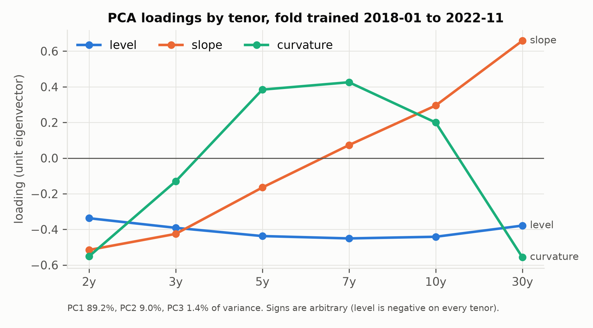
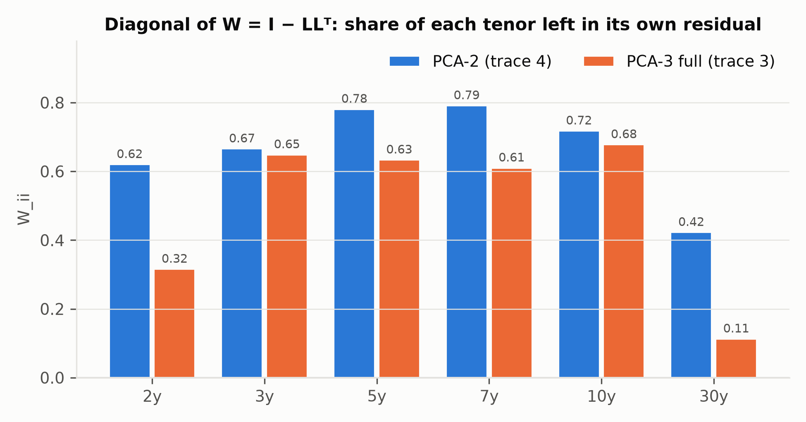
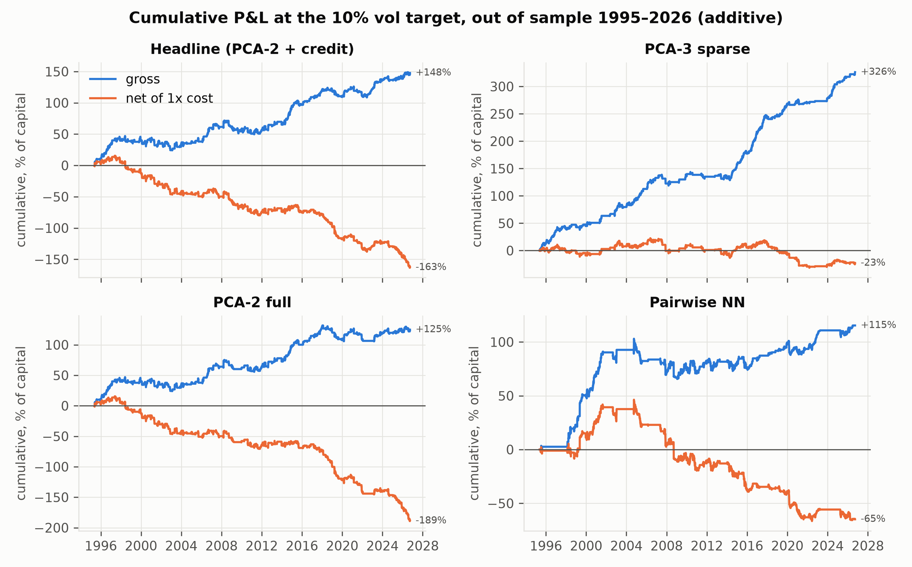
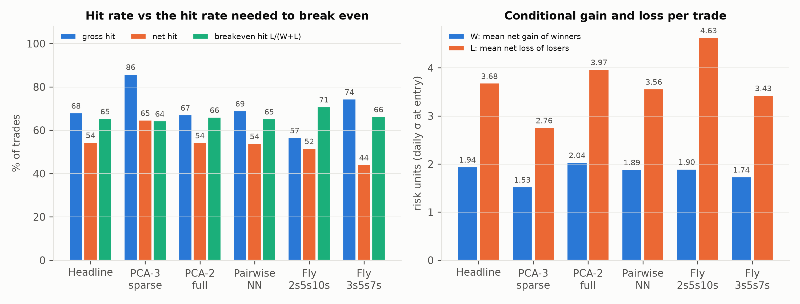
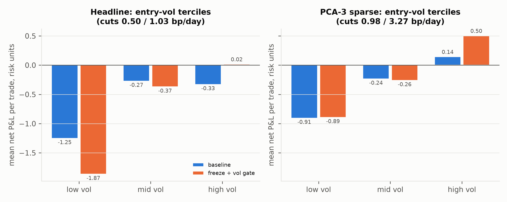
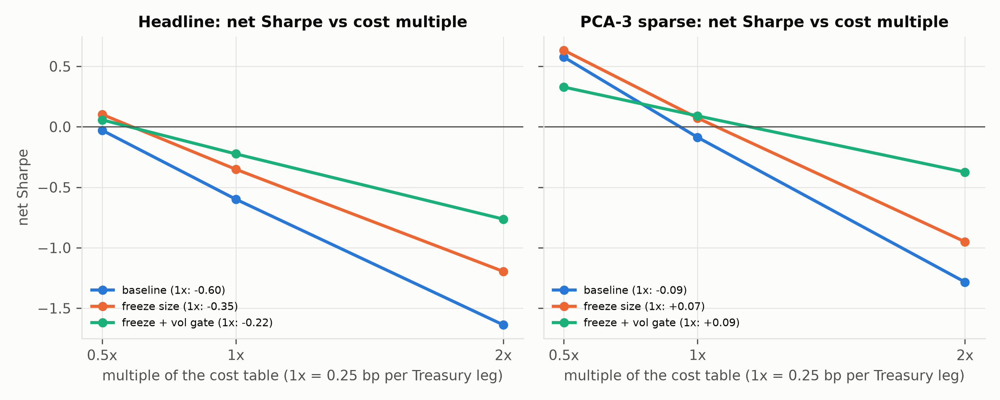

# Statistical Arbitrage on the US Treasury Curve: PCA Residual Mean Reversion

**Sleeve 1, mean reversion.** Final report, 2026-10-23. Every number below is sourced in `deck_numbers.md`; the section letters in brackets point to it.

## 1. Research question

After the curve's common factors (level, slope and, optionally, curvature) are hedged out, does each Treasury tenor's residual mean-revert strongly and fast enough to pay realistic transaction costs?

**Answer.**
- **The signal is real before cost.** Every model has a positive gross Sharpe (0.45–1.21), and the entry signal has a positive, significant rank correlation with the next 10 days' residual move (IC 0.13–0.33).
- **No model survives cost at the 1x table.** The headline model's net Sharpe is −0.60. The best variant, PCA-3 sparse, is at −0.09 and breaks even at 0.93x the cost table.
- **One cost-reduction round helped but did not change the answer.** Freezing position size at entry, plus a per-fold vol gate, lifts PCA-3 sparse to +0.09 net. After correcting for 35 trials, that is indistinguishable from zero.

## 2. Data and design

**Data.**
- Daily Bloomberg generic Treasury yields (2y, 3y, 5y, 7y, 10y, 30y; bp), 1990–2026. The 3y starts in 2005 and the 7y in 2009.
- HY and IG OAS indices and CDX HY, used by the credit pairs in the headline model (Bloomberg 2026).
- The fed funds target from FRED, used only to label regimes.

**Walk-forward design.**
- 33 folds: 5-year (1,260-bar) training window, 1-year (252-bar) test window, 10-bar purge, 5-bar embargo.
- Everything is fitted on the training window only: loadings, bands, scalers and regime models.
- Rolling statistics are trailing.
- A leakage suite rewrites all data after a cut-off date and checks that no decision made before it changes.

**Costs and timing.**
- 0.25 bp per Treasury leg, one way, charged on every position change and on sleeve-leverage changes. Credit pairs pay 0.5–2 bp.
- A signal computed at the close of day t sets the position held over day t+1.

**Models compared.**

| model | construction |
|---|---|
| Pairwise static / adaptive | Engle–Granger and Johansen screen (Engle and Granger 1987; Johansen 1991); OLS or Kalman hedge ratio (Kalman 1960); OU bands; adaptive version has a regime gate |
| PCA-2 full | tenor residual after projecting out level and slope |
| PCA-3 sparse | each tenor hedged with its 3 nearest tenors, neutral to level, slope and curvature |
| **Headline** (named before the PCA model was run on real data) | PCA-2 full + the adaptive credit pairs |
| Fixed flies (benchmarks) | 2s5s10s and 3s5s7s, traded with the same rules |

## 3. Method

### 3.1 PCA hedge

On each training window, the covariance of daily yield changes Δy (bp) gives eigenvectors L (one column per factor). The first three are the level, slope and curvature factors of Litterman and Scheinkman (1991).

- **PCA-2 full.** The residual is r_t = W Δy_t with **W = I − L Lᵀ** (k = 2), so row i of W is the factor-neutral package for tenor i.
- **PCA-3 sparse.** Holds one unit of the own tenor, with weights on the k = 3 nearest tenors solving L_hedgesᵀ w = −L_own exactly.

The fold whose test window starts on 2022-12-12 (trained 2018-01 to 2022-11) is shown below [B].

| | PC1 level | PC2 slope | PC3 curvature |
|---|---|---|---|
| variance share | 89.2% | 9.0% | 1.4% |

- **W diagonal (PCA-2):** 0.62 (2y), 0.67, 0.78 (5y), 0.79, 0.72, 0.42 (30y). The trace is 4 = 6 − 2.
- **5y package:** +0.78 (5y), −0.23 (2y), −0.24 (3y), −0.19 (7y), −0.14 (10y), −0.06 (30y).

### 3.2 OU / AR(1) s-score

Following Avellaneda and Lee (2010), the cumulative residual C_t is fitted on a trailing **60-bar** window, re-estimated every bar:

Ct = a + b · Ct−1 + et

b = cov(Ct, Ct−1) / var(Ct−1),   a = mean(Ct) − b · mean(Ct−1)

m = a / (1 − b),   σeq = √( var(e) / (1 − b²) ),   var(e) = var(Ct) − b² · var(Ct−1)

<b>zt = (Ct − m) / σeq</b>,   half-life = −ln 2 / ln b,   κ = ln 2 / half-life

A bar is tradeable only if 0 < b < 1 and the half-life is under 30 bars. This screen passes 90% of live bars for PCA-2 and 96% for PCA-3 sparse [A].

The fitted reversion is much faster than the training-window process.

| | PCA-2 full | PCA-3 sparse |
|---|---|---|
| median half-life, trailing 60-bar fit | 6.4 bars | 4.5 bars |
| median half-life, 5-year training fit | 103 bars | 32 bars |

Most of the gap is small-sample bias in the AR(1) coefficient (Kendall 1954). Simulating the training process and fitting it on 60 bars gives 8.3 and 7.1 bars before any screen [C]. σ_eq and the half-life are therefore optimistic.

### 3.3 Entry, exit and stop

- **Entry and exit.** Short the residual (in yield units) when z > entry, go long when z < −entry, and flat once |z| ≤ exit.
  - Entry is chosen from {1.0, 1.25, 1.5, 1.75, 2.0, 2.5}, exit from {0, 0.25, 0.5, 0.75}.
  - Both are picked per member per fold to maximise **net** per-bar Sharpe on the training window.
- **Stop-loss.** If |z| > 4, the position is closed and not reopened until |z| is back inside the entry band. There is no time stop.
- **Sign.** z > 0 means the tenor's yield is high relative to the factors, i.e. the bond is cheap. The trade buys it and takes the opposite side of the hedge legs [A, K].

### 3.4 Sizing and costs

- **Member sizing.** Each member holds signal / σ̂, where σ̂ is the EW (span 60) standard deviation of daily residual changes, floored at 25% of its expanding median. One position unit is one "risk unit", about one daily standard deviation.
- **Sleeve sizing.** Members are equal-weighted. The sleeve is scaled to a 10% annual vol target using the larger of recent (EW-120) and long-run vol, with leverage capped at 3x. The drawdown overlay is off.
- **Cost per bar.** |Δposition| × Σ_legs |w_leg| × 0.25 bp, plus |Δ sleeve weight| × mean |position| × unit cost.

## 4. Results

### 4.1 Model comparison (1x cost) [E]

| model | gross SR | net SR | breakeven cost × | IC 10d (entry bars) | trades / yr | cost, % cap pa | effective bets |
|---|---|---|---|---|---|---|---|
| **Headline (PCA-2 + credit)** | 0.547 | −0.599 | 0.475 | 0.166 | 13.1 | 9.6 | 8.7 |
| PCA-3 sparse | 1.210 | −0.087 | 0.934 | 0.326 | 7.9 | 10.8 | 2.3 |
| PCA-2 full | 0.448 | −0.668 | 0.398 | 0.196 | 10.6 | 9.7 | 5.7 |
| Pairwise adaptive (NN gate) | 0.459 | −0.257 | 0.640 | 0.127 | 7.7 | 5.6 | 14.4 |
| Fly 2s5s10s | 0.109 | −0.422 | 0.215 | — | — | 3.9 | — |
| Fly 3s5s7s | 0.382 | −0.766 | 0.315 | — | — | 10.1 | — |

**Per dollar [G].** On $1m of capital, PCA-3 sparse earns $100.5k a year gross and pays $107.6k in cost, so each $1 of gross P&L costs $1.07. The headline pays $2.10 of cost per $1 of gross.

### 4.2 Hit ratio, conditional gain and loss, expectancy [D]

**Units.** Trade P&L is in risk units (daily σ at entry); it is neither σ_eq nor bp.
- W = the mean net gain of winning trades; L = the mean net loss of losing trades.
- Expectancy = p·W − (1 − p)·L.
- Breakeven hit rate = L / (W + L).

| model | net hit p | W | L | W/L | expectancy | breakeven hit |
|---|---|---|---|---|---|---|
| Headline | 54.5% | 1.94 | 3.68 | 0.53 | −0.62 | 65.5% |
| PCA-3 sparse (member trades) | 64.7% | 1.53 | 2.76 | 0.55 | +0.01 | 64.4% |
| PCA-3 sparse (distinct trades) | 57.6% | 1.52 | 2.86 | 0.53 | −0.33 | 65.2% |
| PCA-2 full | 54.4% | 2.04 | 3.97 | 0.51 | −0.70 | 66.1% |
| Pairwise NN | 54.0% | 1.89 | 3.56 | 0.53 | −0.62 | 65.4% |
| Fly 2s5s10s | 51.7% | 1.90 | 4.63 | 0.41 | −1.26 | 70.9% |
| Fly 3s5s7s | 44.2% | 1.74 | 3.43 | 0.51 | −1.15 | 66.4% |

**The shape is the same for every model.** Trades win more often than not (gross hit rates of 57–86%). But after cost, a loser costs about twice what a winner earns (W/L ≈ 0.5), so the strategy needs a net hit rate of about 65% and gets 54–65%. Cutting L matters more than raising p.

### 4.3 Why the entry band sits at 2.0–2.5, and at the top of the grid

Each round trip pays a **fixed** cost in bp, while the reversion a trade can capture is roughly (entry − exit) × σ_eq. A wider band therefore captures more reversion per unit of cost, at the price of fewer trades.

For PCA-2 the numbers are:
- a round trip costs 0.73 bp;
- median σ_eq is 0.9–1.6 bp by tenor [C];
- so entering at 2.5 and exiting at 0.25 targets about 2.0–3.6 bp.

The net-Sharpe optimiser pushes the band up for exactly this reason. **The median entry is 2.5 for five of six PCA-2 tenors, and the band sits at the grid's top value in 45–70% of folds** [A]. The optimum may lie above the grid.

Higher fixed bands do not rescue the model out of sample:

| fixed entry band | effect |
|---|---|
| 2.5 | lifts PCA-2 net Sharpe from −0.67 to −0.33, at 3.5 trades a year |
| 3.0 | leaves 0.6 trades a year |

The underlying problem is that realised reversion falls short of the forecast. The median OU-implied reversion is 1.67 bp, but the mean realised move per trade is 0.45 bp.

### 4.4 Quiet vs volatile entries [F]

Trades are split into terciles of residual vol at entry (bp/day, the sizing vol). The terciles are taken over each model's trades, ex post.

- **Cost.** Cost is fixed in bp while the position is 1/vol, so a quiet market buys more DV01 per unit of edge. In the low-vol tercile a round trip costs 1.3–2.3× a day's move.
- **Losses.** Low-vol trades lose on every model: −1.25 (headline), −0.48 (PCA-3 sparse) and −1.47 (PCA-2) risk units per trade.
- **Exception.** PCA-3 sparse makes +0.48 per trade in its high-vol tercile.

## 5. Cost round 1: freeze size, vol gate [H]

Two cost-reduction rules were tested in this round:

- **freeze_size**: hold the entry size until exit. There is no resizing within a trade and no leverage rescaling of open trades.
- **vol_gate**: block new entries when trailing residual vol is below X. X is fitted per member per fold on the training window, as the percentile (10th–50th) that maximises training net P&L per trade. The fitted X counts as a trial.

| model | config | gross SR | net SR 1x | trades / yr | net hit | mean net / trade | cost % pa | breakeven × | net SR 0.5x / 2x |
|---|---|---|---|---|---|---|---|---|---|
| Headline | baseline | 0.547 | −0.599 | 13.1 | 54.5% | −0.62 | 9.6 | 0.48 | −0.03 / −1.64 |
| Headline | freeze_size | 0.557 | −0.351 | 13.1 | 56.1% | −0.45 | 8.2 | 0.61 | +0.10 / −1.20 |
| Headline | freeze + vol_gate | 0.339 | −0.224 | 8.4 | 55.9% | −0.38 | 4.5 | 0.60 | +0.06 / −0.76 |
| PCA-3 sparse | baseline | 1.210 | −0.087 | 7.9 | 57.6% | −0.33 | 10.8 | 0.93 | +0.58 / −1.28 |
| PCA-3 sparse | freeze_size | 1.168 | +0.073 | 7.9 | 60.8% | −0.12 | 9.5 | 1.07 | +0.63 / −0.95 |
| PCA-3 sparse | freeze + vol_gate | 0.559 | +0.090 | 3.4 | 61.3% | −0.10 | 3.9 | 1.19 | +0.33 / −0.38 |

- **Freezing size is the clean gain.** It has no fitted parameter, leaves gross intact, cuts cost by 11–14%, and adds 0.16–0.25 net Sharpe.
- **The vol gate halves cost again but also halves PCA-3 sparse's gross Sharpe.** It removes most low-vol entries: 142 → 35 for the headline, 85 → 21 for PCA-3 sparse.
- **Net positive at 1x?** The headline is not. PCA-3 sparse is marginally positive, and not distinguishable from zero (§6).

## 6. Robustness

**Trial count and deflated Sharpe** (Bailey and López de Prado 2014) [J]. 35 trials are documented: 11 model-table rows, 8 cost filters, 8 curve rules, 4 design revisions and 4 cost-round configs.

| trial set | best variant | DSR net | DSR gross |
|---|---|---|---|
| 11 model-table rows | PCA-3 sparse | 0.016 | 1.00 |
| all 35 documented | PCA-3 sparse freeze + vol_gate | 0.009 | 0.61 |
| 47 (adding 12 earlier experiments never booked as trials) | same | 0.002 | 0.42 |

The gross edge survives the selection correction at the narrow count; the net result does not.

**PCA-3 sparse construction defect, 2010–13.**
- **Cause.** Before the 7y has a full training window, the 3y residual is hedged by a nearly singular 2y/5y/10y solve, with weights +68 / −121 / +69 per unit of 3y. It passes the `cond < 1e8` check.
- **Effect.** Trades entered in those four folds lost 34 risk units across 13 distinct trades, 20 of it from the 3y portfolio. That is −67 if members are counted separately.
- **Status.** It is deliberately left unfixed, because a fix chosen after seeing results would be another trial.

**Overlap in PCA-3 sparse.**
- The 2y, 3y and 5y members are often the same portfolio, so its 6 members are 2.3 effective bets.
- Counting each distinct portfolio once moves its net Sharpe by only 0.01–0.03 (−0.097 baseline; +0.061 freeze + gate) [I].

**Regimes.**
- Every Fed regime loses net, and auction weeks are no different (p > 0.09).
- Daily P&L correlates with rates, MOVE and HY OAS at |ρ| < 0.1.

## 7. Limitations and next steps

**Limitations.**
- **Cost model.**
  - The cost table is flat; a time-varying one (0.5 bp before 2008, 30y at 1.5x) makes every model worse.
  - Financing, carry, roll-down, specialness and futures basis are not modelled.
  - The curve is traded in cash-yield bp.
- **Credit pairs.** HY/IG OAS cannot be traded as modelled.
- **Parameter provenance.** Several experiment parameters were proposed after full-sample results were seen. The repo has no version history.

**Next steps.** The aim is to cut L, the average loss, which is twice the average gain.

1. **Time stop.** A 20-bar time stop was tested and hurt PCA-3 sparse (−0.26 Sharpe). Next, fit the stop per fold rather than fixing it at 20.
2. **Tighter stop-loss.** The current stop is |z| > 4. Tighten it, or add a P&L stop in risk units, fitted per fold.
3. **Regime gate.** A trailing MOVE-tercile gate improved every model slightly. Next, test a gate on the residual's own vol regime or on half-life stability.
4. **Fix the 2010–13 hedge defect** with a Σ|w| cap, and count it as a trial.
5. **Slow the signal.** Use a 120- or 250-bar OU window, or a minimum holding period, to reduce small-sample bias and turnover.
6. **Futures execution.** Price micro yield futures (about 0.1 bp per leg) as a separate cost scenario after confirming ticks and commissions with the broker.

## References

- Avellaneda, M., and Lee, J.-H. (2010). Statistical arbitrage in the U.S. equities market. *Quantitative Finance*, 10(7), 761–782.
- Bailey, D. H., and López de Prado, M. (2014). The deflated Sharpe ratio: Correcting for selection bias, backtest overfitting, and non-normality. *Journal of Portfolio Management*, 40(5), 94–107.
- Bloomberg L.P. (2026). Generic US Treasury yields (USGG2YR, USGG3YR, USGG5YR, USGG7YR, USGG10YR, USGG30YR Index), Bloomberg US Corporate High Yield OAS (LF98OAS Index) and US Corporate Investment Grade OAS (LUACOAS Index), CDX HY 5Y generic, HYG. Retrieved via Bloomberg Terminal, 2026. **[VERIFY: index display names]**
- Board of Governors of the Federal Reserve System (2026). Federal funds target rate (DFEDTAR) and target range upper limit (DFEDTARU). Retrieved from FRED, Federal Reserve Bank of St. Louis.
- Engle, R. F., and Granger, C. W. J. (1987). Co-integration and error correction: Representation, estimation, and testing. *Econometrica*, 55(2), 251–276.
- Johansen, S. (1991). Estimation and hypothesis testing of cointegration vectors in Gaussian vector autoregressive models. *Econometrica*, 59(6), 1551–1580.
- Kalman, R. E. (1960). A new approach to linear filtering and prediction problems. *Journal of Basic Engineering*, 82(1), 35–45.
- Kendall, M. G. (1954). Note on bias in the estimation of autocorrelation. *Biometrika*, 41(3/4), 403–404.
- Leung, T., and Li, X. (2015). Optimal mean reversion trading with transaction costs and stop-loss exit. *International Journal of Theoretical and Applied Finance*, 18(3), 1550020.
- Litterman, R., and Scheinkman, J. (1991). Common factors affecting bond returns. *Journal of Fixed Income*, 1(1), 54–61.

*Leung and Li (2015) is used for the optimal-stopping band variant (PCA-2/PCA-3 Leung-Li rows of the model table). Its gross Sharpe is −0.05 and 0.26, so it is reported but not pursued.*
